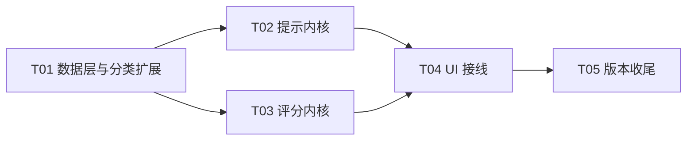

# ARCH · v1.5.0「技巧教练」增量合并设计

> 版本 v1.0 ｜ 作者：高见远（架构师）｜ 状态：v1.5.0 已落地，见 §13
> 上游输入：`shottuner` v1.4.0 现有代码（39 条技法 / 无状态匹配器 / 构图分）、`paike-coach/docs/TIPS.md`（67 条）、`paike-coach/docs/PRD.md` §4 §7.2
> **本文是唯一施工依据。** 只做增量，不重写。
> ⚠️ **读法**：§0–§12 记录的是**设计意图**；§13 记录**落地时的实际偏离**。两者冲突时**以 §13 为准**。

---

## 0. 设计结论速览

| 项 | 结论 |
|---|---|
| 技法库 | **39 → 83 条**（净增 44 条），分类 **11 → 15**（新增 SELFIE / CAMERA_MOVE / PARAMS / PITFALL） |
| 去重 | 我们 67 条中 **22 条撞车 + 1 条内部自撞**，吸收进 18 条现有技法；**净新写 44 条** |
| 调度器 | 新增有状态 `PromptScheduler`，时钟走**方法参数注入**（`now: Long`），纯 Kotlin 可 JUnit 直测 |
| 三卡 UI | **技法页三卡保留不动**；另在底部面板顶部新增**「教练提示」单条槽**（推送态）→ 推送与浏览彻底分离 |
| 四维评分 | **实时参考分**（不依赖快门，因为 shottuner 不拍照）；水平 25 / 曝光 30 / 构图 25 / 清晰 20 |
| 构图 25 分 | `CompositionAnalyzer.score` **×0.25**，且必须先**剔除倾斜扣分**（否则与水平度重复计分） |
| 清晰度 | **新增半分辨率中心区拉普拉斯方差**（每 15 帧一次）；**不用 `edgeDensity` 降级**，理由见 §6.4 |
| 录像 | 8 条运镜技法进 `CAMERA_MOVE`，用**静态映射表 + 互补池**避免与 `VideoRecommender.plan.tips` 说同一句话 |
| 新增依赖 | **0 个**（只加 `sensors/` 用系统 `SensorManager`，无 gradle 变更） |
| 版本 | `versionCode 6` / `versionName "1.5.0"` |

---

## 1. 合并后技巧库规模

### 1.1 各分类条数

| # | 分类 | 现有 | 新增 | 合计 |
|---|---|---:|---:|---:|
| 1 | PORTRAIT 人像 | 7 | 10 | **17** |
| 2 | LANDSCAPE 风光 | 6 | 4 | **10** |
| 3 | NIGHT 夜景 | 4 | 3 | **7** |
| 4 | LIGHT 用光 | 3 | 3 | **6** |
| 5 | FOOD 食物 | 3 | 2 | **5** |
| 6 | STREET 街头 | 3 | 2 | **5** |
| 7 | BASIC 基本功 | 4 | 0 | **4** |
| 8 | ACTION 宠物小孩 | 3 | 0 | **3** |
| 9 | MACRO 微距细节 | 2 | 0 | **2** |
| 10 | INDOOR 室内弱光 | 2 | 0 | **2** |
| 11 | SILHOUETTE 剪影 | 2 | 0 | **2** |
| 12 | SELFIE 自拍 **（新）** | 0 | 5 | **5** |
| 13 | CAMERA_MOVE 运镜 **（新）** | 0 | 8 | **8** |
| 14 | PARAMS 参数 **（新）** | 0 | 3 | **3** |
| 15 | PITFALL 避坑 **（新）** | 0 | 4 | **4** |
| | **合计** | **39** | **44** | **83** |

验算：39 + 44 = 83。现有 39 条**一条不改分类、一条不改 id**。

新增 44 条在 PORTRAIT 最大（17 条），因为我们的「构图」类（C 系列）没有独立分类，按主体归属拆进 PORTRAIT / STREET / LANDSCAPE —— **不新增 COMPOSITION 分类**，理由是 shottuner 的分类是"按拍摄对象"划分的，混入一个"按技巧维度"划分的分类会破坏现有分类语义，且 `buildSkillChips()` 已有 15 个 chip 横向滚动压力。

### 1.2 新增条目的 id 命名（必须遵守）

沿用现有下划线小写风格，前缀按分类：`selfie_*` / `move_*` / `params_*` / `pitfall_*`，其余沿用 `portrait_*` / `landscape_*` / `night_*` / `light_*` / `food_*` / `street_*`。
例：`landscape_horizon_level`（K01 地平线端平）、`move_elbow_tucked`（V01 手肘夹紧）、`pitfall_grid_on`（X01 开网格）。

> ⚠️ **id 一旦提交不得再改**：v1.5 的调度器规则表用 id 做引用，改 id 等于静默丢规则（有测试兜底，见 §9）。

---

## 2. 分类映射表与 enum 变更

### 2.1 映射（我们 10 类 → shottuner 15 类）

| 我们的分类 | 条数 | 去向 | 说明 |
|---|---:|---|---|
| composition 构图 | 10 | PORTRAIT（6）/ STREET（2）/ LANDSCAPE（2） | 按**拍摄对象**拆，不建 COMPOSITION |
| light 光线 | 8 | LIGHT（6）/ FOOD（1）/ LANDSCAPE（1，撞车并入） | 纯光线原理归 LIGHT |
| portrait 人像 | 9 | PORTRAIT（7）/ 撞车 2 | |
| selfie 自拍 | 5 | **SELFIE（新）** | 场景独立（前置/手臂距离/看镜头），与 PORTRAIT 的人机距离完全不同 |
| food 美食 | 5 | FOOD（2 新增 + 3 撞车） | |
| landscape 风景 | 6 | LANDSCAPE（4 新增 + 2 撞车） | |
| night 夜景 | 5 | NIGHT（3 新增 + 2 撞车） | |
| video 运镜 | 8 | **CAMERA_MOVE（新）** | 与 `VideoIntent` 是"意图 vs 动作"两个维度 |
| params 参数 | 5 | **PARAMS（新）** | ISO / 快门 / EV / 白平衡的定量档位，与 BASIC 的"顺序原则"区分 |
| pitfall 避坑 | 6 | **PITFALL（新）** | "别做什么"，与"该做什么"分开，避免混进建议流 |

### 2.2 需要新增的 enum 值

`knowledge/Technique.kt` 第 6–18 行，在 `SILHOUETTE("剪影")` 之后追加 4 行：

```kotlin
    SILHOUETTE("剪影"),
    SELFIE("自拍"),
    CAMERA_MOVE("运镜"),
    PARAMS("参数"),
    PITFALL("避坑")
```

**顺序有意义**：`buildSkillChips()` 用 `TechCategory.values()` 顺序生成 chip，新分类排在最后 → 现有 11 个 chip 的位置不变，用户肌肉记忆不被破坏。

### 2.3 ⚠️ 对「新增 enum 打破 when 穷尽性」的更正

**实测结论：新增 `TechCategory` 值不会导致编译失败。** 全仓 `when` 扫描结果：

| 位置 | 文件:行 | 是否穷尽 | 加 enum 后 |
|---|---|---|---|
| `when (tech.category)` | `knowledge/TechniqueMatcher.kt:109-113` | **否**，有 `else ->` | 编译通过；但 4 个新分类会落到 `else`，卡片副标题变成「适合当前画面的通用提醒」→ **内容缺陷，必须补分支** |
| `when (scene)` | `recommend/ParamRecommender.kt:203-211` | **是**（7 个 SceneType 全覆盖，无 else） | 若新增 `SceneType` 值 → **编译失败**。所以 **v1.5 绝不新增 SceneType** |
| `when (intent)` | `video/VideoRecommender.kt:74-83` | **是**（8 个 VideoIntent） | 若新增 `VideoIntent` → **编译失败**。所以 **v1.5 绝不新增 VideoIntent** |
| `when (ai.scene)` | `analysis/SceneClassifier.kt:45-50` | 否（`else -> null`） | 不受影响 |
| `when (intent?.action)` | `screen/ScreenCaptureService.kt:83` | 否（字符串） | 不受影响 |
| `TechCategory.values()` | `MainActivity.kt:399 / 408 / 429` | — | 自动变成 15 chip，需 UI 验收横向可滚 |

**必须补的分支（`TechniqueMatcher.kt:109-113`）**：

```kotlin
TechCategory.BASIC      -> "先把这条基本功做稳"
TechCategory.LIGHT      -> "先判断现场光线性格"
TechCategory.SELFIE     -> "前置自拍，距离和角度最要紧"
TechCategory.CAMERA_MOVE-> "录像靠身体带机器，不靠手臂"
TechCategory.PARAMS     -> "这一档数值照抄就行"
TechCategory.PITFALL    -> "这条是别踩的坑"
else                    -> "适合当前画面的通用提醒"
```

### 2.4 新增 `TechTrigger` 两个条件（必需，否则新条目无法按欠曝/过曝触发）

我们 44 条里有 3 条（欠曝提亮、过曝压暗、夜景压高光）需要"暗部占比过高"和"高光占比过高"作触发条件，而现有 `TechTrigger` 只有 `minHighlightClip`，**没有** `maxHighlightClip` 与 `minShadowClip`。

`Technique.kt:78-94` 的 `TechTrigger` 末尾（`weight` 之后）追加两个带默认值的参数 —— 默认 `null`，**现有 39 条的 `TechTrigger(...)` 全部用具名参数、一个字都不用改**：

```kotlin
    val minShadowClip: Float? = null,
    val maxHighlightClip: Float? = null,
    val weight: Int = 10
```

对应 `TechniqueMatcher.scoreOf()` 要在 `maxEdge` 判断之后（约 `:176`）补两段：

```kotlin
val minShadow = trigger.minShadowClip
if (minShadow != null) { if (signals.shadowClip < minShadow) return null; score += CONDITION_BONUS }
val maxHighlight = trigger.maxHighlightClip
if (maxHighlight != null) { if (signals.highlightClip > maxHighlight) return null; score += CONDITION_BONUS }
```

`reasonFor()` 同步补两句（约 `:100`）：`"暗部死黑 ${pct(shadowClip)}%"`、`"高光已收住"`。

---

## 3. 重复条目处理清单

### 3.1 判定重复的三条判据（按把握度排序，任一命中即判 dup）

| # | 判据 | 说明 | 把握度 |
|---|---|---|---|
| J1 | **同一物理动作**：我们的 `action` 与 shottuner 条目的某一步 `steps` 描述同一个手部动作（"点 2x"/"眼睛移到三分线"/"对天空测光"/"关闪光"） | 动作是唯一的、可执行的，撞就是撞 | 高 |
| J2 | **同一触发条件**：我们的信号条件与 shottuner 的 `trigger` 数值条件指向同一画面特征（`highlightClip` 高 → 逆光压 EV） | 条件撞车说明讲的是同一件事 | 高 |
| J3 | **同一专有名词**：黄金时刻 / 蓝调 / 三分线 / 交叉点 / 45 度 / 剪影 / 引导线 / 前景三层 | 名词撞车**必须人工复核**（可能只是话题相同，动作不同） | 中 |

### 3.2 保留规则

**一律保留 shottuner 的那条**，我们的条目降级为"信息注入"。三条理由：

1. **id 稳定**优先于文案优劣 —— 5 个现有测试 + 未来调度器规则表都按 id 引用；
2. shottuner 条目有 `steps`（3–5 步）/ `check` / `params` 三件套，信息密度高于我们的 `action + why + mistake`；
3. 我们的 `why` ≤40 字，塞进 shottuner 的 `why`（要求 60–120 字）会**破坏测试**，所以 `why` 字段一律不动。

### 3.3 撞车清单（22 条 → 18 个吸收目标）

| # | 保留的 id | 吸收我们的 | 注入槽位 | 注入内容要点 |
|---|---|---|---|---|
| 1 | `portrait_eyes_thirds` | C01 眼睛放交叉点 | steps 第 2 步**改写** | 明确"四个交叉点之一"，不只上三分线 |
| 2 | `landscape_horizon_thirds` | C04 地平线压三分线、K02 天地按三分分 | steps 末步**追加一条**（原 3 步 → 4 步）+ params | `"地平线位置" to "上/下三分线"`；天空好给 2/3，地面好给 1/3 |
| 3 | `landscape_leading_lines` | C06 顺着线收到主体 | mistakes 追加 | "线条横穿画面，或指向画外" |
| 4 | `landscape_three_layers` | C08 前景挡掉四分之一、K06 树枝石头当前景 | steps 改写 1 步 + params | `"前景占比" to "约 1/4 画面，别只露一角"` |
| 5 | `landscape_golden_blue_hour` | L01 抓住黄金一小时 | mistakes 追加 + params | `"时段" to "日出后 / 日落前 1 小时"` |
| 6 | `portrait_window_45` | L04 侧光出立体、L08 靠窗侧前方坐 | steps 改写 1 步 + mistakes 追加 | "侧约 45 度，脸上要有明暗过渡"；"背对窗户，脸一起黑" |
| 7 | `portrait_backlit_face_first` | L05 逆光降 EV 保脸 | **仅** mistakes 追加 | ⚠️ **不注入 EV 数值**：shottuner 说 +0.7~+1.5（保脸），我们说 −0.7~−1.0（压背景），是两个策略，同时出现会让用户困惑 |
| 8 | `silhouette_meter_sky` | L06 剪影就压到最暗 | mistakes 追加 | "剪影还硬拉亮度，糊成一片灰" |
| 9 | `food_side_light` | L08 靠窗侧前方坐（美食侧） | steps 追加 1 步 + params | `"位置" to "窗边 1 米内"` |
| 10 | `portrait_wide_face` | P01 换到 2x 再拍人 | params 追加 | `"焦距" to "2x 或 3x"` |
| 11 | `portrait_hands_busy` | P06 给手找个事做 | steps 改写 + mistakes 追加 | "托腮 / 扶帽檐 / 拿杯咖啡，任选一个" |
| 12 | `portrait_background_layers` | P08 先把背景清干净、X03 背景别塞满杂物 | steps 追加 1 步 + mistakes 追加 | "扫一眼四角，让背后只剩墙 / 天 / 绿植" |
| 13 | `food_angle_45_top` | F01 45 度斜拍、F02 站起来俯拍整桌 | steps 追加 1 步 + params | `"俯拍" to "90 度，整桌才交代得完"` |
| 14 | `food_no_flash_soft` | F03 关掉闪光灯 | mistakes 追加 | "一暗就开闪光硬怼，菜发白、油光刺眼" |
| 15 | `night_handheld_static` | N01 靠墙靠栏杆再按 | steps 改写 + params | `"支点" to "墙 / 栏杆 / 桌面"` |
| 16 | `night_blue_hour` | N05 等蓝调那 20 分钟 | params 追加 | `"窗口" to "日落后 20–30 分钟"` |
| 17 | `basic_shutter_then_iso` | A01 白天用基准档 | params 追加 | `"白天基准" to "ISO100 / 1/200 / EV0"` |
| 18 | `action_freeze_250` | A03 抓拍先提快门 | params 追加 | `"抓拍" to "ISO400-800 / ≥1/500"` |

**注入的三条硬约束（防止把测试写红）**：

1. **`title` / `oneLiner` / `whenTo` / `why` / `check` 一律不动** —— 这 5 个字段有长度区间断言（8–16 / 4–20 / 40–80 / 60–120 / 20–70），追加必超上限。
2. **`steps` 上限 6 步**（`.size in 3..6`）。**实测：现有 39 条中 38 条为 3 步，仅 `portrait_backlit_face_first` 为 4 步。** 清单里标"追加 1 步"的 5 个目标（#2 `landscape_horizon_thirds`、#4 `landscape_three_layers`、#9 `food_side_light`、#12 `portrait_background_layers`、#13 `food_angle_45_top`）全部是 3 步 → 追加后 4 步，安全；其余目标只做"改写"，不增步。唯一 4 步那条（#7）只注入 `mistakes`，不动 `steps`。因此**全部注入都落在 3..6 区间内**。
3. **`mistakes` / `params` 无长度断言**，是唯一可以放心追加的槽位。

### 3.4 内部自撞（我们 67 条自己撞自己）

| 冲突 | 处理 |
|---|---|
| **C03 脚底贴住底边** vs **X04 别顶天立地** | **保留 C03，删除 X04**。C03「脚底贴到画面最底部」是显腿长的可执行技巧；X04 的"脚底留白"与它直接矛盾。X04 中**"头顶留白"部分并入 C02**。最终产出 `portrait_headroom`（= C02，含 X04 的头顶语义）与 `portrait_feet_anchor`（= C03），X04 不再单独成条。 |

> 因此：67 − 22（撞车）− 1（X04 合并）= **44 条新增**。

---

## 4. 字段补全规则（44 条新条目怎么写得过测试）

`PhotographyBookTest.textFieldsAreReasonable()` 是硬闸门，区间：`title 8..16`、`oneLiner 4..20`、`whenTo 40..80`、`why 60..120`、`steps 3..6`、`mistakes` 非空、`check 20..70`、`params` 非空。

我们 TIPS 的原始数据（`action ≤20`、`why ≤40`、无 `steps`、`check`、`params` 多为 `—`）**全部不达标**。**结论：逐条补写，禁止自动生成后不校验。** 但可以用固定模板把补写成本压到可控 —— 每条按下列 6 条规则改写，写完立刻跑测试。

### 4.1 `title`（8–16 字）：原标题 + 场景限定或反义补足

| 原始（字数） | 改写后（字数） |
|---|---|
| 建筑横平竖直（6） | 建筑横平竖直，别凭手感拍（12） |
| 门框窗框做画框（7） | 用门框窗框做画框，挡掉杂物（13） |
| 收下巴（3） | 让 TA 收一点下巴，脸更小（12） |
| 0.5x 装大场面（8） | 切 0.5x 装大场面，人站中间（13） |

规则：**前半句保留原标题语义，后半句补"不要什么"或"关键限定"**，凑到 8–16 字。不许出现"注意""要好看"这类空话。

### 4.2 `oneLiner`（4–20 字）：直接用我们的 `action` 压缩

`action` 本来就是"动词开头、当场可执行"，压到 4–20 字几乎无损。
例：`把手机抬到 45 度角对准这盘菜`（15）→ `抬到 45 度再按`（8）。

### 4.3 `whenTo`（40–80 字）：三段式模板

```
{什么画面/场景}时用。{手上的动作是什么}，{判断依据或边界条件}。
```
例（K01 地平线端平，62 字）：
> "画面里出现海平面、地平线、栏杆等横向长线时用。打开网格，把这条线和最上面或最下面的横线对齐，别让它歪着横穿画面。"

### 4.4 `steps`（3–6 步）：把 `action` 拆成"判断 → 动手 → 验证"三步

| 步 | 内容来源 | 模板 |
|---|---|---|
| ① 判断 | `scenario` + `whenTo` | 「先看 {%s}，确认要不要做这件事」 |
| ② 动手 | `action`（核心，必有） | 原 `action` 展开成完整句子 |
| ③ 验证/微调 | `mistake` 的反义 或 `params` | 「如果 {%s}，说明还没做到位」 |

若 `action` 能拆成两个连续动作（如"蹲下 + 贴地举高"），拆成 4 步。**上限 6 步，超过就合并相邻步**。

### 4.5 `params`（非空）：三档兜底

| 情况 | 写法 |
|---|---|
| 有定量（我们的 `params` 有值） | 原样拆成 `Pair`，如 `"EV" to "-0.3~-0.5"` |
| 无量产但有相对位置 | 用相对量作参数：`"前景占比" to "约 1/4"`、`"留白" to "约 1/5 画面"`、`"机位" to "腰腹高度"` |
| 纯动作（确实没有参数） | 至少两条：`"做法" to "手上动作"`、`"判断" to "看一眼 XXX"` —— **不允许留空** |

### 4.6 `check`（20–70 字）：五个可复用模板

1. 「拍完放大看{%s}，{%s}就对了，{%s}说明还差一点。」
2. 「把照片缩小到手机屏幕大小看，第一眼是否落在{%s}上。」
3. 「看{%s}有没有{%s}；有就把{%s}再调一点。」
4. 「和刚才那张对比，{%s}是不是更{%s}了。」
5. 「让别人看一眼，他能不能一句话说出{%s}。」

### 4.7 `mistakes`：直接用我们的 `mistake`（1 条），可再补 1 条

### 4.8 `trigger`：给 44 条新条目配条件（否则永不触发）

| 情况 | 写法 |
|---|---|
| 有明确画面特征 | 填 `maxLuma` / `minShadowClip` / `maxHighlightClip` / `minSaturation` / `minSkinRatio` / `minEdgeDensity` |
| 只在特定场景成立 | 填 `scenes`（只能从 7 个 `SceneType` 里选，**不许新增**） |
| 纯动作/纯观念（如"关美颜""别开滤镜""开网格"） | `scenes = emptySet()` + `weight = 8~12`（低权重，只在兜底轮播出现） |

**权重分配约定**（防止新条目抢走现有条目的推荐位）：

| 档次 | weight | 适用 |
|---|---|---|
| 硬伤纠错 | 28–32 | K01 地平线端平、N02 压高光、欠曝提亮 |
| 场景强相关 | 18–24 | 自拍 5 条、PARAMS 3 条、美食 2 条 |
| 通用动作 | 12–17 | 构图 6 条、PITFALL 前 2 条 |
| 纯观念 | 8–11 | PITFALL 后 2 条（美颜/滤镜）、运镜中的"别甩镜" |

---

## 5. 提示调度器设计

### 5.1 三个层次（职责严格分离）

```
PromptSignals  ← MainActivity 折算（纯数据，无 Android 类型）
     │
PromptEngine.evaluate(signals, now) : List<PromptCandidate>     ← 纯函数，无状态，可单测
     │  （规则表 + 持续时长 holdMs 标记，不做冷却判断）
PromptScheduler.tick(signals, now) : PromptDecision             ← 有状态机，纯 Kotlin
     │  （冷却 / 驻留 / 打断 / 拉黑 / 密度 / 持续时长累计）
MainActivity.renderCoachSlot(decision)                          ← 只 setText
```

### 5.2 新增文件 `knowledge/PromptSignals.kt`

```kotlin
enum class PromptPriority(val rank: Int, val label: String) {
    URGENT(0, "硬伤"), CONTEXT(1, "场景"), GUIDE(2, "教学")
}
enum class PromptDensity { QUIET, STANDARD, CHATTER }

/** 调度用信号：TechSignals 的超集 + 设备姿态 + 界面上下文。刻意只依赖 Kotlin 标准库。 */
class PromptSignals(
    val tech: TechSignals = TechSignals(),
    /** 画面倾角（度），优先取结构张量，取不到用重力传感器；null 表示都没有 */
    val roll: Float? = null,
    /** 俯仰角（度），0 = 手机竖直，负 = 俯拍 */
    val pitch: Float? = null,
    /** 当前页：0 照片 / 1 录像 / 2 功能 / 3 技法 */
    val tab: Int = 0,
    /** 录像意图序号（VideoIntent.ordinal），非录像页为 -1 */
    val videoIntentOrdinal: Int = -1,
    val scene: SceneType = SceneType.GENERAL,
    val hasTele: Boolean = false,
    val equivFocalMm: Int = 24,
    val gridOn: Boolean = true,
    /** FeatureAdvisor 本轮已就"长焦/夜景/HDR"发过言的 topic，用于排他，避免两处说同一件事 */
    val coveredTopics: Set<String> = emptySet(),
    /** 本次会话已拍张数（shottuner 不拍照，此处恒为 0，留作统计位） */
    val sessionCount: Int = 0
)

class PromptCandidate(
    val ruleId: String,
    val tipId: String,
    val priority: PromptPriority,
    val weight: Int,
    /** 卡片主文案（已渲染好动态数值） */
    val action: String,
    /** 卡片副文案，一句话说明为什么 */
    val reason: String,
    /** 该规则需要持续满足多久才允许出牌（0 = 立即） */
    val holdMs: Long = 0,
    /** 信号恢复即视为"已执行"并永久拉黑 */
    val autoResolve: Boolean = false,
    /** 出牌时拍的快照，供 autoResolve 判"信号是否已恢复" */
    val recoverKey: String? = null
)
```

> **v1.5 不设提示内操作按钮。** 动作指令只作文案（`action` / `reason` 两个字符串），卡片本身不可点，也没有「切 2x」「开 EV」这类快捷按钮。
> 原因：教练模式下用户是在**原生相机**里拨变焦、拨曝光，App 内的卡没有可执行的对象；留一个按钮字段会让人以为"已经有按钮了"，从而在 `renderCoachSlot()` 里去找一个不存在的控件。
> 需要引导操作时，把动作写进文案（如「切到 2x 再拍」），由用户自己在系统相机里完成。详见 §13。

### 5.3 新增文件 `knowledge/PromptEngine.kt`

```kotlin
object PromptEngine {
    fun evaluate(signals: PromptSignals, now: Long): List<PromptCandidate>
    fun ruleIds(): List<String>          // 供测试遍历穷尽性
    fun candidateFor(ruleId: String, signals: PromptSignals, now: Long): PromptCandidate?
}
```

**规则表（11 条，id 稳定，测试逐条断言）**

| ruleId | tipId | 优先级 | weight | 条件 | holdMs |
|---|---|---|---:|---|---:|
| `R01_tilt` | `landscape_horizon_level`（K01 新条） | URGENT | 30 | `roll != null && abs(roll) > 3f && tab == 0` | 800 |
| `R02_overexposed` | `basic_protect_highlights` | URGENT | 28 | `tech.highlightClip > 0.12f` | 500 |
| `R03_underexposed` | 夜景→`night_handheld_static`；其余→`light_white_add_black_minus` | URGENT | 28 | `tech.meanLuma < 0.18f \|\| tech.shadowClip > 0.28f` | 500 |
| `R04_backlit_face` | `portrait_backlit_face_first` | URGENT | 30 | `tech.meanLuma > 0.45f && tech.centerBias < -0.08f && tech.skinRatio > 0.04f` | 500 |
| `R05_portrait_wide` | `portrait_wide_face` | CONTEXT | 22 | `scene == PORTRAIT && equivFocalMm <= 28 && tech.skinRatio > 0.05f && hasTele` | 1000 |
| `R06_night_low_light` | 有肤色→`night_portrait_no_direct_flash`；否则→`night_handheld_static` | CONTEXT | 20 | `scene == NIGHT \|\| tech.meanLuma < 0.15f` | 800 |
| `R07_food_angle` | `food_angle_45_top` | CONTEXT | 18 | `pitch != null && abs(pitch + 45f) > 20f && tech.saturation > 0.35f && tech.edgeDensity > 0.15f && tech.meanLuma > 0.25f`（见注） | 1200 |
| `R08_tele_abuse` | `street_get_closer` | CONTEXT | 16 | `hasTele && equivFocalMm > 50 && tech.meanLuma < 0.25f && !coveredTopics.contains("tele")` | 1000 |
| `R09_move_guide` | 由 `VideoMovePlanner` 决定 | ~~GUIDE~~ → CONTEXT | 12 | `tab == 1 && now - lastGuideAt > 8000`（`lastGuideAt` 由调度器按 `candidate.paced` 回填） | 0 |
| `R10_fallback_guide` | 按 `scene` 的池轮播 | GUIDE | 10 | 无任何 URGENT/CONTEXT 候选 && 画面稳定 | 6000 |
| `R11_grid_off` | `pitfall_grid_on`（X01 新条） | ~~GUIDE~~ → CONTEXT | 14 | `!gridOn && gridOffAgoMs > 60_000` 且本会话未提示过 | 0 |

> ⚠️ **表内 R09 / R11 的优先级、`lastGuideAt` 回填条件、R11 的 60 秒静默期，是落地时相对本设计稿的偏离**，完整原因见 §13。读这张表时请一并读 §13。

> **注（R05）**：本条规定"切 2x"，但**不提供按钮**，这句话完整写进 `action` 文案（「切到 2x 再拍，广角怼脸会把人拍宽」）。用户自己去原生相机拨。

> **注（R07）**：shottuner 没有"美食场景"（`SceneType` 无 FOOD），所以 R07 用**姿态 + 饱和度高 + 边缘密度高**作为美食代理信号：`pitch != null && abs(pitch + 45f) > 20f && tech.saturation > 0.35f && tech.minEdgeDensity > 0.15f && tech.meanLuma > 0.25f`。在 `pitch == null`（无重力传感器）时 **R07 静默不触发**，不做猜测。

**候选排序（写死，可测）**：

```
compareBy { priority.rank }            // URGENT < CONTEXT < GUIDE
 .thenBy { if (executed) 1 else 0 }    // 已执行的排后面（正常情况下已被拉黑，进不来）
 .thenBy { if (cooledDown) 0 else 1 }  // 冷却已过期优先（未过期者一律剔除）
 .thenByDescending { weight }
 .thenBy { ruleId }                    // 稳定 tie-break，保证"同输入同输出"
```

### 5.4 新增文件 `knowledge/PromptScheduler.kt`

```kotlin
/** 一条正在展示的提示。 */
class ActivePrompt(
    val candidate: PromptCandidate,
    val shownAt: Long,
    val cycle: Int
)

/** 一次 tick 的结果。changed=false 时 UI 不要碰任何控件（防闪烁）。 */
class PromptDecision(
    val prompt: ActivePrompt?,
    val changed: Boolean,
    val feedback: PromptFeedback? = null,
    val visibleCount: Int = 0
)
enum class PromptFeedback { LEVEL_OK, EXPOSURE_OK }

/**
 * 提示调度器。全部时间来自入参 now，不读系统时钟 —— 这是可测的前提。
 */
class PromptScheduler {

    fun tick(signals: PromptSignals, now: Long): PromptDecision
    /** 用户点「下一条」：当前条进入 8s 冷却，不拉黑 */
    fun onNext(now: Long): PromptDecision
    /** 用户长按「别再说了」：当前条进本会话黑名单 */
    fun onBlock(now: Long): PromptDecision
    /** 外部检测到用户已完成动作（如真的切了 2x）：永久拉黑 */
    fun markExecuted(tipId: String, now: Long)
    fun setMuted(muted: Boolean)
    fun setDensity(density: PromptDensity)
    fun pause(paused: Boolean)
    /** 切页/退出时清会话态（冷却、黑名单、当前条），密度/静音保留 */
    fun resetSession(now: Long)
    fun snapshot(): SchedulerSnapshot          // 供测试与调试
}

class SchedulerSnapshot(
    val currentTipId: String?,
    val cooldowns: Map<String, Long>,
    val blacklist: Set<String>,
    val executed: Set<String>,
    val cycle: Int,
    val muted: Boolean,
    val density: PromptDensity
)

object SchedulerConfig {
    const val COOLDOWN_MS = 8_000L        // 同条 8 秒内不重复
    const val MIN_DWELL_MS = 3_000L       // 最短驻留 3 秒
    const val GUIDE_INTERVAL_MS = 8_000L  // 运镜/教学轮播节拍
    const val IDLE_TRIGGER_MS = 6_000L    // 无候选 6 秒后开始兜底轮播
}
```

**状态字段**

| 字段 | 类型 | 含义 |
|---|---|---|
| `current` | `ActivePrompt?` | 当前展示条 |
| `cooldowns` | `MutableMap<String, Long>` | tipId → 允许再次展示的时间戳 |
| `blacklist` | `MutableSet<String>` | 本会话永不展示（长按屏蔽 + 已执行） |
| `executed` | `MutableSet<String>` | 已执行集合（供 UI 显示"已照做 ✓"，同时并入 blacklist） |
| `ruleFirstTrue` | `MutableMap<String, Long>` | ruleId → 条件首次为真的时间（算 holdMs） |
| `lastGuideAt` | `Long` | 上次教学/运镜出牌时间（8s 节拍） |
| `lastCandidateAt` | `Long` | 上次有任何候选的时间（算 6s 兜底） |
| `muted` / `density` / `paused` | — | 用户设置 |

**规则表（行为规格，全部可单测）**

| # | 场景 | 判定 | 动作 |
|---|---|---|---|
| S1 | 当前无提示，候选非空 | 取排序后第 1 条 | 展示，`cooldowns[tip]=now+8000`，`cycle++` |
| S2 | 当前有 `URGENT` 候选 | 无条件 | 立即替换（旧的记 `dismissed`），`changed=true` |
| S3 | 当前有 `CONTEXT`/`GUIDE` 候选 | `now - current.shownAt >= 3000` 才允许 | 替换；否则**吞掉候选**（不排队，排队会让旧信号在新画面下变成噪音） |
| S4 | 当前条 `autoResolve=true` 且 `recoverKey` 已恢复正常 | 立即撤下 | 若 tipId 是 K01 → `feedback=LEVEL_OK`；`markExecuted` → 永久拉黑 |
| S5 | 用户点「下一条」 | — | 当前条 `cooldowns[tip]=now+8000`，不拉黑，`current=null` |
| S6 | 用户长按 | — | 当前条进 `blacklist`，`current=null` |
| S7 | `muted == true` | — | 不返回 prompt，只回 `visibleCount`（UI 显示一个小圆点暗示"有话说"）；URGENT 仍然不显示（静音就是静音） |
| S8 | 密度过滤 | `QUIET` 只放 URGENT；`STANDARD` 放 URGENT+CONTEXT；`CHATTER` 全放 | 在候选入库前过滤 |
| S9 | `holdMs > 0` | `now - ruleFirstTrue[rule] >= holdMs` 才进候选 | 条件消失则清除 `ruleFirstTrue` |
| S10 | `paused == true` | 不 tick，保持现状 | 切页/息屏时暂停 |
| S11 | 黑名单/冷却命中 | 直接剔除 | 冷却未过期剔除；黑名单永久剔除 |

**模式隔离的实现方式**：不做 `Technique.modes` 白名单数组（那是给"用户选场景"的 Web 版设计的），shottuner 没有"用户选模式"这个动作。改为**规则自带 `tab` 条件**（R01/R02/R03/R04/R05/R06/R07/R08 只在 `tab==0`；R09 只在 `tab==1`；R10/R11 全页）+ `tipId` 本身就属于某分类 → 效果等价，且不需要给 83 条条目逐个填白名单。

### 5.5 新增文件 `knowledge/VideoMovePlanner.kt`

```kotlin
object VideoMovePlanner {
    /** 按录像意图给出该意图下可用的运镜技法池（已剔除被 plan.tips 讲过的内容） */
    fun poolFor(intentOrdinal: Int): List<String>
    /** 在这个池里挑一条（按 weight 降序 + 轮转，不重复） */
    fun nextMove(intentOrdinal: Int, rotation: Int): String?
}
```

**互补映射表（8 个 intent）** —— 目标是"`plan.tips` 讲参数/器材，`CAMERA_MOVE` 讲身体动作，两者不重复"：

| VideoIntent | `plan.tips` 已经讲了 | CAMERA_MOVE 池（避开左侧） |
|---|---|---|
| WALK 走动跟拍 | 已讲"两腿微屈、贴身体"（≈V01/V02）、"头尾停 2 秒"（≈V04） | `move_find_support`(V08)、`move_push_slow`(V03) |
| TALK 口播 | 已讲三脚架/机位高度/背景距离 | `move_find_support`(V08)、`move_no_whip`(V06) |
| SPORT 运动抓拍 | 已讲快门 1/250、提前半秒按、身体转向 | `move_orbit_30`(V05)、`move_head_tail_hold`(V04) |
| CONCERT 暗光现场 | 参数为主 | `move_elbow_tucked`(V01)、`move_small_steps`(V02) |
| CINEMA 风光运镜 | 三脚架/缓慢平移 | `move_push_slow`(V03)、`move_orbit_30`(V05) |
| SLOWMO 慢动作 | 快门/帧率 | `move_head_tail_hold`(V04)、`move_find_support`(V08) |
| TIMELAPSE 延时 | 固定机位 | `move_find_support`(V08)、`move_no_whip`(V06) |
| SCAN 翻拍文档 | 平铺/对焦 | `move_find_support`(V08)、`move_elbow_tucked`(V01) |

> 池为空时 `nextMove` 返回 null → 调度器回落到 R10 兜底池，不是崩溃。
>
> ⚠️ **落地订正**：上表里的 `move_no_whip`(V06) 实际 id 为 `move_no_whip_pan`，且它已被列为**仅浏览**（`TechniqueBookV15.BROWSE_ONLY_IDS`，没有角速度信号可依），**不得出现在任何运镜池里**。实际池子以 `VideoMovePlanner.poolFor()` 为准，见 §13 的 13.4。

---

## 6. 四维参考分

### 6.1 为什么是「实时参考分」而不是「拍完出分」

shottuner **没有 `ImageCapture`**（`CameraEngine` 只有 `start/stop/liveParams/applyManual`，产品定位是"不负责拍照"）。所以不能有"按下快门 → 出分"的时序。

**方案**：四维分**实时刷新**（1 Hz），并在面板上加一个「记一张」按钮，把当前四维分 + 4 条建议固化成一张复盘卡（`AlertDialog`，可复制）。这样：
- 不需要接管拍照，不违背产品定位；
- 用户在拨参数的过程中就能看到分数变化 —— 这是 shottuner 本来就有的"闭环调参"体验的延伸；
- 复盘卡的文案沿用 PRD 的「参考分」口径。

新增文件 `analysis/ScoreBoard.kt`（**纯 JVM，只 import kotlin.math**）：

```kotlin
enum class ScoreDimension { LEVEL, EXPOSURE, COMPOSITION, CLARITY }

class DimensionScore(
    val dimension: ScoreDimension,
    val label: String,        // "水平" / "曝光" / "构图" / "清晰"
    val score: Int,
    val max: Int,
    val measured: Boolean     // false → UI 显示「未测」而不是 0
)

class Recommendation(val tipId: String, val text: String, val dimension: ScoreDimension)

class ScoreResult(
    val total: Int,
    val grade: String,                    // 优秀 / 良好 / 及格 / 待改进
    val dimensions: List<DimensionScore>,
    val recommendations: List<Recommendation>   // ≤3，每维度最多 1 条
)

object ScoreBoard {
    fun score(
        stats: FrameStats,
        hint: CompositionHint,
        roll: Float?,          // 重力传感器 roll，null = 不可用
        scene: SceneType
    ): ScoreResult

    fun level(roll: Float?, hint: CompositionHint): DimensionScore
    fun exposure(stats: FrameStats, scene: SceneType): DimensionScore
    fun composition(hint: CompositionHint): DimensionScore
    fun clarity(stats: FrameStats): DimensionScore
    fun gradeOf(total: Int): String
}
```

### 6.2 水平度 25 —— 双数据源

| 优先级 | 源 | 条件 | 分值 |
|---|---|---|---|
| 1 | 结构张量 | `hint.horizonDetected == true` | 用 `hint.tiltDeg`（最准，测的是"画面里的地平线真歪没歪"） |
| 2 | 重力传感器 | `hint.horizonDetected == false && roll != null` | 用 `roll`，但**只在 `|roll| > 3°` 时扣分**（无地平线时手机歪不等于画面歪，避免误判） |
| 3 | 都没有 | — | **记满分 25，`measured = false`**（不因缺传感器扣用户分） |

计分：`|θ| ≤ 1 → 25`；`1 < |θ| ≤ 5 → 25 * (1 - (|θ|-1)/4)`；`> 5 → 0`（四舍五入取整）。

> 与 `CompositionHint.tiltDeg` 的符号约定一致：**正值 = 画面右侧偏低**（README 已确认）。

### 6.3 曝光 30 —— 必须做阈值换算（口径对齐的关键）

PRD 的口径是 Web 版定义的：`clipHigh = 亮度 > 0.95 的占比`、`clipLow = 亮度 < 0.05 的占比`。
shottuner 的 `FrameAnalyzer` 是：`highlightClip = y >= 250 (0.98+)`、`shadowClip = y <= 8 (0.031-)`。

**两者的统计口径更严（窗口更窄）→ 同一画面在 shottuner 里的 clip 值会系统性偏小。直接套 PRD 阈值会导致"过曝永远报不出来"。** 换算系数按阈值区间宽度估算：

| 指标 | PRD 窗口 | shottuner 窗口 | 宽度比 | 换算后阈值 |
|---|---|---|---|---|
| 过曝 | > 0.95（宽 0.05） | >= 0.98（宽 0.02） | ≈ 0.4 | `0.20 × 0.6 = **0.12**`（取 0.6 而非 0.4，留余量） |
| 欠曝 | < 0.05（宽 0.05） | <= 0.031（宽 0.031） | ≈ 0.62 | `0.35 × 0.7 = **0.245**`（取 0.7） |

**曝光计分**：基线 30，三项各扣 10：`highlightClip < 0.02`、`shadowClip < 0.06`、`meanLuma ∈ [0.32, 0.68]`。
**宽松档**（`scene ∈ {NIGHT, BACKLIT, SILHOUETTE}`）：`0.08 / 0.14 / [0.14, 0.80]`。
**硬顶**：`highlightClip > 0.30 || meanLuma < 0.10` → `score = min(score, 10)`。

> 这些常数全部放进 `ScoreBoard` 的 `private const val`，并在注释里写明推导来源；标定期只需改这一处。

### 6.4 清晰度 20 —— 必须新增真实拉普拉斯方差

**为什么不能拿 `edgeDensity` 降级**：`edgeDensity` 是目前 `grid`（160×120，即 25× 降采样）上相邻采样点的梯度均值，除以 40 归一化。25× 降采样已经把**手抖产生的高频模糊彻底抹平**——手持抖动 2–3px 在 25× 降采样后不足 0.1 个采样间距，`edgeDensity` 几乎不变。用它算清晰度，结果是"清晰度维度长期满分"，比不评分更糟（用户会认为这个分数是假的）。

**方案**：新增 `analysis/SharpnessMeter.kt`（纯 JVM）+ 在 `FrameAnalyzer` 里**每 15 帧**（约 0.5s）在**Y 平面中心 1/3 区域按 stride 2 采样**跑一次 3×3 拉普拉斯。

成本估算：4000×3000 的 Y 平面，中心 1/3 = 1333×1000，stride 2 → 666×500 = 333k 采样点 × 9 次加减 ≈ 3M 次运算，每 0.5 秒一次 → 对 30fps 的单帧耗时增量 < 0.2ms。可接受。

```kotlin
object SharpnessMeter {
    /**
     * 中心区拉普拉斯方差。
     * @param luma 灰度块（0..255），行优先
     * @param meanLuma 全画面平均亮度（0..1），用于对比度归一化
     * @return 归一化清晰度 0..1，0 = 完全糊
     */
    fun evaluate(luma: FloatArray, cols: Int, rows: Int, meanLuma: Float): Float

    /** 拉普拉斯核：[[0,1,0],[1,-4,1],[0,1,0]]，边界像素跳过 */
    fun laplacianVariance(luma: FloatArray, cols: Int, rows: Int): Float

    /** 方差 → 0..1 的分段映射，断点可标定 */
    fun normalize(variance: Float, meanLuma: Float): Float

    // 标定断点（需真机 6 张样张标定：3 张清晰 / 3 张抖动）
    // vNorm = sqrt(variance) / (meanLuma * 255 + 8)
    // vNorm <= 0.020 → 0.0（糊）
    // vNorm >= 0.075 → 1.0（实）
    // 中间线性
}
```

计分：`clarity = (normalize(...) * 20).roundToInt()`。
**必须做对比度归一化**（除以 `meanLuma`），否则暗画面方差天然小，会被误判成糊。

**UI 文案必须诚实**：分项条显示「清晰（估）」，不要写「清晰度」，因为这是相对指标，绝对数值不可跨设备比较。§7 里 `FrameStats` 加字段 `focusVar`，值为 0（未计算帧）时 `measured=false`。

### 6.5 构图 25 —— 直接 ×0.25，但必须先剔除倾斜分

**折算方式：`(hint.scoreNoTilt * 0.25f).roundToInt()`，不重新标定。**

三条理由：
1. `CompositionAnalyzer` 已有 Python 等价实现 + 9 个构图回归用例（README §算法验证），**重新标定会让这套回归基线全部失效**；
2. 直接线性映射保持单调性，用户看到的"构图从 72 涨到 88"与分项条同步，不需要重新建立直觉；
3. 现有扣分上限合计约 81 分，正常好片落在 70–90 → ×0.25 = 17.5–22.5，与"25 分制"的分布吻合，不需要拉伸。

**必须先剔除倾斜扣分**，否则倾斜会被扣两次（水平度一次、构图一次）。做法：`CompositionAnalyzer` 内部把倾斜那一项的扣分单独记录，输出 `scoreNoTilt`：

```kotlin
// CompositionAnalyzer.analyze() 内部
var tiltPenalty = 0
if (horizonDetected && abs(tilt) > TILT_TOLERANCE) {
    tiltPenalty = min(20f, 4f * abs(tilt)).roundToInt()
    // ...原有 tips 与 score 减扣保持不变
}
return CompositionHint(
    score = score.coerceIn(0, 100),              // 原有字段，语义不变（回归测试依赖它）
    // ...
    scoreNoTilt = (score + tiltPenalty).coerceIn(0, 100)   // 新增字段
)
```

`model/CompositionHint.kt` 末尾新增一个带默认值的参数（默认引用前序参数，Kotlin 合法）：

```kotlin
    val tips: List<String>,
    /** 剔除倾斜扣分后的构图分，供四维评分使用（避免与水平度重复计分） */
    val scoreNoTilt: Int = score
```

> `scoreNoTilt` 放在参数表**末尾**，且 `CompositionHint.EMPTY` 与 `CompositionAnalyzer` 都用具名参数构造 → 无需改动其他调用点。

### 6.6 复盘建议（≤3 条，每维度最多 1 条）

| 维度扣分条件 | 建议文案 | 关联 tipId |
|---|---|---|
| 水平 `|θ| > 1` | 地平线还差 {X}°，{方向}转一点 | `landscape_horizon_level` |
| 曝光 `highlightClip > 0.10` | 亮部糊了，曝光补偿降 0.3 | `basic_protect_highlights` |
| 曝光 `meanLuma < 0.28` | 画面偏暗，慢一档快门或 ISO 加一档 | `light_white_add_black_minus` |
| 曝光 `centerBias < -0.10` | 对着脸点一下测光再拍 | `portrait_backlit_face_first` |
| 构图 `hint.suggestMove` | 主体往{左上/右下}交点靠一点 | `portrait_eyes_thirds` |
| 构图 贴边（`subjectX/Y` 距边 < 0.05） | 退半步，别让主体贴边 | `portrait_headroom` |
| 清晰 `measured && clarity < 0.5` | 手肘夹住身体，按快门时屏住呼吸 | `move_elbow_tucked` |
| 全部满分 | 这张没什么可挑的，去拍下一张 | — |

排序：按 `(1 - score/max)` 降序取维度，每维度最多 1 条，总 ≤3。

---

## 7. 文件级改动清单

### 7.1 新增（9 个源文件 + 4 个测试）

| # | 路径 | 职责 | 纯 JVM |
|---|---|---|---|
| N1 | `app/src/main/java/com/clover/shottuner/knowledge/PromptSignals.kt` | `PromptPriority` / `PromptDensity` / `PromptSignals` / `PromptCandidate` | ✅ |
| N2 | `app/src/main/java/com/clover/shottuner/knowledge/PromptEngine.kt` | 11 条规则表 + `evaluate()` 纯函数 + 排序 | ✅ |
| N3 | `app/src/main/java/com/clover/shottuner/knowledge/PromptScheduler.kt` | 有状态调度器（冷却/驻留/打断/拉黑/密度/hold） | ✅ |
| N4 | `app/src/main/java/com/clover/shottuner/knowledge/TechniqueBookV15.kt` | 44 条新技法（独立 object，不改老文件的大 list） | ✅ |
| N5 | `app/src/main/java/com/clover/shottuner/knowledge/VideoMovePlanner.kt` | 8 个 intent → CAMERA_MOVE 互补池 + 轮转 | ✅ |
| N6 | `app/src/main/java/com/clover/shottuner/analysis/ScoreBoard.kt` | 四维参考分 + 等级 + 建议映射 | ✅ |
| N7 | `app/src/main/java/com/clover/shottuner/analysis/SharpnessMeter.kt` | 拉普拉斯方差 + 对比度归一化 + 分段映射 | ✅ |
| N8 | `app/src/main/java/com/clover/shottuner/sensors/LevelMath.kt` | 重力向量 → roll/pitch（含屏幕旋转补偿），纯函数 | ✅ |
| N9 | `app/src/main/java/com/clover/shottuner/sensors/LevelSensor.kt` | `SensorManager` 监听 `TYPE_GRAVITY`（无则退 `TYPE_ACCELEROMETER`），回调 roll/pitch | ❌ Android |
| T1 | `app/src/test/java/com/clover/shottuner/knowledge/PromptSchedulerTest.kt` | 冷却/驻留/打断/拉黑/密度/hold/静音 | ✅ |
| T2 | `app/src/test/java/com/clover/shottuner/knowledge/PromptEngineTest.kt` | 11 条规则逐条 + 排序确定性 | ✅ |
| T3 | `app/src/test/java/com/clover/shottuner/knowledge/TechniqueBookV15Test.kt` | 83 条总数 / id 唯一 / 规则引用的 tipId 全部存在 / 新分类非空 | ✅ |
| T4 | `app/src/test/java/com/clover/shottuner/analysis/ScoreBoardTest.kt` | 四维边界 + 总分 + 等级 + 建议条数 + `SharpnessMeter` | ✅ |

### 7.2 修改（8 个文件）

| # | 路径 | 改什么 | 位置 |
|---|---|---|---|
| M1 | `knowledge/Technique.kt` | ① `TechCategory` 追加 4 个值 ② `TechTrigger` 末尾追加 `minShadowClip` / `maxHighlightClip` | `:17` 后；`:93` 后 |
| M2 | `knowledge/PhotographyBook.kt` | **仅 2 行**：`val all = listOf(...)` 改成 `private val base = listOf(...)`，再加一行 `val all: List<Technique> = base + TechniqueBookV15.list` | `:13` |
| M3 | `knowledge/TechniqueMatcher.kt` | ① `reasonFor` 的 `when` 补 4 个分支 ② `scoreOf` 支持 2 个新条件 ③ `reasonFor` 补 2 条 reason 文案 ④ 新增 `fun poolFor(scene, category)` 供调度器兜底 | `:109-113`；`:176` 后；`:100` 后；末尾 |
| M4 | `MainActivity.kt` | ① 字段：`scheduler`、`levelSensor`、`lastCoachRender`、`moveRotation` ② `onCreate` 绑定槽位点击/长按 ③ 新增 `buildPromptSignals()` / `renderCoachSlot()` / `renderScoreBoard()` ④ `render()` 末尾调用两者 ⑤ `renderComposition()` 里给 `ScoreBoard` 供 `hint` ⑥ `toggleGuide()` 文案同步（"参考分 --"）⑦ `tvCaps` 附技法总数（真机核对 R8） | `:91-99`；`:152-156`；新增段；`:611` 前；`:618-627`；`:640-643`；`:219` |
| M5 | `analysis/CompositionAnalyzer.kt` | 抽出 `tiltPenalty` 变量，返回值加 `scoreNoTilt` | `:184-188`；`:226-239` |
| M6 | `model/CompositionHint.kt` | 末尾加 `val scoreNoTilt: Int = score` | `:33` 后 |
| M7 | `model/FrameStats.kt` | 末尾加 `val focusVar: Float = 0f` | `:43` 后 |
| M8 | `analysis/FrameAnalyzer.kt` | 每 15 帧在中心区按 stride 2 采样算 `focusVar` | 常量区 `:30-38`；`compute()` 内 `:218` 附近 |
| M9 | `res/layout/activity_main.xml` | ① tabs 行之后插 `llCoachSlot`（含 `tvCoachTitle` / `tvCoachAction` / `tvCoachReason` / `tvCoachBtn` / `tvCoachDot`）② `tvScore` 行下插 `tvScoreDetail`（四维明细单行） | `:146` 后；`:195` 后 |
| M10 | `app/build.gradle.kts` | `versionCode = 6`、`versionName = "1.5.0"` | `:14-15` |
| M11 | `README.md` | 版本、技法 83 条、四维参考分、教练提示槽（可选但建议） | 全文相关段 |

> M9 的 `llCoachSlot` 放在**底部面板内、tabs 行之下、四个 page 之上** → 跨页常驻，切 tab 不重建，与"相机常驻"同理。

### 7.3 明确不改

- `camera/CameraEngine.kt`（不加 `ImageCapture`，不做拍照）
- `recommend/ParamRecommender.kt`（`when(scene)` 是穷尽式，一改就编译失败；且四维分与它无耦合）
- `video/VideoRecommender.kt`（`plan.tips` 一个字不动，运镜去重在 `VideoMovePlanner` 里做）
- `analysis/SceneClassifier.kt`、`device/*`、`feature/*`、`schedule/*`、`screen/*`、`tile/*`、`ui/GuideOverlayView.kt`
- `proguard-rules.pro`（无反射、无序列化，纯 object + 常量字符串，R8 安全）
- 依赖（`build.gradle.kts` 的 `dependencies` 块零变更）

---

## 8. 有序任务列表

> 5 个任务，按依赖串行。**每个任务结束后必须 `./gradlew test` 全绿**，否则不进下一个。

### T01 · 数据层与分类扩展（**同一次提交完成**）

| 项 | 内容 |
|---|---|
| 文件 | M1 `Technique.kt`、M2 `PhotographyBook.kt`、N4 `TechniqueBookV15.kt`、T3 `TechniqueBookV15Test.kt` |
| 依赖 | 无 |
| 要点 | ① 先加 enum 再写条目，**同一个 commit**（`allCategoriesCovered` 会立刻要求每个新分类 ≥1 条）② `PhotographyBook` 只改 2 行 ③ 44 条按 §4 的 6 条字段规则逐条补写 ④ 22 条撞车按 §3.3 表注入到 `mistakes` / `params` / `steps`（steps 上限 6） |
| 验收 | `PhotographyBookTest` 7 个用例全绿（尤其 `textFieldsAreReasonable`）；`TechniqueBookV15Test` 断言 `PhotographyBook.all.size == 83`、15 个分类各 ≥1 条、id 唯一、无 `title` 重复 |

### T02 · 纯逻辑内核：信号 + 规则 + 调度器

| 项 | 内容 |
|---|---|
| 文件 | N1 `PromptSignals.kt`、N2 `PromptEngine.kt`、N3 `PromptScheduler.kt`、N5 `VideoMovePlanner.kt`、T1、T2 |
| 依赖 | T01（规则表要引用真实 tipId） |
| 要点 | ① 时钟全部走 `now: Long` 入参，**类内不出现 `System.currentTimeMillis()`** ② 排序键写死五元组，`ruleId` 做稳定 tie-break ③ `holdMs` 由调度器累计 `ruleFirstTrue` ④ 冷却/驻留常量集中 `SchedulerConfig` |
| 验收 | `PromptSchedulerTest`：8s 冷却内不重出 / 3s 驻留不被 CONTEXT 打断 / URGENT 立即打断 / 长按后永不再现 / `QUIET` 只剩 URGENT / 静音时不返回 prompt 但 `visibleCount>0` / `holdMs=800` 未满不出牌、满 800 出牌 / `resetSession` 清冷却与黑名单但保留 density。`PromptEngineTest`：11 条规则各 1 正 1 反；每条规则的 `tipId` 都能在 `PhotographyBook.all` 找到 |

### T03 · 评分内核

| 项 | 内容 |
|---|---|
| 文件 | N7 `SharpnessMeter.kt`、N6 `ScoreBoard.kt`、M5 `CompositionAnalyzer.kt`、M6 `CompositionHint.kt`、M7 `FrameStats.kt`、M8 `FrameAnalyzer.kt`、T4 |
| 依赖 | T01（建议文案要引用 tipId） |
| 要点 | ① `scoreNoTilt` 加在参数末尾且默认 `score` ② `focusVar` 加在 `FrameStats` 末尾且默认 `0f` ③ `FrameAnalyzer` 每 15 帧算一次，异常静默吞掉 ④ 阈值都是 `private const val` 并注明推导 |
| 验收 | `ScoreBoardTest`：满分样例 = 100 / 每维度边界（0/1/3/5 度；clip 阈值上下）/ 宽松档在 NIGHT 生效 / `roll==null && !horizonDetected` → 水平度 25 且 `measured=false` / 建议 ≤3 且每维度 ≤1 / `SharpnessMeter` 全白图方差 ≈0、棋盘图方差大 |

### T04 · UI 增量接线

| 项 | 内容 |
|---|---|
| 文件 | M9 `activity_main.xml`、M4 `MainActivity.kt`、N8 `LevelMath.kt`、N9 `LevelSensor.kt` |
| 依赖 | T02、T03 |
| 要点 | ① 槽位插在 tabs 与 page 之间 ② `renderCoachSlot` **只在 `decision.changed` 时 setText**（防每 220ms 刷一次造成闪烁）③ 调度器时钟用 `SystemClock.elapsedRealtime()`，与 `render()` 的 220ms 节流**解耦**（单独 `postDelayed` 500ms 循环）④ `LevelSensor` 在 `onResume/onPause` 注册/注销 ⑤ `tvCaps` 末尾加 `技法 ${PhotographyBook.all.size} 条` |
| 验收 | 真机：倾斜手机 3 秒内出现"地平线歪了"卡；扶正后卡消失并显示"平了 ✓"；点"下一条"换条且 8 秒内不回；长按后本会话不再出现；切到录像页出运镜提示且与 `plan.tips` 不重复措辞；四维分随画面变化；关网格后出现"开网格"提示；15 个分类 chip 可横滑 |

### T05 · 版本收尾与真机回归

| 项 | 内容 |
|---|---|
| 文件 | M10 `build.gradle.kts`、M11 `README.md` |
| 依赖 | T04 |
| 要点 | ① 版本号 6 / 1.5.0 ② release 构建（`isMinifyEnabled=true`）跑一遍，核对 `tvCaps` 里的"技法 83 条"没被 R8 裁掉 ③ 对比 APK 体积（预期 +15KB 量级，ML Kit 12MB 主导不变） |
| 验收 | `./gradlew assembleRelease` 成功；签名 APK 可安装；首屏 `tvCaps` 显示 83 条；v1.4.0 的全部功能（参数推荐/录像方案/功能建议/构图引导/悬浮卡）逐项手测无回归 |



---

## 9. 测试清单（Kotlin JUnit4，无 Robolectric）

### 9.1 `TechniqueBookV15Test`

| 用例 | 断言 |
|---|---|
| `totalIsEightyThree` | `PhotographyBook.all.size == 83` |
| `idsUnique` | id 去重后数量不变 |
| `newCategoriesNonEmpty` | `SELFIE/CAMERA_MOVE/PARAMS/PITFALL` 各 ≥1 条（这条与现有 `allCategoriesCovered` 重复但更早失败、更好定位） |
| `titlesUnique` | 83 条 title 无重复（防撞车漏判） |
| `newEntriesTriggerIsSane` | 新条目的 `trigger.weight in 8..32`；纯观念条目 `scenes.isEmpty()` |
| `ruleTipIdsExist` | `PromptEngine.ruleIds()` 里每个规则产出的 `tipId` 都能在 `all` 中找到（**防悬空引用，最重要的一条**） |
| `videoMovePoolIdsExist` | `VideoMovePlanner` 8 个池里每个 id 都在 `all` 中且 `category == CAMERA_MOVE` |

### 9.2 `PromptSchedulerTest`（**核心，12 个用例**）

| 用例 | 输入 | 期望 |
|---|---|---|
| `singlePromptVisible` | 同 tick 给 3 个候选 | 只返回 1 条 |
| `cooldownBlocksRepeat` | t=0 出 A；t=7000 再给 A | 不出 A |
| `cooldownExpires` | t=0 出 A；t=8001 再给 A | 出 A |
| `minDwellBlocksContext` | t=0 出 A（CONTEXT）；t=1000 给 B（CONTEXT） | 仍 A，`changed=false` |
| `minDwellAllowsAfter3s` | 同上，t=3001 给 B | 换成 B |
| `urgentInterruptsImmediately` | t=0 出 A；t=500 给 B（URGENT） | 换成 B |
| `contextCannotInterruptUrgent` | t=0 出 A（URGENT）；t=500 给 B（CONTEXT） | 仍 A |
| `blacklistIsPermanent` | 长按屏蔽 A；t=99999 再给 A | 永不出 A |
| `executedIsPermanent` | `markExecuted("landscape_horizon_level")` | 该条不再出现 |
| `autoResolveGivesFeedback` | 当前条 `recoverKey="roll"`，新 signals.roll=0.5 | `prompt=null` + `feedback=LEVEL_OK` |
| `quietDensityOnlyUrgent` | density=QUIET，给 CONTEXT | 不出 |
| `mutedSuppressesButCounts` | muted=true，给 URGENT | `prompt=null` 且 `visibleCount>0` |
| `holdMsGate` | 规则 holdMs=800 | t=0 起持续为真，t=799 不出，t=800 出 |
| `holdMsResetsOnFalse` | t=0 真 → t=400 假 → t=600 真 | t=1100 仍不出（第二次持续只 500ms） |
| `resetSessionClearsCooldownAndBlacklist` | 屏蔽 A 后 reset | A 可再出；`density` 保留 |

### 9.3 `PromptEngineTest`

| 用例 | 断言 |
|---|---|
| `allRulesHaveUniqueIds` | 11 条，id 唯一 |
| `tiltRuleFiresAbove3Deg` | roll=3.1 → 有 `R01_tilt`；roll=2.9 → 无 |
| `tiltRuleNeedsPhotoTab` | tab=1 且 roll=5 → 无 |
| `overexposedRuleUsesCalibratedThreshold` | highlightClip=0.13 → 触发；0.11 → 不触发（验证 §6.3 的换算值） |
| `underexposedPicksNightVariant` | scene=NIGHT 且 meanLuma=0.12 → tipId 是夜景条 |
| `backlitSignalsRequired` | 只有 `centerBias<-0.08` 但 `skinRatio=0` → 不触发 |
| `foodRuleSilentWithoutPitch` | pitch=null → 不触发（不猜） |
| `teleAbuseSuppressedByCoveredTopic` | `coveredTopics={"tele"}` → 不触发 |
| `moveGuideUsesPlanner` | tab=1，intent=0 → tipId ∈ `VideoMovePlanner.poolFor(0)` |
| `rankingIsDeterministic` | 同输入连跑 100 次，结果序列完全一致 |

### 9.4 `ScoreBoardTest`

| 用例 | 断言 |
|---|---|
| `perfectScores100` | 各维度满分 → total=100、grade="优秀" |
| `levelBoundaries` | roll 0/1/3/5/6 → 25/25/12/0/0（±1 容差） |
| `levelUnmeasuredGivesFull` | `roll=null && !horizonDetected` → 25 且 `measured=false` |
| `exposureStrictVsRelaxed` | 同一低光画面，LANDSCAPE 扣满 vs NIGHT 宽松档少扣 |
| `exposureHardCap` | highlightClip=0.5 → score ≤10 |
| `compositionScalesByQuarter` | `scoreNoTilt=80` → 20 |
| `clarityFromSharpness` | `focusVar=0/正常/极高` → 0 / 中 / 20 |
| `recommendationsAtMostThree` | 全维度都扣分 → 3 条，且每维度 ≤1 |
| `recommendationsAllPerfect` | 满分 → 1 条"没什么可挑的" |
| `sharpnessFlatVsCheckerboard` | 全灰块 variance≈0；棋盘块 variance 显著更大 |

### 9.5 `LevelMathTest`

| 用例 | 断言 |
|---|---|
| `portraitUprightIsZero` | gravity=(0,9.81,0)，rotation=0 → roll≈0、pitch≈0 |
| `rollRightIsPositive` | gravity=(2,9.4,0) → roll>0 |
| `pitchDownIsNegative` | gravity 向前倾 → pitch<0 |
| `rotation90SwapsAxes` | 同重力向量，rotation=90 → roll 换成 beta 轴 |
| `degenerateZeroGravity` | gravity=(0,0,0) → 返回 null（不返回 NaN） |

---

## 10. 风险与降级

| # | 风险 | 概率 | 影响 | 应对 |
|---|---|---|---|---|
| R1 | **`textFieldsAreReasonable` 直接写红** —— 我们 44 条原始数据全部不达标（title ≤8 字、why ≤40 字、无 steps/check、params 常为 `—`） | **极高** | 阻塞 T01 | 按 §4 六条规则逐条补写；把该测试当成"写一条验一条"的实时闸门（`./gradlew test --tests *PhotographyBookTest`）；**不接受**放宽断言 |
| R2 | **`allCategoriesCovered` 立即变红** —— 加了 enum 但条目还没写（分两次提交必红） | 高 | 阻塞 T01 | enum + 每个新分类 ≥1 条**同一个 commit**；T01 内部先写 22 条骨架再补细节 |
| R3 | **UI 抖动**：`tick()` 挂在 `render()`（220ms 节流）里，导致 setText 每 220ms 触发一次、冷却计时随节流漂移 | 中高 | 体验崩坏（卡片疯狂闪） | ① `tick` 用独立 `postDelayed` 500ms 循环 + `elapsedRealtime()` ② `renderCoachSlot` 只在 `decision.changed` 时 setText ③ 驻留 3s 天然吞掉 500ms 级抖动 |
| R4 | **清晰度维度长期满分** —— 若偷懒用 `edgeDensity` 近似 | 中 | 评分可信度崩塌 | 明确上 `SharpnessMeter`（半分辨率真拉普拉斯），并把"未计算帧"标 `measured=false` 而不是 0 |
| R5 | **过曝/欠曝永不触发** —— 直接套 PRD 阈值（0.20 / 0.35），而 shottuner 的 clip 窗口更窄 | 中高 | 两条 URGENT 规则形同虚设 | §6.3 的换算系数（0.12 / 0.245）写进 `private const val` 并单测；真机复测三条光线 |
| R6 | **`when(scene)` / `when(intent)` 编译失败** —— 若擅自新增 `SceneType` 或 `VideoIntent` | 中 | 编不过 | 硬约束写进本文：**v1.5 绝不新增这两个 enum 的任何值** |
| R7 | **R8 裁掉技法数据** | 低 | 83 条变 0 条 | 全是 `object` 常量 + 被引用，R8 不会删；但**必须在 release 包的真机上核对 `tvCaps` 的"技法 83 条"**（这就是把它显示在界面上的原因） |
| R8 | **APK 体积** | 低 | +15KB | 44 条 × 约 350 字 ≈ 15K 汉字 ≈ 45KB 源码 → dex 后约 +15–20KB；ML Kit 的 12MB 完全主导，可忽略 |
| R9 | **`VideoMovePlanner` 与 `plan.tips` 措辞重复** | 中 | "同一句话说两遍" | §5.5 互补映射表把已讲条目从池里剔除；T04 验收要求逐 intent 手测 8 次 |
| R10 | **重力传感器缺失**（部分机型/模拟器无 `TYPE_GRAVITY`） | 中 | 水平仪没数 | `LevelSensor` 退 `TYPE_ACCELEROMETER`（低通滤波）；都失败 → `roll=null` → 水平度记满分并标「未测」，R01/R07 静默不触发，其余功能不受影响 |
| R11 | **`scoreNoTilt` 与 `score` 语义漂移** —— 未来有人改分析器忘记同步 | 中 | 倾斜被重复扣分 | 在 `CompositionAnalyzer` 里用 `tiltPenalty` 单一变量同时驱动两处；测试断言 `scoreNoTilt >= score` 恒成立 |

---

## 11. 待明确事项与默认取舍

| # | 问题 | 默认取舍 |
|---|---|---|
| Q1 | 是否要新增 `SceneType.SELFIE` / `FOOD` 让自拍与美食能被场景分类触发 | **不加**。`ParamRecommender:203` 的 `when(scene)` 是穷尽式，加一个值就编译失败；改用"姿态 + 肤色/饱和度"代理信号，缺信号时静默 |
| Q2 | 四维评分要不要接管拍照（`ImageCapture`） | **不接管**。产品定位是"不负责拍照"，加 `ImageCapture` 会引入权限/存储/相册一堆边界，且与 README 的已知边界冲突。改为实时分 + 「记一张」快照卡 |
| Q3 | 澄清度阈值怎么定 | 给默认断点 `vNorm<=0.020 → 0`、`>=0.075 → 1`，**必须用 6 张真机样张（3 清晰 / 3 抖动）标定一次**；标定只改 `SharpnessMeter` 里两个常量，不碰逻辑 |
| Q4 | 提示密度三档（PRD P1-5）算不算本期 | **算**，成本极低（一个 enum + 一次过滤），且在槽位右侧加一个小 chip 即可。默认 `STANDARD` |
| Q5 | 提示埋点（PRD P1-8）与"提示命中率"指标 | **本期不做**。无后端、无上传，本地统计没有消费方；`SchedulerSnapshot` 已留好读取口，后续要做只需加一个 SharedPreferences 计数器 |
| Q6 | 会话小结（PRD P1-7） | **不做**。等埋点先有 |
| Q7 | 语音播报 | **不做**（P2） |
| Q8 | 悬浮卡要不要也显示教练提示 | **要**，但只显示 1 条（`decision.prompt.action`），不加交互。改动在 `screen/CoachOverlay.kt`，**留到 v1.5.1**，避免本期把 `ScreenCaptureService` 的稳定性拖进来（该模块 README 已注明"未在真机验证"）。顺带发现：`screen/ScreenStats.kt:142` 也构造 `FrameStats`，所以**四维评分对悬浮卡天然可用**，v1.5.1 只需一行调用，不需要额外适配 |
| Q9 | 新分类要不要做专属配色 | 不要。现有 `bg_chip` 单一高亮色即可，15 个 chip 再多配色会花 |
| Q10 | 撞车条目里我们的 `why` 信息是否丢失 | **接受丢失**。shottuner 的 `why` 已经更详细（60–120 字含物理原理），我们的 `why`（≤40 字）是它的子集 |

---

## 12. 与 v1.4.0 的兼容性自检表

| v1.4.0 功能 | 是否会受影响 | 依据 |
|---|---|---|
| 参数推荐（ISO/快门/色温） | 否 | `ParamRecommender` 零改动 |
| 构图引导（三分线/水平线/主体标记） | 否 | `GuideOverlayView` 零改动；`CompositionHint` 只加字段 |
| 录像方案（8 意图） | 否 | `VideoRecommender` 零改动（`plan.tips` 一字不改） |
| 功能建议（4 条卡） | 否 | `FeatureAdvisor` 零改动；仅通过 `coveredTopics` 单向读取其结论做排他 |
| 技法页 3 卡 | 否 | `renderSkills()` / `skillCard()` 零改动；`:399` 自动变 15 chip |
| 技法详情弹窗 | 否 | `showSkillDialog()` 零改动（新条目字段齐全，能正常渲染） |
| 悬浮卡 | 否 | 本期不改（见 Q8） |
| 本机写入 / 锁定参数 | 否 | `maybeApply` / `toggleLock` 零改动 |
| 直方图 | 否 | 零改动 |
| 现有 5 个测试 | 部分需新增条目补齐 | `allCategoriesCovered` 要求新分类有条目（T01 内解决） |

---

## 13. v1.5.0 落地后的实际偏离

设计与实现之间有几处不一致，记录在此，**下次读本文档的人以本节为准**。
（本节原被误编为第二个「§11」，与 §11「待明确事项」编号冲突，已改为 §13。）

| # | 设计文档写的 | 落地实际做法 | 为什么改 |
|---|---|---|---|
| 13.1 | R09/R10/R11 都是 `GUIDE` | R09（运镜）、R11（开网格）升为 `CONTEXT`，R10（兜底轮播）保持 `GUIDE`，并在功能页加了三档密度选择器（安静/标准/话多，持久化在 `prompt_density`） | S8 的 STANDARD 档位只放 URGENT+CONTEXT，三条全留 GUIDE 会让教学层在默认档位下**整条不可见**；而只改档位不改归属，又会把最吵的兜底轮播一起放出来。分开处理 + 给用户开关 |
| 13.2 | `lastGuideAt` 按 `priority == GUIDE` 回填 | 改为按 `PromptCandidate.paced` 回填（R09/R10 为 `true`） | 13.1 把 R09/R11 移出 GUIDE 后，按优先级判定的回填条件**静默失效**（值永远停在 -1，8 秒节拍判断恒真）。按"节奏类规则"显式标记才不会随归属变更而失效 |
| 13.3 | R11 在 `gridOn == false` 时提示 | 加 `gridOffAgoMs > 60_000` 静默期（`GRID_OFF_QUIET_MS`），文案改成陈述句「网格关着，构图少了一条参照线」 | `gridOn` 只观测本 App 叠加层，观测不到系统相机网格。原实现会在用户主动关闭网格后 ≤500ms 就要求他打开——**跟用户的显式选择对着干** |
| 13.4 | 44 条新条目全部进推送池 | 自拍 5 条 + `night_slow_shutter` / `move_no_whip_pan` / `pitfall_beauty_overdo` 共 8 条降级为**仅浏览**（`TechniqueBookV15.BROWSE_ONLY_IDS` / `SELFIE_IDS`，推送池用 `pushEligibleIds`） | 前者因为 App 只有后摄（`CameraEngine:106` 写死 `DEFAULT_BACK_CAMERA`），后摄拍人会误命中"人像+肤色"而推出自拍话术；后三者无信号可依（无角速度、读不到美颜强度、阈值比 URGENT 更严抢不到出牌） |
| 13.5 | `PromptCandidate.actionLabel`（R05「切 2x」按钮） | 字段**已删除**；卡片只有 `action` / `reason` 两个文案字段，无按钮 | 教练模式下用户是在系统相机里拨变焦，App 提示卡没有可点的按钮。留着会让人误以为"已经有按钮了"，从而去 `renderCoachSlot()` 里找一个不存在的控件。需要引导操作时把动作写进文案，由用户自己拨 |
| 13.6 | 拍完出四维分 | 改为**实时参考分**（1Hz）+「记一张」快照卡 | 本版 `CameraEngine` 没有 `ImageCapture` 通路，"拍照→评分→复盘"这条时序在这台产品上不存在 |
| 13.7 | 清晰度可用 `edgeDensity` 近似 | 新增 `SharpnessMeter`（中心区半分辨率拉普拉斯方差） | `grid` 已 25× 降采样，手抖 2–3px 被彻底抹平，用 edgeDensity 会让清晰度长期满分，比不评分更糟。四维分若有任一维度未测，总分显示「参考分 -- · 有一项未测」而不是给数字（分母不完整，给了也是错的） |

> 保留项：`TechniqueBookV15.categoryCounts()` 的实际分布（portrait 10 / move 8 / selfie 5 / pitfall 4 / landscape 4 / params 3 / night 3 / light 3 / street 2 / food 2 = 44）与 §1.1 的预估**完全吻合**，这部分无需订正。

### 遗留（明确不做，不是 TODO）

- `resetSession()` 未接线：切 tab 保留 8 秒冷却与黑名单是**有意决定**，避免用户来回切页就重置提示预算。
- `setMuted()` 未接线：静音入口本版不做。
- `coveredTopics` 恒空：还没有"用户已学过"的持久化。
- 真机验证未做：R8 混淆包、密度选择器在窄屏的实际观感、悬浮卡接入四维分，都需要装到设备上才能定。
