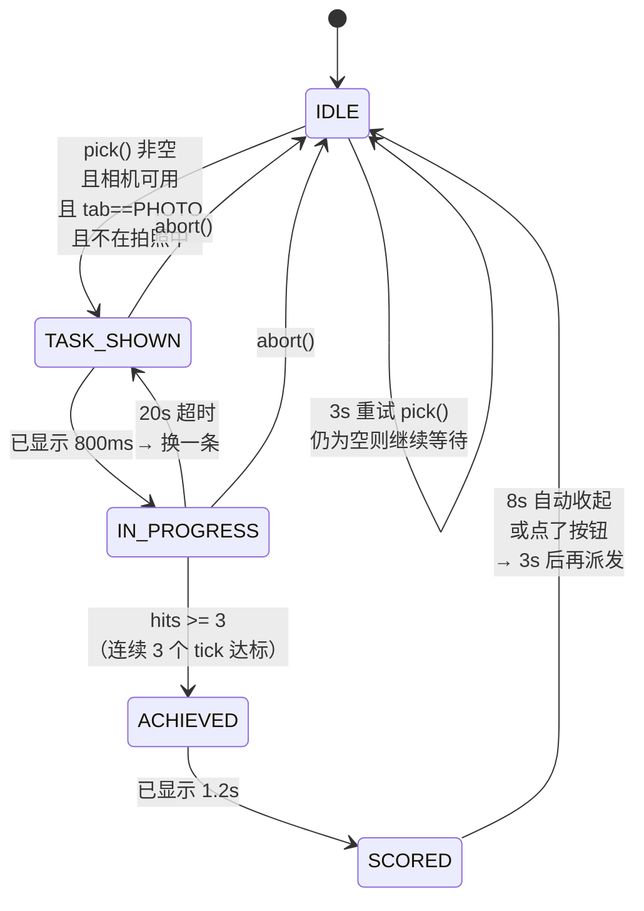
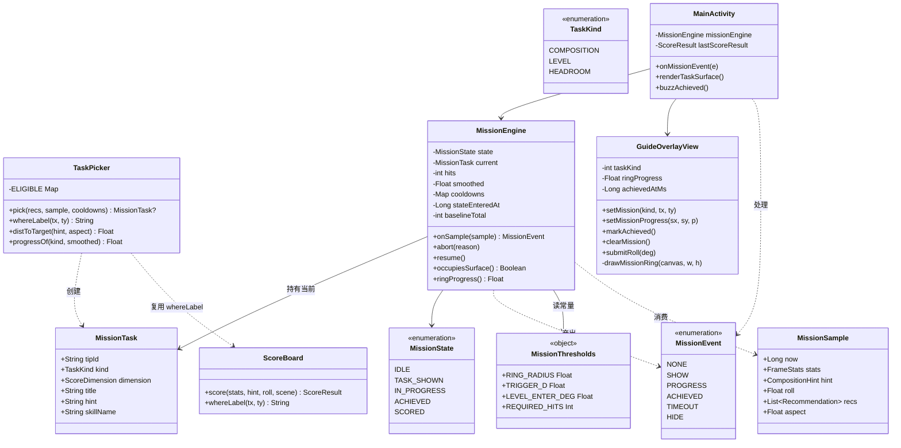
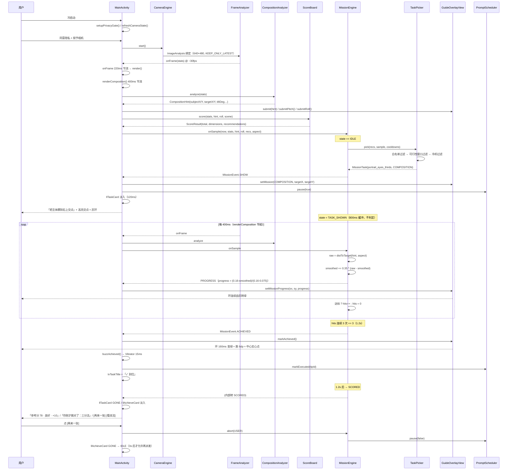

# G1 实现规格：首屏 Aha 改造（任务卡 + 到位反馈 + 免拍照得分）

> 版本目标：v3.1.0 / versionCode 31
> 前置：v3.0.0（versionCode 30，包体 `com.shottuner.app`）
> 上游：`docs/GROWTH-PRD.md` §3（Aha 时刻）、§8 Backlog 的 G1
> 作者：架构师
> 状态：**可直接开工**。所有阈值、文案、XML、函数签名都已定死，工程师照抄即可。

---

## 0. 这份规格要解决的问题

一句话：**把 Aha 的成本从"拍一张"降到"挪一下手机"。**

现在用户冷启动后看到的是 `ISO 320 · 1/60 · WB 5600K` —— 一串只有学过摄影才读得懂的数字，且必须自己按快门才能拿到任何分数。G1 要做的就是在取景器上直接派一个**5–15 秒能做完的动作任务**，做完了立刻给一个明确的"到位"+ 一张成绩卡，全程不拍照、不联网、不依赖悬浮窗。

---

# 第一部分：现状基线（读代码得出的结论）

## 1.1 分析回调的真实频率 —— PRD 里的「1 Hz」是错的

| 环节 | 位置 | 频率 | 说明 |
|---|---|---|---|
| CameraX ImageAnalysis | `CameraEngine.bind()` (CameraEngine.kt:167-172) | ~30 fps | `setTargetResolution(Size(640,480))` + `STRATEGY_KEEP_ONLY_LATEST` |
| `FrameAnalyzer.analyze()` | FrameAnalyzer.kt:61 | 每帧 | YUV 直读，单帧 <8ms |
| `MainActivity.onFrame()` | MainActivity.kt:1145 | **≤4.5 Hz** | 220ms 节流，然后 `uiHandler.post { render() }` |
| `MainActivity.render()` | MainActivity.kt:1152 | ≤4.5 Hz | 主线程 |
| `MainActivity.renderComposition()` | MainActivity.kt:1319 | **≤2.5 Hz** | 400ms 节流，产出 `CompositionHint` |
| `AiVision` 位图回调 | FrameAnalyzer.kt:38 | ~0.67 Hz | `BITMAP_EVERY_N_FRAMES = 45` |
| `focusVar`（清晰度） | FrameAnalyzer.kt:44 | ~2 Hz | `FOCUS_EVERY_N_FRAMES = 15`，但有值缓存 |
| `PromptScheduler` tick | MainActivity.kt:1463 | 2 Hz | `COACH_TICK_MS = 500` |
| `LevelSensor` roll | MainActivity.kt:312 | 10 Hz | 只写字段 `levelRoll`，不直接刷 UI |

**结论**：PRD §1.3 写的「1 Hz 分析」不成立。真实的构图诊断频率是 **2.5 Hz（400ms）**，渲染是 4.5 Hz。这对 G1 是好消息——400ms 的延迟对"挪手机"这种动作足够跟手，不需要改任何相机管线。

**G1 的判定节拍就挂在 `renderComposition()` 的 400ms 节流上，不新开 Handler，不新开线程。**

## 1.2 首屏现在的主位到底是什么

`activity_main.xml` 的 z 序与视觉权重：

```
previewView      全屏（取景器）
guideOverlay     全屏（三分线/水平线/主体圈）
tvShutterFlash   全屏（拍照白闪）
topBar           顶部 pill：场景 / 档位 / 亮度
llCoachSlot      topBar 下方（教练槽，默认 gone）
panel            ScrollView，屏高 45%，贴着 llControlBar
llControlBar     底部固定条：缩略图 / 快门 / 占位
（后面依次是 llCameraOff / llCameraError / llAbout / llCoachIntro / llPrivacyGate / llPrivacyFull）
```

照片页（`pagePhoto`，XML:355-717）的元素顺序与字号：

| 顺序 | id | 字号 | 沉浸档可见？ |
|---|---|---:|---|
| 1 | 页签行（照片/录像/功能/技法） | 13sp bold | 是 |
| 2 | `llReviewCard`（复盘卡） | 13sp | 是（gone→拍照后） |
| 3 | `tvScore`「构图 82」+ `tvCompose` + `btnGuide` | **17sp** accent | 是（`tvCompose` 否） |
| 4 | `tvScoreDetail`「参考分 78 · 良好 / 水平 25 …」 | 11sp warm | **否**（`applyUiPreset` 隐藏） |
| 5 | `histogram` | 46dp 高 | **否** |
| 6 | **四格读数：ISO 20sp / 快门 26sp / 色温 20sp / 偏差 11sp** | **20–26sp bold** | **是** |
| 7 | `tvAdvice` | 13sp | 是 |
| 8 | `btnMode` / `btnMore` + `llMoreActions` | 44dp 按钮 | 部分 |

**结论：首屏主位就是第 6 项的四格读数**（`ISO 320 · 1/60 · 5600K`），字号 20–26sp，是整屏最大的文字块，占垂直空间约 60dp。PRD §0 短板 #4 的描述准确。

`tvScoreDetail` 在沉浸档被隐藏，所以"参考分"这个本该是 Aha 核心的数字，默认档根本看不见 —— 这是本次必须一并修掉的。

## 1.3 `GuideOverlayView` 现在能画什么、缺什么

**已有的能力（GuideOverlayView.kt）：**

| 元素 | Paint | 画法 |
|---|---|---|
| 三分线（双描边：黑底 2.5dp + 白面 1dp） | `gridShadowPaint` / `gridPaint` | `drawThirds()` |
| 四个三分交点（r=7dp，双描边） | `gridShadowPaint` / `crossPaint` | `drawThirds()` |
| 水平参考线（绿 = 已平，白 = 未平） | `levelPaint` | `onDraw()`，`levelOk = horizonDetected && abs(tiltDeg) <= 1.8f` |
| 实际地平线（橙色虚线，按 tiltDeg 旋转） | `horizonPaint` | 仅 `!levelOk` 时 |
| 主体点（r=3.2dp）+ 主体圈（r=13dp） | `subjectDotPaint` / `subjectPaint` | `showSubjectMarks && subjectConfidence > 0.30f` |
| 目标交点圈（r=17dp 虚线）+ 主体→目标连线 | `targetPaint` | `suggestMove == true` |
| 右侧俯仰刻度 | `pitchScalePaint` / `pitchTickPaint` | `showPitchGauge` |

**结论：画环的能力完全具备**（`drawCircle` 已经在用了），但三件事做不到：

1. **不能高亮"某一个"交点** —— `drawThirds()` 对 4 个交点一视同仁，没有"哪个是本次目标"的输入。
2. **没有状态** —— 没有"任务进行中"的概念，没有"离目标多近"的输入，没有"到位"的一次性动画。
3. **沉浸档看不见** —— `showSubjectMarks = pro`（applyUiPreset:2327），默认档主体圈和目标圈都是关的，而 G1 的环必须默认可见。

**另外两个必须一起改的坑：**

- `levelOk` 的判定写死为 `hint.horizonDetected && abs(hint.tiltDeg) <= 1.8f`（GuideOverlayView.kt:191）。没有地平线时（室内、人像）这条永远是 false，水平参考线永远是白的 —— 意味着**一半以上的场景里"端平了"这件事在画面上没有任何反馈**。G1 必须补 `submitRoll()`。
- 1.8° 这个值与评分口径（`ScoreBoard.LEVEL_TOLERANCE = 1°`）和 G1 任务口径（2.5°）都不一致，三者必须对齐到 2.5°。

## 1.4 `CompositionHint` 相关字段怎么用

| 字段 | 产出位置 | G1 用途 |
|---|---|---|
| `subjectX` / `subjectY` | CompositionAnalyzer.kt:93-94，显著度加权质心 | **判定输入**：主体当前位置 |
| `targetX` / `targetY` | CompositionAnalyzer.kt:170-171，就近三分交点 `{1/3, 2/3}` | **环心** |
| `suggestMove` | CompositionAnalyzer.kt:244，`subjectConfidence > 0.30f && dist > 0.10f` | 派发前置条件之一（但阈值与 G1 不同，见 §2.3） |
| `scoreNoTilt` | CompositionAnalyzer.kt:247 | 四维分的构图维度；任务完成后应可见上涨 |
| `horizonDetected` / `tiltDeg` | CompositionAnalyzer.kt:162 | 水平任务的判定源（优先） |
| `subjectTop`（`by0`） | CompositionAnalyzer.kt:100 | headroom 任务的判定源 |
| `subjectConfidence` | CompositionAnalyzer.kt:129，`lineLike \|\| diffuse` 时归 0 | **必须 > 0.30 才派发构图任务**，否则是在指挥噪声 |

## 1.5 现有 tipId 与"可完成性"清单

`ScoreBoard.buildRecommendations()` 目前只会吐出 7 个 tipId（`ScoreBoard.kt:129-135`）+ 1 个空 id。逐个判定：

| tipId | 常量 | 维度 | G1 是否做任务卡 | 判定与理由 |
|---|---|---|---|---|
| `landscape_horizon_level` | `TIP_HORIZON` | LEVEL | ✅ **主力** | 转手腕 2–5 秒可完成；`tiltDeg`（结构张量）或 `roll`（重力）都是连续量，可精确判定；完成后水平维度 6 → 16，**参考分 +10** |
| `portrait_eyes_thirds` | `TIP_EYES_THIRDS` | COMPOSITION | ✅ **主力** | 挪手机 5–10 秒；`subjectX/Y` vs `targetX/Y` 连续量；完成后构图维度约 +2~3 |
| `portrait_headroom` | `TIP_HEADROOM` | COMPOSITION | ✅ 次选（改写文案） | 原文案「退半步，别让主体贴边」要走路，超时风险高 → 改写为「镜头往下压一指」，用 `subjectTop` 判定 |
| `basic_protect_highlights` | `TIP_HIGHLIGHT` | EXPOSURE | ❌ **G1 不做** | 见 §3.4，达标线无法落到 `ScoreBoard` 的加分边界上，做完参考分不涨 = 反效果 |
| `portrait_backlit_face_first` | `TIP_BACKLIT` | EXPOSURE | ❌ **G1 不做** | 原意是"对着脸点一下测光"，但本 App 的 `PreviewView` 没接 tap-to-focus，用户点屏幕不会有任何反应 → 任务不可执行 |
| `light_white_add_black_minus` | `TIP_EXPOSURE` | EXPOSURE | ❌ **不做** | 「慢一档快门 / ISO 加一档」是纯参数操作，必须进系统相机拨盘，App 内做不到 |
| `move_elbow_tucked` | `TIP_STEADY` | CLARITY | ❌ **不做** | 两个硬伤：①「手肘夹紧」是身体习惯不是一次性动作，没有"完成时刻"；② `focusVar` 每 15 帧（~0.5s）才更新一次，且受被摄体自身运动影响，用户无法在 5–15 秒内稳定控制，判定必然滞后 |
| `""`（全满分） | `ALL_PERFECT_TEXT` | — | ❌ 不派发 | 直接进 IDLE |

**技法库里另外 76 条（`TechniqueBookV15` 44 + `PhotographyBook` 39，共 83）全部不参与 G1。** 理由：任务卡的判定必须是"画面里有个连续量在变"，而 83 条里绝大多数是"知道/别做"类（`pitfall_*`）或"参数类"（`params_*`），没有可测量的完成态。G3（技法图鉴）才需要全库。

**一句话规则：能当任务的 tip，必须同时满足 —— ① 用户做一个物理动作（转/挪/压）；② 画面里有一个 400ms 内能测到的连续量会跟着变；③ 变到达标线时 `ScoreBoard` 的对应维度真的涨分。**

`TIP_STEADY` 倒在第 ② 条，`TIP_EXPOSURE` 倒在第 ① 条，`TIP_HIGHLIGHT` 倒在第 ③ 条。

---

# 第二部分：任务卡设计

## 2.1 任务从哪来

**复用 `ScoreBoard.buildRecommendations()` 的输出，不改它的排序。**

它已经按「扣分比例降序 + 每维度最多 1 条 + 总 ≤3」排好（`ScoreBoard.kt:275-281`），这正是"最值得改的那一条"。G1 在它上面加**三层过滤**，不改它本身：

```
recs = lastScoreResult.recommendations        // 已按扣分比例降序
  ↓ ① 白名单过滤（§1.5 的 ✅ 三条）
  ↓ ② 可行性窗口过滤（当前状态落在 [TRIGGER, GIVEUP] 内，§3）
  ↓ ③ 冷却过滤（该 tipId 在 missionCooldown / 静默期内 → 跳过）
  ↓ 取第一条 → MissionTask
  ↓ 一条都不剩 → null → 任务卡 GONE，回落到现有 tvAdvice
```

**为什么不在 `ScoreBoard` 里改**：`ScoreBoard` 是纯评分口径，它不知道"用户能不能在 15 秒内做到"。把可完成性判断放进 `ScoreBoard` 会污染评分语义，也会让 `ScoreBoardTest` 变成交互测试。所以新增 `growth/TaskPicker.kt` 单独承担。

## 2.2 降级规则（第一条不适合时怎么办）

按 §2.1 的三层过滤逐条往下试。**关键：全不通过时不要强行派发，也不要给用户任何"你失败了"的提示。**

- 全不通过 → 任务卡 `GONE`，照片页完全保持现在的样子（`tvAdvice` 照常显示参数建议）。用户感知不到"有个功能没触发"。
- 3 秒后再试一次（`RETRY_IDLE_MS = 3_000`），不要每个 400ms tick 都跑一遍 pick。
- 若连续两轮都挑不出任务 → 进 60 秒静默（`QUIET_AFTER_TWO_MISS = 60_000`），期间完全不跑 pick。理由：连续挑不出说明场景不适合（拍文档、纯色墙面、黑屏），继续跑只是白耗 CPU。

## 2.3 文案改写表

`ScoreBoard` 的原文案是"诊断口吻"，任务卡要的是"动作口吻"。改写表写死在 `TaskPicker`：

| tipId | `ScoreBoard` 原文 | 任务卡主句（≤10 字） | 任务卡副句（≤16 字） |
|---|---|---|---|
| `landscape_horizon_level` | 「地平线还差 3°，顺时针转一点」 | **把手机端平** | 转一下，橙线压到绿线上 |
| `portrait_eyes_thirds` | 「主体往右上 交点靠一点」 | **把主体挪到{方位}交点** | 让白点进圈，圈变绿就到位 |
| `portrait_headroom` | 「退半步，别让主体贴边」 | **头顶多留一点空间** | 镜头往下压一指，别顶到画框 |

`{方位}` 复用 `ScoreBoard` 的象限判断。**必须把这段逻辑从 `ScoreBoard.recommendFor()` 抽成 public 函数 `whereLabel(targetX, targetY)`，两处共用** —— 否则两处各写一份，将来改一处就走样（这是 v1.7 的 `tvFraming` 踩过的坑，见 MainActivity.kt:1557-1565 的注释）。

```kotlin
// ScoreBoard.kt 新增（第 291 行 recommendFor 之前）
fun whereLabel(targetX: Float, targetY: Float): String = when {
    targetX < 0.5f && targetY < 0.5f -> "左上"
    targetX < 0.5f -> "左下"
    targetY < 0.5f -> "右上"
    else -> "右下"
}
```

`recommendFor()` 里原来的 `val where = when {...}` 删掉，改调 `whereLabel(hint.targetX, hint.targetY)`。**这是纯重构，现有单测不应当失败。**

## 2.4 任务超时（20 秒没到位）

```
TASK_TIMEOUT_MS = 20_000                    // PRD §11 明确的值
TIMEOUT_COOLDOWN_MS = 12_000                // 超时后该 tipId 的冷却，保证换一条
CONSECUTIVE_TIMEOUT_QUIET_MS = 60_000       // 连续 2 次超时后的静默
```

超时动作序列：

1. 当前 `tipId` 写入 `missionCooldown[tipId] = now + 12_000`；
2. 任务卡做一个换条动画：`alpha 1 → 0`（120ms）→ 换 `tvTaskTitle/tvTaskHint` 文案 → `alpha 0 → 1`（120ms）。**不做位移** —— 位移会让眼睛重新找焦点，而这里要的是"同一张卡换了句话"；
3. 重新 `pick()`。挑到新的 → 回 `TASK_SHOWN`；挑不到 → `IDLE` + 任务卡 `GONE`；
4. 连续 2 次超时 → 进静默 60 秒，任务卡 `GONE`，`tvAdvice` 照常。

**不做的事**：不弹「没做到」「再试一次」之类的提示。超时是产品没挑对任务，不是用户失败。

---

# 第三部分：「到位」判定

## 3.0 三个通用防抖机制（适用于所有任务类型）

### (a) EMA 平滑 —— 判定用平滑值，不用单帧值

```kotlin
smoothed += SMOOTH_ALPHA * (raw - smoothed)      // SMOOTH_ALPHA = 0.35f
```

`SMOOTH_ALPHA = 0.35` 在 400ms 采样下时间常数约 1.2 秒。**这是"有手感"的关键**：用户看到的是一条平滑靠近的进度，不是一个跳变的数字。ring 的绿意进度也由 `smoothed` 驱动，所以"环由灰转绿"是连续的，不是到点突变。

### (b) 连续 N 次达标 —— 单帧达标不算

`hits++` 当且仅当本帧（本 tick）达标；任一 tick 不达标 → `hits = 0`（不是 `hits--`）。`hits >= REQUIRED_HITS` 才算 `ACHIEVED`。

| 任务类型 | REQUIRED_HITS | 折算时长 | 取值理由 |
|---|---:|---:|---|
| COMPOSITION | 3 | 1.2 s | 用户在持续移动，1.2s 足够确认是"停住了"而不是"路过" |
| LEVEL | 3 | 1.2 s | 同上 |
| HEADROOM | 3 | 1.2 s | 同上 |

### (c) 单向锁定 —— ACHIEVED 之后 3 秒不再判定

`POST_ACHIEVE_QUIET_MS = 3_000`。进入 `ACHIEVED` 后即使 `smoothed` 又跑出达标圈，**也不撤销**。理由：环已经绿了、震动已经给了、成绩卡马上要出，撤销会让"到位"这个承诺变得不可信。

## 3.1 构图类任务（`TIP_EYES_THIRDS`）—— 主体进入目标区

### 距离口径（重要，先统一）

`CompositionAnalyzer` 内部的 `dist` 用的是**未做长宽比校正的归一化 hypot**，在竖屏下纵向被系统性低估 1.78 倍。G1 不用它，改用**"画面短边为单位的像素距离"**：

```kotlin
// growth/TaskPicker.kt
/** 竖屏下 h >= w，故 min(w,h) == w。aspect = h / w。 */
fun distToTarget(hint: CompositionHint, aspect: Float): Float {
    val dx = hint.subjectX - hint.targetX
    val dy = (hint.subjectY - hint.targetY) * aspect
    return kotlin.math.hypot(dx, dy)
}
```

这样 `d` 与"环在屏幕上的半径 / 屏幕宽"是同一个单位，**判定线与视觉环严格一致** —— 用户看到"进圈"就是"到位"，不出现"明明在圈里却没绿"。

`aspect` 由 `MainActivity` 从 `binding.guideOverlay` 实测尺寸算出，兜底 `1.7778f`（16:9）：

```kotlin
private fun overlayAspect(): Float {
    val w = binding.guideOverlay.width
    val h = binding.guideOverlay.height
    return if (w > 0 && h > 0) h.toFloat() / w.toFloat() else 1.7778f
}
```

### 阈值

| 常量 | 值 | 含义 | 理由 |
|---|---:|---|---|
| `RING_RADIUS` | **0.075** | 环半径 = 达标线 | 360dp 宽屏上 = 27dp。相当于主体重心落在以三分交点为心、直径 54dp 的圆里。肉眼明确可辨，且真的需要挪动手机（约 10–15cm 横移或重取景）才能做到 —— 太松没有成就感，太紧做不到 |
| `FADE_START` | **0.16** | 开始由灰转绿 | 58dp。从这里开始环就有绿意，用户一动就有反馈 |
| `TRIGGER_D` | **0.16** | ≥ 此值才派发 | 与 `FADE_START` 对齐：派发瞬间环是全灰的，任何靠近都立刻有视觉回报。低于此值说明主体本来就在圈附近，不值得出任务 |
| `GIVEUP_D` | **0.55** | > 此值不派发 | 198dp，接近画面宽的一半。主体基本在对角，用户得走过去，15 秒内做不到 |
| `SMOOTH_ALPHA` | 0.35 | EMA 系数 | 见 §3.0(a) |
| `REQUIRED_HITS` | 3 | 连续达标帧数 | 见 §3.0(b) |

**环的绿意进度**（同时驱动 `GuideOverlayView` 和任务卡文案）：

```kotlin
progress = ((FADE_START - smoothed) / (FADE_START - RING_RADIUS)).coerceIn(0f, 1f)
```

- `smoothed >= 0.16` → `progress = 0`（纯灰）
- `smoothed <= 0.075` → `progress = 1`（纯绿）
- 中间线性过渡

**派发前置条件（三条全满足）**：
1. `hint.subjectConfidence > 0.30f`（否则是在指挥噪声）
2. `d in [TRIGGER_D, GIVEUP_D]`
3. `recs` 里有 `TIP_EYES_THIRDS` 且没在冷却里

## 3.2 水平类任务（`TIP_HORIZON`）

| 常量 | 值 | 含义 | 理由 |
|---|---:|---|---|
| `LEVEL_TASK_ENTER_DEG` | **2.5°** | 达标线 | **比 `ScoreBoard.LEVEL_TOLERANCE = 1°` 宽松 1.5 倍**。1° 是评分满分线，但手持本身就有 ±1° 抖动（`LevelSensor` 10Hz 实测），卡在 1° 会出现"永远差一点点"，新手尝不到甜头。2.5° 是肉眼刚能察觉倾斜的临界（摄影教学通用 2–3°），达成后画面确实变正，成就感是真的。代价：完成后水平维度是 16/25 不是 25/25 —— 但相对起手（4° → 6 分）**涨了 10 分**，用户看到的是 +10 |
| `LEVEL_TASK_TRIGGER_DEG` | **4.0°** | ≥ 此值才派发 | 4° 时水平维度 = `25 × (1 − 3/4)` = 6 分，扣分比例 76%，确实是"最值得改的"，与 `buildRecommendations` 的排序一致。低于 4° 说明基本是平的，不值得打扰 |
| `LEVEL_TASK_GIVEUP_DEG` | **12°** | > 此值不派发 | 超过 12° 要么是用户故意斜拍（构图选择），要么是手机在乱转，逼他端平是跟用户对着干 |
| `SMOOTH_ALPHA` | 0.35 | EMA 系数 | roll 是 10Hz 输入，400ms 采样下仍有抖动 |
| `REQUIRED_HITS` | 3 | 连续达标帧数 | 同上 |

**判定源**（与 `ScoreBoard.level()` 完全同口径，避免两处不一致）：

```kotlin
val theta: Float? = when {
    hint.horizonDetected -> hint.tiltDeg                       // 结构张量，最准
    roll != null         -> roll                               // 重力兜底
    else                 -> null                               // 没数据 → 不派发
}
```

⚠️ 与 `ScoreBoard.level()` 的差异要写清楚：`ScoreBoard` 在重力路径上做了 `if (abs(roll) > 3°) roll else 0f` 的"手机歪不等于画面歪"抑制（ScoreBoard.kt:148）。**任务卡用原始 `roll`，不加这个抑制** —— 因为任务卡要的是"用户转手机时数字会跟着动"，加了抑制会出现"转了 2° 但进度条不动"。代价是"手机歪但画面不歪"的场景下会误派发，但我们的触发下限是 4°，而抑制阈值是 3°，两者只重叠在 3–4° 这个窄带，可接受。

**必须同步改的两处显示阈值**：
- `GuideOverlayView.kt:191` 的 `levelOk` 从 `1.8f` 改成 `2.5f`，并改用 `LEVEL_OK_DEG` 常量；
- `GuideOverlayView` 新增 `submitRoll(rollDeg: Float)`，让 `horizonDetected == false` 时水平参考线也能变绿（现在永远白）。

## 3.3 headroom 任务（`TIP_HEADROOM`）

| 常量 | 值 | 含义 |
|---|---:|---|
| 派发条件 | `hint.subjectTop < 0.08f` **且** `stats.skinRatio > 0.06f` | 与 `CompositionAnalyzer.kt:209` 出这条 tip 的条件完全一致 |
| 达标条件 | `hint.subjectTop >= 0.12f` | 从 <0.08 抬到 ≥0.12，约需镜头下压 4% 画面高 |
| 放弃条件 | `hint.subjectTop < 0.02f` | 头顶已经完全出框，压不下去了 |
| `REQUIRED_HITS` | 3 | 1.2 s |

`skinRatio > 0.06` 这个前置条件**必须保留**：`CompositionAnalyzer` 只在检测到肤色时才认为"头顶"有意义，否则会把天空/墙面的亮块当成头顶。

## 3.4 曝光类任务 —— G1 不做，理由给全

**问题**：`ScoreBoard.exposure()` 的扣分是**阶跃**的，不是连续的：

```kotlin
if (stats.highlightClip >= clipHighLimit) score -= 10      // strict: 0.02 / relaxed: 0.08
if (stats.shadowClip     >= clipLowLimit)  score -= 10      // strict: 0.06 / relaxed: 0.14
if (meanLuma < lumaMin || meanLuma > lumaMax) score -= 10
```

要让"任务完成"带来可见的参考分上涨，达标线必须**跨过某个阶跃边界**。但：

- 触发线是 `REC_HIGHLIGHT = 0.10`（ScoreBoard.kt:119），达标线必须 `< 0.02`（strict 边界）才能真正加回那 10 分；
- 从 `highlightClip = 0.15` 降到 `< 0.02`，意味着画面里最亮的部分从 15% 降到 2%，在大多数场景里**根本做不到**（除非用户换到完全不同的机位）；
- 结果：用户照做 15 秒，参考分从 68 变成 68 —— **"做对了却没奖励"比"没做"更伤**。

**G1 决策：曝光维度不派任务卡。** 曝光建议继续走 `tvAdvice`（现状），不出任务卡、不出环、不出成绩卡。

**G1.5 备选（若 clover 坚持要做曝光任务，按这个来，且必须接受分数不涨）**：
- 只在 `highlightClip ∈ [0.02, 0.10]` 时派发（"只差临门一脚"的画面）；
- 达标线 `highlightClip <= 0.018`，连续 **5** 次（2.0s，曝光量比几何量更容易抖，防抖要更狠）；
- 文案改为动作化：「把镜头往下压一点，让最亮那块少占点画面」；
- 成绩卡**不显示 +N**（因为分数不会涨），只显示「高光收住了」。

## 3.5 判定入口（唯一）

**只在 `renderComposition()` 末尾调用一次判定，不另开 Handler、不在 `onPitchRoll()` 里判定。**

理由：
1. `renderComposition()` 已经是 400ms 节流，正好是我们要的节拍；
2. `levelRoll` 是字段（10Hz 写入），判定时刻读到的就是最新值，不需要单独的高频通路；
3. `onPitchRoll()` 是 10Hz，在那儿判定会让 hits 计数与渲染错位，出现"环还没画出来就已经 ACHIEVED"。

```kotlin
// MainActivity.renderComposition() 末尾（第 1331 行 updateFramingLine 之后）
renderScoreDetail(stats, comp)          // 内部把 ScoreResult 存进 lastScoreResult
missionEngine.onSample(
    now    = SystemClock.elapsedRealtime(),
    stats  = stats,
    hint   = comp,
    roll   = levelRoll,
    recs   = lastScoreResult?.recommendations.orEmpty(),
    aspect = overlayAspect()
)
```

`renderScoreDetail()` 需要把 `ScoreResult` 存成字段 `lastScoreResult: ScoreResult?`（现在它算完就丢），供任务引擎与任务卡上的实时参考分共用。

---

# 第四部分：反馈设计

## 4.1 环变绿的动画

**时长 160ms，减速插值，颜色 + 线宽 + 半径三者同时变化。**

在 `GuideOverlayView.onDraw()` 里按 `SystemClock.elapsedRealtime()` 自算进度（不引入 `ValueAnimator`，View 保持无动画对象状态，便于单测）：

```kotlin
private const val RING_ANIM_MS = 160L

// onDraw 内
val now = android.os.SystemClock.elapsedRealtime()
val t = if (achievedAtMs < 0L) 0f
        else ((now - achievedAtMs).toFloat() / RING_ANIM_MS).coerceIn(0f, 1f)
val ease = 1f - (1f - t) * (1f - t) * (1f - t)          // DecelerateInterpolator 等价手写
val p    = maxOf(ringProgress, ease)                     // 到位动画期间强制拉满

ringPaint.color       = lerpArgb(IDLE_RING_COLOR, accent, p)
ringPaint.strokeWidth = dp(1.5f + 1.5f * p)              // 1.5dp → 3dp
val grow = if (achievedAtMs >= 0L) (6f * sin(Math.PI * t.toDouble())).toFloat() else 0f
canvas.drawCircle(tx, ty, r0 + grow, ringPaint)          // 先胀 6dp 再收回

if (p > 0.01f) {                                          // 中心实心点：绿意的第二个载体
    dotPaint.alpha = (255 * p).toInt()
    canvas.drawCircle(tx, ty, dp(4f), dotPaint)
}
if (achievedAtMs >= 0L && t < 1f) postInvalidateOnAnimation()
```

参数表：

| 项 | 值 |
|---|---|
| `RING_ANIM_MS` | 160ms |
| 插值 | `1-(1-t)³`（Decelerate） |
| 颜色 | `Color.argb(150,255,255,255)`（灰，与现有 `targetPaint` 同色）→ `R.color.st_accent #7FE3C0` |
| 线宽 | 1.5dp → 3dp |
| 半径 | `RING_RADIUS * min(w,h)`，到位时 +6dp 正弦胀缩后收回 |
| 中心点 | r=4dp 实心，alpha 0 → 255 |

`lerpArgb` 手写 10 行（**不要引 `androidx.core.graphics.ColorUtils`**，虽然 androidx.core 已存在，但手写零风险且不增加 R8 需保留的类）：

```kotlin
private fun lerpArgb(from: Int, to: Int, t: Float): Int {
    val a = Color.alpha(from) + ((Color.alpha(to) - Color.alpha(from)) * t).toInt()
    val r = Color.red(from)   + ((Color.red(to)   - Color.red(from))   * t).toInt()
    val g = Color.green(from) + ((Color.green(to) - Color.green(from)) * t).toInt()
    val b = Color.blue(from)  + ((Color.blue(to)  - Color.blue(from))  * t).toInt()
    return Color.argb(a, r, g, b)
}
```

**颜色不单独承载信息**（沿用 `renderParams`/`evColorRes` 的既有原则）：到位同时有 ① 变绿 ② 线宽加倍 ③ 中心多一个实心点 ④ 环胀一下 ⑤ 任务卡文案变「到位」⑥ 震动。去掉颜色，剩下 5 个信号仍然完整。

## 4.2 震动 15ms

### 代码（minSdk 24 兼容）

```kotlin
private var lastBuzzAt = 0L

private fun buzzAchieved() {
    if (!uiPrefs.getBoolean(KEY_TASK_BUZZ, true)) return
    val now = SystemClock.elapsedRealtime()
    if (now - lastBuzzAt < 800L) return                       // 防连震
    val vib = ContextCompat.getSystemService(this, Vibrator::class.java) ?: return
    if (!vib.hasVibrator()) return                            // 平板/模拟器直接跳过
    lastBuzzAt = now
    try {
        if (Build.VERSION.SDK_INT >= Build.VERSION_CODES.O) {
            vib.vibrate(
                VibrationEffect.createOneShot(ACHIEVE_BUZZ_MS, VibrationEffect.DEFAULT_AMPLITUDE)
            )
        } else {
            @Suppress("DEPRECATION")
            vib.vibrate(ACHIEVE_BUZZ_MS)                      // API 24/25 路径
        }
    } catch (e: Throwable) {
        Diag.w(TAG, "到位震动失败", e)                          // ROM 差异，吞掉即可
    }
}
```

- `ContextCompat.getSystemService(Context, Class<T>)` 来自已有的 `androidx.core`，**不新增依赖**；
- `VibrationEffect` 是 API 26，`else` 分支覆盖 24/25，编译器的 `SDK_INT` 检查能正确消除警告；
- `ACHIEVE_BUZZ_MS = 15L`。**已知限制**：部分国产 ROM 对 <20ms 的震动会截断或不执行。真机验收时如果感觉不到，**改成 20ms**（A4 的上限是 400ms，20ms 无任何冲突）。这是唯一允许的调整项，别动别的。

### `VIBRATE` 权限要不要加 —— 结论：加，但必须同步改隐私政策

**先说清楚这个权限的性质：**

| 项 | 事实 |
|---|---|
| 保护级别 | **`normal`**（不是 `dangerous`） |
| 授予方式 | **安装时自动授予**，不弹运行时权限框，用户看不到任何授权流程 |
| 数据相关 | **零**。不读任何传感器之外的东西，不产生任何数据 |
| 网络相关 | **无关**。`VIBRATE` 与 `INTERNET` 没有任何关系，不影响 manifest 里 `tools:node="remove"` 的移除逻辑 |
| 商店可见性 | 会出现在系统设置的权限列表里（通常在"其他权限"下），部分商店会在详情页列出 |

**对"零网络"这个立身之本的影响：零。** 隐私政策 §1 的「未申请 INTERNET，系统层面不具备联网能力」这句话仍然 100% 成立。

**但必须做的配套动作**（否则"最小权限"的自我承诺出现漏洞）：

1. `AndroidManifest.xml` 在 `POST_NOTIFICATIONS` 之后加一行：
   ```xml
   <uses-permission android:name="android.permission.VIBRATE" />
   ```
   **不要**加 `tools:node` 相关属性，也不要动 `INTERNET` / `ACCESS_NETWORK_STATE` 那两条 `remove`（那是 P0 阻断项，碰了就是废稿）。

2. `res/raw/privacy_v1.txt` 在「2.6 存储权限」段之后、「三、第三方 SDK 清单」之前，插入 2.7：

   ```
   2.7 震动权限（VIBRATE）

   · 用途：在你完成一次构图或水平任务（例如把主体挪到三分交点、把手机端平）时，触发一次约 15 毫秒的极短震动，作为"到位"的确认反馈。
   · 性质：该权限为系统普通权限，安装时自动授予，不会弹出任何授权请求，也不需要你进行任何操作。
   · 范围：仅在任务达成瞬间触发一次，不读取任何数据，不产生任何记录，不涉及网络。
   · 可关闭：你可以在应用内关闭震动反馈（功能页开关），关闭后"到位"仍有颜色、线宽与文案提示。
   ```

3. 功能页（`pageFeature`）加一个开关 `swTaskBuzz`（默认开），存 `uiPrefs` 的 `KEY_TASK_BUZZ`。**加开关的理由**：震动是可感知的打扰，必须给用户关闭的出口，否则差评。

**如果 clover 拍板"一个权限都不加"**，走这个 fallback（同样满足"到位有反馈"）：
- 环变绿 + 线宽加倍 + 中心实心点 + 环胀 6dp；
- 任务卡文案换成「✓ 到位」并做一次 120ms 的 scale 0.96 → 1.0；
- 复用 `tvShutterFlash` 做一次极弱白闪：`alpha 0 → 0.18 → 0`，总时长 90ms（比拍照白闪的 0.55 弱 3 倍，不刺眼）。

我推荐**加权限**。15ms 震动是"到位"手感里唯一不占视觉通道的信号，取景时用户的眼睛在画面上，触觉反馈的价值远高于它的权限成本。

## 4.3 「到位」后的成绩卡

### 位置

浮在取景器中央（`llAchieveCard`，见 §5.2），**不放在 `panel` 里**。理由：现有的 `llReviewCard` 在 ScrollView 里，用户如果正把面板滚在下面，卡片会看不见（`showReviewCard()` 里已经有 `panel.scrollTo(0,0)` 这个补丁，MainActivity.kt:1911 —— 那是个 workaround，不是设计）。Aha 的产物不该需要一个滚动补丁才能被看到。

### 字段与文案

| View | 内容 | 样式 |
|---|---|---|
| `tvAchieveScore` | `参考分 78 · 良好` 或 `参考分 78 · 良好 · +10` | 20sp bold，monospace，`st_accent` |
| `tvAchieveReason` | `你刚才做对了：三分法` | 13sp，`st_text` |
| `btnAchieveAgain` | `再来一张` | `bg_chip`，11sp，`st_accent` |
| `btnAchieveDex` | `看技法 ›` | `bg_chip`，11sp，`st_accent` |

**`+N` 的规则（这是"有手感的变化"的核心）**：

```kotlin
val delta = currentTotal - taskStartTotal
head = buildString {
    append(if (allMeasured) "参考分 $total · $grade" else "参考分 -- · 有一项未测")
    if (allMeasured && delta != 0) append(" · ${if (delta > 0) "+" else ""}$delta")
}
```

- `taskStartTotal` 是**任务派发那一刻**的总分（在 `TASK_SHOWN` 进入时快照）；
- **任一维度未测时，只显示「参考分 -- · 有一项未测」，不显示 `+N`**。守住口径：分母不完整时不给数字，更不给差值；
- `delta == 0` 时不显示（不显示「+0」，那是废话）。

**技法短名映射**（3 条写死在 `TaskPicker`）：

| tipId | 短名 |
|---|---|
| `landscape_horizon_level` | `地平线端平` |
| `portrait_eyes_thirds` | `三分法` |
| `portrait_headroom` | `头顶留白` |

（取自 `TechniqueBookV15` / `PhotographyBook` 的 `title`：「地平线一定端平，歪一点就废」/「眼睛放上三分线，别放正中」/「头顶留一小格，别让人顶到边」，压缩成 4 字以内。）

### 停留时长与按钮行为

| 项 | 值 | 理由 |
|---|---|---|
| 自动收起 | **8 000 ms** | 比复盘卡的 5 秒长。成绩卡是 Aha 的产物，要读完两行 + 决定点哪个按钮。但它压在取景器中央，不能常驻 |
| 点卡片任意位置 | **保持常驻**（`uiHandler.removeCallbacks(hideAchieveRunnable)`） | 与现有 `llReviewCard` 的行为完全一致（MainActivity.kt:648），一致性 > 新奇 |
| `[再来一张]` | 隐藏成绩卡 → `IDLE` → `POST_ACHIEVE_QUIET_MS`（3s）后重新 `pick()` | 3 秒缓冲是为了防止立刻又派发同一个刚达成的任务 |
| `[看技法 ›]` | 隐藏成绩卡 → `selectTab(TAB_SKILL)` | G3（图鉴）做完之后改成 `[看图鉴]`并跳图鉴页。**G1 阶段就用技页，别留空按钮** |
| 若 3 秒后挑不出新任务 | 任务卡 `GONE`，照片页回落现状 | 不弹任何"没任务了"的提示 |

---

# 第五部分：首屏层级重排

## 5.1 目标层级

| 层级 | 内容 | 载体 | 沉浸档 | 专业档 |
|---|---|---|---|---|
| **L1 主位** | 任务卡（动作 + 到位反馈 + 实时参考分） | `llTaskCard`（浮在取景器） | ✅ | ✅ |
| **L1 主位** | 成绩卡（参考分 + 做对了什么 + 两个按钮） | `llAchieveCard`（浮在取景器） | ✅ | ✅ |
| **L2** | 四维小条（参考分/水平/曝光/构图/清晰） | `tvScoreDetail`（照片页内） | ✅ **（本次从隐藏改为可见）** | ✅ |
| **L2** | 「构图 82」+ 网格开关 | `tvScore` + `btnGuide`（照片页内） | ✅ | ✅ |
| **L3** | 直方图 + ISO / 快门 / 色温 / 偏差 | `llParams`（照片页内，可折叠） | 默认收起，点 `llParamsHeader` 展开 | 默认展开，可收起 |
| **L3** | 参数一行摘要（收起时可见） | `tvParamsSummary` | ✅ | 展开时 GONE |
| — | `tvAdvice`（参数建议） | 不动 | ✅ | ✅ |

**参数能力一个字都不删**：ISO / 快门 / 色温 / 偏差 四个读数、直方图、复制参数、本机写入、锁定、恢复自动、怎么拨，全部保留在原处，只是整块被 `llParams` 包起来、默认收起。ProShot 那批用户点一下 `参数 ▾` 就全回来了。

## 5.2 `activity_main.xml` 的具体改动

### 改动 A：新增 `llTaskCard` + `llAchieveCard`

**插入位置：`llCoachSlot` 结束之后（第 164 行 `</LinearLayout>` 之后）、`panel` 的注释块（第 166 行）之前。**

必须在这个位置的三个理由：
1. **z 序**：在 `panel` 之前 → 不盖面板与页签；在 `llCameraOff`（第 1187 行）/ `llPrivacyGate`（第 1511 行）之前 → 被这两个覆盖层正确盖住，不会出现"相机关着还弹任务卡"。
2. **锚点**：`panel` 已经声明，可以 `constraintBottom_toTopOf="@id/panel"`。
3. **不碰 inset**：`applyPanelInsets()` / `applyControlBarInsets()` 只改 `panel` 与 `llControlBar` 的 `paddingBottom`。任务卡锚定在 `topBar` 与 `panel` 之间，不接触系统栏，**不需要任何 inset 处理**。

```xml
<!--
  G1 任务卡（v3.1.0）。

  z 序：声明在 llCoachSlot 之后、panel 之前 —— 盖住取景与引导线，
  但不盖面板/页签；同时被后面的 llCameraOff / llPrivacyGate 盖住。

  垂直位置：锚在 topBar 下沿与 panel 上沿之间，bias 0.62 让它落在
  取景区偏下的位置（画面上部留给 topBar 与地平线，下部是用户视线
  从画面移到面板的过渡带，卡片放这里不挡主体）。

  **必须双锚点 + bias**：与 panel 同一个坑（P1-a），单锚点会在部分
  ConstraintLayout 版本上把高度解析成 0。

  默认 gone。显隐只由 MainActivity.renderTaskSurface() 一处控制。
-->
<LinearLayout
    android:id="@+id/llTaskCard"
    android:layout_width="0dp"
    android:layout_height="wrap_content"
    android:layout_marginHorizontal="24dp"
    android:background="@drawable/bg_pill"
    android:orientation="vertical"
    android:paddingHorizontal="14dp"
    android:paddingVertical="10dp"
    android:visibility="gone"
    app:layout_constraintBottom_toTopOf="@id/panel"
    app:layout_constraintEnd_toEndOf="parent"
    app:layout_constraintStart_toStartOf="parent"
    app:layout_constraintTop_toBottomOf="@id/topBar"
    app:layout_constraintVertical_bias="0.62">

    <LinearLayout
        android:layout_width="match_parent"
        android:layout_height="wrap_content"
        android:baselineAligned="false"
        android:gravity="center_vertical"
        android:orientation="horizontal">

        <TextView
            android:id="@+id/tvTaskTitle"
            android:layout_width="0dp"
            android:layout_height="wrap_content"
            android:layout_weight="1"
            android:ellipsize="end"
            android:maxLines="1"
            android:text=""
            android:textColor="@color/st_text"
            android:textSize="15sp"
            android:textStyle="bold" />

        <TextView
            android:id="@+id/tvTaskScore"
            android:layout_width="wrap_content"
            android:layout_height="wrap_content"
            android:layout_marginStart="8dp"
            android:fontFamily="monospace"
            android:text="参考分 --"
            android:textColor="@color/st_text_warm"
            android:textSize="12sp"
            android:textStyle="bold" />
    </LinearLayout>

    <TextView
        android:id="@+id/tvTaskHint"
        android:layout_width="match_parent"
        android:layout_height="wrap_content"
        android:layout_marginTop="2dp"
        android:ellipsize="end"
        android:maxLines="1"
        android:text=""
        android:textColor="@color/st_text_dim"
        android:textSize="11sp" />
</LinearLayout>

<!--
  G1 成绩卡（v3.1.0）。声明在 llTaskCard 之后 → z 序更高，到位时盖住任务卡。

  背景用 bg_pill（92% 不透明深底）而不是 bg_card（12% 白）：
  bg_card 是给面板里的深色底用的，浮在明亮取景画面上完全读不清。

  bias 0.45 → 落在取景区正中偏上，这是 Aha 的产物，要给主位。
-->
<LinearLayout
    android:id="@+id/llAchieveCard"
    android:layout_width="0dp"
    android:layout_height="wrap_content"
    android:layout_marginHorizontal="20dp"
    android:background="@drawable/bg_pill"
    android:orientation="vertical"
    android:paddingHorizontal="16dp"
    android:paddingVertical="14dp"
    android:visibility="gone"
    app:layout_constraintBottom_toTopOf="@id/panel"
    app:layout_constraintEnd_toEndOf="parent"
    app:layout_constraintStart_toStartOf="parent"
    app:layout_constraintTop_toBottomOf="@id/topBar"
    app:layout_constraintVertical_bias="0.45">

    <TextView
        android:id="@+id/tvAchieveScore"
        android:layout_width="match_parent"
        android:layout_height="wrap_content"
        android:fontFamily="monospace"
        android:text=""
        android:textColor="@color/st_accent"
        android:textSize="20sp"
        android:textStyle="bold" />

    <TextView
        android:id="@+id/tvAchieveReason"
        android:layout_width="match_parent"
        android:layout_height="wrap_content"
        android:layout_marginTop="4dp"
        android:ellipsize="end"
        android:maxLines="1"
        android:text=""
        android:textColor="@color/st_text"
        android:textSize="13sp" />

    <LinearLayout
        android:layout_width="match_parent"
        android:layout_height="wrap_content"
        android:layout_marginTop="12dp"
        android:orientation="horizontal">

        <TextView
            android:id="@+id/btnAchieveAgain"
            android:layout_width="0dp"
            android:layout_height="wrap_content"
            android:layout_marginEnd="8dp"
            android:layout_weight="1"
            android:background="@drawable/bg_chip"
            android:gravity="center"
            android:paddingVertical="8dp"
            android:text="再来一张"
            android:textColor="@color/st_accent"
            android:textSize="12sp"
            android:textStyle="bold" />

        <TextView
            android:id="@+id/btnAchieveDex"
            android:layout_width="0dp"
            android:layout_height="wrap_content"
            android:layout_weight="1"
            android:background="@drawable/bg_chip"
            android:gravity="center"
            android:paddingVertical="8dp"
            android:text="看技法 ›"
            android:textColor="@color/st_accent"
            android:textSize="12sp"
            android:textStyle="bold" />
    </LinearLayout>
</LinearLayout>
```

**不新增任何 drawable / color**：`bg_pill`、`bg_chip`、`st_text` / `st_text_dim` / `st_text_warm` / `st_accent` 全部复用现有资源。

### 改动 B：照片页的参数降级（L3）

现有结构（XML:407-560）：
```
<TextView tvScoreDetail/>                      <!-- 407 -->
<HistogramView histogram/>                     <!-- 417 -->
<LinearLayout 四格读数（423-560）/>

```

改成：
```
<TextView tvScoreDetail/>                      <!-- 407，不动。L2 -->
<LinearLayout android:id="@+id/llParams" ...>  <!-- 新增包裹层，L3 -->
    <HistogramView histogram/>                 <!-- 原样搬进来 -->
    <LinearLayout 四格读数/>                    <!-- 原样搬进来，内容一字不改 -->
</LinearLayout>
<LinearLayout android:id="@+id/llParamsHeader" ...>   <!-- 新增 -->
    <TextView android:id="@+id/tvParamsToggle" ... text="参数 ▾" />
    <TextView android:id="@+id/tvParamsSummary" ... />  <!-- 收起时显示 "ISO 320 · 1/60 · 5600K · EV +0.3" -->
</LinearLayout>
```

```xml
<!--
  G1 参数降级（v3.1.0 L3）。

  ISO / 快门 / 色温 / 偏差 与直方图**一个都不删**，只是整块包进 llParams
  并默认收起。ProShot 那批用户点一下「参数 ▾」就全回来了。

  收起时由 tvParamsSummary 显示一行摘要，保证"参数还在"这件事有可见证据。
-->
<LinearLayout
    android:id="@+id/llParams"
    android:layout_width="match_parent"
    android:layout_height="wrap_content"
    android:orientation="vertical"
    android:visibility="gone">

    <com.shottuner.app.ui.HistogramView
        android:id="@+id/histogram"
        android:layout_width="match_parent"
        android:layout_height="46dp"
        android:layout_marginTop="8dp" />

    <!-- ↓↓↓ 原 XML 第 423–560 行的四格读数，原样搬到这个容器里，内容一字不改 ↓↓↓ -->
    ...
    <!-- ↑↑↑ -->
</LinearLayout>

<LinearLayout
    android:id="@+id/llParamsHeader"
    android:layout_width="match_parent"
    android:layout_height="wrap_content"
    android:layout_marginTop="8dp"
    android:baselineAligned="false"
    android:gravity="center_vertical"
    android:orientation="horizontal">

    <TextView
        android:id="@+id/tvParamsToggle"
        android:layout_width="wrap_content"
        android:layout_height="wrap_content"
        android:text="参数 ▾"
        android:textColor="@color/st_accent"
        android:textSize="12sp"
        android:textStyle="bold" />

    <TextView
        android:id="@+id/tvParamsSummary"
        android:layout_width="0dp"
        android:layout_height="wrap_content"
        android:layout_marginStart="10dp"
        android:layout_weight="1"
        android:ellipsize="end"
        android:fontFamily="monospace"
        android:gravity="end"
        android:maxLines="1"
        android:text=""
        android:textColor="@color/st_text_dim"
        android:textSize="11sp" />
</LinearLayout>
```

### 改动 C：功能页加震动开关

在 `swVolumeShutter` 那一段（XML:978-996）之后插入：

```xml
<TextView
    android:id="@+id/tvTaskBuzzTitle"
    android:layout_width="match_parent"
    android:layout_height="wrap_content"
    android:layout_marginTop="10dp"
    android:text="到位震动"
    android:textColor="@color/st_text"
    android:textSize="14sp"
    android:textStyle="bold" />

<Switch
    android:id="@+id/swTaskBuzz"
    android:layout_width="match_parent"
    android:layout_height="wrap_content"
    android:layout_marginTop="2dp"
    android:checked="true"
    android:showText="false"
    android:switchPadding="10dp"
    android:text="完成任务时震一下"
    android:textColor="@color/st_text_option"
    android:textSize="12sp" />

<TextView
    android:id="@+id/tvTaskBuzzHint"
    android:layout_width="match_parent"
    android:layout_height="wrap_content"
    android:text="约 15 毫秒的极短震动；关掉后仍有颜色与文案提示"
    android:textColor="@color/st_text_faint"
    android:textSize="10sp" />
```

### 改动 D：`applyUiPreset()` 的调整（MainActivity.kt:2308）

```kotlin
private var paramsExpanded = false      // 新增字段：用户手动展开的状态（不落盘，与 llMoreActions 同策略）

private fun applyUiPreset() {
    val pro = uiPreset == UiPreset.PRO
    val detailVisibility = if (pro) View.VISIBLE else View.GONE

    binding.tvMode.text = "${uiPreset.label} · 点切换"
    binding.tvMode.setTextColor(ContextCompat.getColor(this, R.color.st_accent))

    // G1：tvScoreDetail 是 L2（四维小条），两个档位都必须可见 —— 它承载"Aha 的分数"
    binding.tvScoreDetail.visibility = View.VISIBLE

    // 构图细节行维持原策略
    binding.tvCompose.visibility = detailVisibility

    // G1：直方图归 llParams 管，这里不再单独控制（删掉原来的 histogram 那行）
    binding.llParams.visibility =
        if (pro || paramsExpanded) View.VISIBLE else View.GONE
    binding.tvParamsSummary.visibility =
        if (binding.llParams.visibility == View.VISIBLE) View.GONE else View.VISIBLE
    binding.tvParamsToggle.text = if (binding.llParams.visibility == View.VISIBLE) "参数 ▴" else "参数 ▾"

    if (!pro) binding.llMoreActions.visibility = View.GONE

    binding.guideOverlay.showPitchGauge = pro
    binding.guideOverlay.showSubjectMarks = pro
}
```

⚠️ **删掉原来的 `binding.histogram.visibility = detailVisibility` 这一行**（第 2317 行）。直方图的显隐现在由 `llParams` 统一管，两处都管会出现"专业档下 llParams 收起但直方图还露着"。

⚠️ **不要在这里碰 `llTaskCard` / `llAchieveCard`**。这两个的显隐只由 `renderTaskSurface()` 一处控制（`applyUiPreset` 会在 `selectTab` 末尾被调用，两处都管就又回到 P1-a 那个"谁最后执行谁说了算"的坑）。

---

# 第六部分：状态机

## 6.1 状态定义



## 6.2 每个状态的进入 / 退出条件

| 状态 | 进入条件（全部满足） | 进入时动作 | 退出条件 | 退出时动作 |
|---|---|---|---|---|
| **IDLE** | 初始态 / 任何 abort / SCORED 结束 | 任务卡 `GONE`、成绩卡 `GONE`、`hits=0`、`smoothed` 重置、`promptScheduler.pause(false)` | pick() 返回非空（每 3s 重试一次） | — |
| **TASK_SHOWN** | ① `privacyAccepted`<br/>② `engine != null` 且 `llCameraError` 不可见<br/>③ `currentTab == TAB_PHOTO`<br/>④ `!captureInProgress`<br/>⑤ `guidesOn == true`<br/>⑥ `llCoachSlot` 未被占用（见 §6.4）<br/>⑦ `pick()` 非空 | 快照 `taskStartTotal`；写 `tvTaskTitle/tvTaskHint`；`guideOverlay.setMission(...)`；任务卡淡入 120ms；**`promptScheduler.pause(true)`** | 800ms 到 → `IN_PROGRESS`；或 abort | — |
| **IN_PROGRESS** | `TASK_SHOWN` 满 800ms | 开始累计 hits | ① `hits >= 3` → `ACHIEVED`<br/>② `now - shownAt > 20_000` → 换任务<br/>③ abort | — |
| **ACHIEVED** | `hits >= REQUIRED_HITS` | 环变绿动画（`guideOverlay.markAchieved()`）；`buzzAchieved()`；`tvTaskTitle` → 「✓ 到位」；`promptScheduler.markExecuted(tipId, now)` | 1.2s 到 → `SCORED` | — |
| **SCORED** | `ACHIEVED` 满 1.2s | 任务卡 `GONE`；成绩卡淡入 120ms；写 `tvAchieveScore/tvAchieveReason`；`postDelayed(hideAchieveRunnable, 8_000)` | ① 8s 到<br/>② 点卡片 → 常驻<br/>③ 点 `[再来一张]` / `[看技法]`<br/>④ abort | 成绩卡 `GONE`；`IDLE`；3s 后才允许再派发 |

**TASK_SHOWN 的 800ms 缓冲是必须的**：没有它，会出现"任务卡刚弹出来就已经达标"（例如 `d` 恰好在 0.16 边界、或用户刚好已经端平），用户什么都没做就绿了 —— Aha 直接变成"莫名其妙"。

## 6.3 与已有机制的交互

### (1) 1 Hz（实际 2.5 Hz）的 `onFrame` 回调

- 判定入口唯一：`renderComposition()` 末尾的 `missionEngine.onSample(...)`；
- `missionEngine.onSample()` 返回 `MissionEvent`（`NONE / SHOW / PROGRESS / ACHIEVED / TIMEOUT / HIDE`），`MainActivity` 按事件刷 UI；
- **`onSample()` 是纯函数式调用，不碰任何 Android 类型**（除了传入的参数），可以在 JVM 单测里直接喂假数据。

### (2) 教练槽（`startCoachLoop` / `tickCoach` / `renderCoachSlot`）—— 互斥规则

**硬规则：任务卡与教练槽同一时刻只允许一个可见。**

仲裁函数（**唯一**控制 `llCoachSlot` 与 `llTaskCard` / `llAchieveCard` 显隐的地方）：

```kotlin
/**
 * 任务卡与教练槽的表面仲裁。所有可能改变两者可见性的路径都必须过这里。
 *
 * 优先级自上而下，命中即返回：
 *   ① 相机不可用 / 隐私未同意 / 非照片页 / 拍照中 / 网格关闭 → 两者都 GONE
 *   ② 任务引擎占用表面（TASK_SHOWN / IN_PROGRESS / ACHIEVED / SCORED）→ 任务卡 VISIBLE + 教练槽 GONE
 *   ③ 其余 → 任务卡 GONE + 教练槽按 PromptScheduler 的决定
 */
private fun renderTaskSurface() {
    val usable = privacyAccepted &&
        currentTab == TAB_PHOTO &&
        engine != null &&
        binding.llCameraError.visibility != View.VISIBLE &&
        !captureInProgress &&
        guidesOn

    if (!usable) {
        binding.llTaskCard.visibility = View.GONE
        binding.llAchieveCard.visibility = View.GONE
        binding.llCoachSlot.visibility = View.GONE
        return
    }
    when (missionEngine.state) {
        MissionState.IDLE -> {
            binding.llTaskCard.visibility = View.GONE
            binding.llAchieveCard.visibility = View.GONE
            // 教练槽交还给 PromptScheduler（它自己决定显隐）
        }
        MissionState.TASK_SHOWN, MissionState.IN_PROGRESS -> {
            binding.llTaskCard.visibility = View.VISIBLE
            binding.llAchieveCard.visibility = View.GONE
            binding.llCoachSlot.visibility = View.GONE       // 硬压
        }
        MissionState.ACHIEVED -> {
            binding.llTaskCard.visibility = View.VISIBLE
            binding.llAchieveCard.visibility = View.GONE
            binding.llCoachSlot.visibility = View.GONE
        }
        MissionState.SCORED -> {
            binding.llTaskCard.visibility = View.GONE
            binding.llAchieveCard.visibility = View.VISIBLE
            binding.llCoachSlot.visibility = View.GONE
        }
    }
}
```

**`tickCoach()` 的改法（MainActivity.kt:1463）**：

```kotlin
private fun tickCoach() {
    if (isFinishing || isDestroyed) return
    coachTicks++
    // 任务卡占用期间**不推进 scheduler**：否则它的 8s 冷却 / 3s 驻留会在
    // 任务期间偷偷跑完，任务一结束立刻弹两条（教练槽 + 新任务）。
    if (missionEngine.occupiesSurface()) {
        binding.llCoachSlot.visibility = LinearLayout.GONE
        return
    }
    val decision = promptScheduler.tick(buildPromptSignals(), SystemClock.elapsedRealtime())
    if (decision.changed) renderCoachSlot(decision)
}
```

**`pause` 的时机**（在状态机的进入/退出动作里，见 §6.2）：
- 进入 `TASK_SHOWN` → `promptScheduler.pause(true)` + `renderTaskSurface()`
- 退出到 `IDLE` → `promptScheduler.pause(false)`

`startCoachLoop()` / `stopCoachLoop()` 里已有的 pause 调用（MainActivity.kt:1445, 1452）**不要动**，它们管的是 Activity 前后台。

**为什么不会同时弹两条**：三重保险 —— ① `renderTaskSurface()` 硬压 `llCoachSlot`；② `tickCoach()` 在任务期直接 return，不推进 scheduler；③ `promptScheduler.pause(true)` 冻结它的内部计时。

**为什么不会"任务结束后立刻弹教练槽"**：任务达成时调 `promptScheduler.markExecuted(tipId, now)`（PromptScheduler.kt:258），把这条 tip 推进 8 秒冷却；加上 `POST_ACHIEVE_QUIET_MS = 3_000` 的 IDLE 缓冲，教练槽最早也要 3 秒后才可能出，且出的不会是刚做完的那条。

### (3) 拍照流程（`capturePhoto()`）

```kotlin
// MainActivity.capturePhoto()，第 1693 行 `if (captureInProgress) return` 之后
missionEngine.abort(reason = AbortReason.CAPTURE)   // 幂等，可重复调用
renderTaskSurface()

// MainActivity.showReviewCard()，第 1900 行开头
missionEngine.abort(reason = AbortReason.CAPTURE)   // 同样再调一次
renderTaskSurface()
```

两处都调是刻意的：
- `capturePhoto()` 里调 → 用户一按快门，任务卡/成绩卡立刻消失，不挡白闪与缩略图飞入；
- `showReviewCard()` 里调 → 覆盖"ACHIEVED 之后 1.2s 内用户就按了快门"这条路径（此时成绩卡可能刚显示）。

`abort()` 幂等（内部判 `state == IDLE` 就直接返回），重复调用无副作用。

**复盘卡与成绩卡不会同屏**：成绩卡用 `llAchieveCard`（浮在取景器），复盘卡用 `llReviewCard`（面板内）。`showReviewCard()` 里的 abort 保证成绩卡先消失。反过来，成绩卡显示期间用户按快门，`capturePhoto()` 里的 abort 也能保证复盘卡正常弹出。

### (4) 页签切换（`selectTab()`）

```kotlin
// MainActivity.selectTab()，第 782 行 currentTab = idx 之后
if (idx == TAB_PHOTO) {
    missionEngine.resume()          // 允许重新 pick（内部有 3s 重试节流）
} else {
    missionEngine.abort(reason = AbortReason.TAB)
}
renderTaskSurface()
```

- 切走：任务卡消失、状态清空、`promptScheduler.pause(false)` 交还教练槽；
- 切回：从 `IDLE` 重新走 pick，`TASK_SHOWN` 的 800ms 缓冲保证不会"切回来就闪一张卡"。

⚠️ **不要动 `applyShutterAvailability()`**（第 823 行）。它已经用 `isEnabled + alpha` 处理了页签守卫，注释里写明了"隐藏 `llControlBar` 会让 `panel` 失去锚点"。G1 的卡片在 `panel` 之上，不参与这套约束，但也不要去碰它。

### (5) `onPause` / `onResume`

```kotlin
override fun onPause() {
    missionEngine.abort(reason = AbortReason.PAUSE)   // 新增，放在 stopCoachLoop() 之前
    if (::orientationTracker.isInitialized) orientationTracker.stop()
    ...
}

override fun onResume() {
    ...
    // refreshCameraState() 之后：状态已回到 IDLE，等下一次 renderComposition 自然派发
    // 不在这里手动 pick —— 此时还没有新的 CompositionHint，pick 只会拿到过期数据
}
```

- `onPause` 必须清空状态（包括 `hits` 和 `smoothed`）：退后台期间画面不更新，回来时主体早就变了，继续判定必然误判；
- `onResume` 不做任何主动动作：`refreshCameraState()` 会重启相机，`renderComposition()` 会在 400ms 内自然产出新的 `CompositionHint`，`pick()` 在下一个 3s 重试窗口里自然发生。

### (6) 网格开关（`toggleGuide()`）

网格关掉时（`guidesOn == false`）→ `abort()`。理由：G1 的环和三分线都画在 `guideOverlay` 上，网格关了就没有载体；而且用户关网格是为了看清画面，这时候弹任务卡是跟他的选择对着干（与 R11「网格关着」的静默期同理，见 MainActivity.kt:1646-1649 的注释）。

重新打开网格 → `resume()`，允许重新派发。

---

# 第七部分：实现拆分

4 个子任务，按顺序做。每个都可独立验证。

---

## T1：纯逻辑层（任务选择 + 状态机 + 单测）

**改/新增的文件：**

| 文件 | 动作 |
|---|---|
| `app/src/main/java/com/shottuner/app/growth/MissionTask.kt` | 新增 |
| `app/src/main/java/com/shottuner/app/growth/TaskPicker.kt` | 新增 |
| `app/src/main/java/com/shottuner/app/growth/MissionEngine.kt` | 新增 |
| `app/src/test/java/com/shottuner/app/growth/TaskPickerTest.kt` | 新增 |
| `app/src/test/java/com/shottuner/app/growth/MissionEngineTest.kt` | 新增 |
| `app/src/main/java/com/shottuner/app/analysis/ScoreBoard.kt` | 改：抽出 `whereLabel()`（§2.3），`recommendFor()` 改调它 |

**全部是纯 JVM 代码，`import` 里不允许出现任何 `android.*`。** 这是这个项目的既有优势（见 `ScoreBoard.kt` 头部注释），不能破坏。

### `MissionTask.kt`

```kotlin
package com.shottuner.app.growth

import com.shottuner.app.analysis.ScoreDimension

enum class TaskKind { COMPOSITION, LEVEL, HEADROOM }

enum class MissionState { IDLE, TASK_SHOWN, IN_PROGRESS, ACHIEVED, SCORED }

enum class MissionEvent { NONE, SHOW, PROGRESS, ACHIEVED, TIMEOUT, HIDE }

enum class AbortReason { CAPTURE, TAB, PAUSE, CAMERA_OFF, GUIDE_OFF, USER }

class MissionTask(
    val tipId: String,
    val kind: TaskKind,
    val dimension: ScoreDimension,
    /** 任务卡主句，≤10 字 */
    val title: String,
    /** 任务卡副句，≤16 字 */
    val hint: String,
    /** 成绩卡上的技法短名，≤4 字 */
    val skillName: String
)

/** 判定用的输入快照。MainActivity 每 400ms 组装一次。 */
class MissionSample(
    val now: Long,
    val stats: com.shottuner.app.model.FrameStats,
    val hint: com.shottuner.app.model.CompositionHint,
    val roll: Float?,
    val recs: List<com.shottuner.app.analysis.Recommendation>,
    val aspect: Float
)

/** 阈值常量集中在这里，改口径只改这一个文件。 */
object MissionThresholds {
    // 构图
    const val RING_RADIUS = 0.075f
    const val FADE_START = 0.16f
    const val TRIGGER_D = 0.16f
    const val GIVEUP_D = 0.55f
    // 水平
    const val LEVEL_ENTER_DEG = 2.5f
    const val LEVEL_TRIGGER_DEG = 4.0f
    const val LEVEL_GIVEUP_DEG = 12f
    // headroom
    const val HEADROOM_TRIGGER_TOP = 0.08f
    const val HEADROOM_ENTER_TOP = 0.12f
    const val HEADROOM_GIVEUP_TOP = 0.02f
    const val HEADROOM_MIN_SKIN = 0.06f
    // 通用
    const val SMOOTH_ALPHA = 0.35f
    const val REQUIRED_HITS = 3
    const val MIN_SUBJECT_CONFIDENCE = 0.30f
    // 时序
    const val TASK_SHOWN_MS = 800L
    const val TASK_TIMEOUT_MS = 20_000L
    const val ACHIEVE_TO_SCORE_MS = 1_200L
    const val SCORE_CARD_MS = 8_000L
    const val POST_ACHIEVE_QUIET_MS = 3_000L
    const val RETRY_IDLE_MS = 3_000L
    const val TIMEOUT_COOLDOWN_MS = 12_000L
    const val QUIET_AFTER_TWO_MISS_MS = 60_000L
}
```

### `TaskPicker.kt`

```kotlin
object TaskPicker {
    /** 白名单：只有这三个 tipId 能变成任务卡。见规格 §1.5。 */
    private val ELIGIBLE = mapOf(
        "landscape_horizon_level" to TaskKind.LEVEL,
        "portrait_eyes_thirds"    to TaskKind.COMPOSITION,
        "portrait_headroom"       to TaskKind.HEADROOM
    )

    /**
     * 按 recs 原顺序（已按扣分比例降序）挑第一条"可完成"的。
     * @param cooldowns tipId → 冷却解除时刻（elapsedRealtime）
     * @return null 表示这次没有可派发的任务
     */
    fun pick(
        recs: List<Recommendation>,
        s: MissionSample,
        cooldowns: Map<String, Long>
    ): MissionTask?

    /** 与 ScoreBoard.recommendFor 共用的方位词。 */
    fun whereLabel(targetX: Float, targetY: Float): String

    /** 构图任务的距离（画面短边为单位）。 */
    fun distToTarget(hint: CompositionHint, aspect: Float): Float

    /** 当前状态相对达标线的进度 0..1，驱动环的绿意。 */
    fun progressOf(state: MissionState, kind: TaskKind, smoothed: Float): Float
}
```

### `MissionEngine.kt`

```kotlin
class MissionEngine {
    val state: MissionState get() = ...
    val current: MissionTask? get() = ...

    /** 唯一判定入口。返回本次 tick 产生的事件，由 MainActivity 刷 UI。 */
    fun onSample(s: MissionSample): MissionEvent

    /** 中断并回到 IDLE。幂等。 */
    fun abort(reason: AbortReason)

    /** 从 IDLE 恢复（切回照片页 / 重开网格 / onResume 之后）。 */
    fun resume()

    /** 是否占用"提示表面"（任务卡或成绩卡可见）。 */
    fun occupiesSurface(): Boolean

    /** 当前环的绿意进度 0..1，交给 GuideOverlayView。 */
    fun ringProgress(): Float
}
```

### 单测清单（`tools/run-tests.ps1 -Rerun` 跑）

`TaskPickerTest.kt`：
1. `whereLabel` 四个象限各一条，且与 `ScoreBoard.buildRecommendations` 对同一 `hint` 产出的方位词一致（防两处走样）
2. `d = 0.10` → 不派发（低于 TRIGGER）
3. `d = 0.20` → 派发 COMPOSITION
4. `d = 0.60` → 不派发（高于 GIVEUP）
5. `subjectConfidence = 0.20` → 不派发
6. 第一条 rec 是 `move_elbow_tucked` → 跳过，选下一条
7. `recs` 只有全满分那条（`tipId = ""`）→ 返回 null
8. headroom 任务在 `skinRatio = 0.03` 时不派发，`0.10` 时派发
9. 冷却中的 tipId 被跳过
10. 三条文案主句都不超过 10 字、副句不超过 16 字

`MissionEngineTest.kt`：
1. 初始状态是 IDLE
2. 喂一个主体在中心的 sample → 事件 `SHOW`，状态 `TASK_SHOWN`
3. `TASK_SHOWN` 期间喂达标 sample → 不 ACHIEVED（800ms 缓冲生效）
4. 连续 2 次达标 → 仍 `IN_PROGRESS`
5. 第 3 次达标 → `ACHIEVED`
6. 达标 2 次 + 不达标 1 次 + 达标 1 次 → 仍 `IN_PROGRESS`（hits 归零生效）
7. 单次跳变（第 1 帧直接达标）→ EMA 后 `smoothed` 仍 > RING_RADIUS，不 ACHIEVED
8. `ACHIEVED` 之后喂不达标 sample → 状态不变（单向锁定）
9. 20 秒未达标 → `TIMEOUT`，原 tipId 进 12s 冷却
10. 连续 2 次超时 → 之后 60 秒内 `onSample` 一律返回 `NONE`
11. `ACHIEVED` 前 `abort()` → 不产生 `ACHIEVED` 事件
12. 水平任务：`|θ| = 4.5°` 派发；降到 `2.4°` 连续 3 次 → `ACHIEVED`
13. `roll = null` 且 `horizonDetected = false` → 不派发水平任务

**自测命令**（PowerShell，bash 里调不了）：
```powershell
cd D:\AI学习\Claw\shottuner
.\tools\run-tests.ps1 -Rerun
```
必须加 `-Rerun`，否则显示 UP-TO-DATE 骗过自己（PRD §10 已写明）。

**验收**：13 + 10 = 23 条用例全绿，且 `ScoreBoardTest` 的既有用例一条都不能红（`whereLabel` 抽取是纯重构）。

---

## T2：取景器绘制（`GuideOverlayView`）

**改的文件：** `app/src/main/java/com/shottuner/app/ui/GuideOverlayView.kt`

### 新增字段

```kotlin
/** 当前任务类型；TASK_NONE = 无任务 */
private var taskKind: Int = TASK_NONE
private var targetNx = 0f
private var targetNy = 0f
private var subjectNx = 0.5f
private var subjectNy = 0.5f
/** 0=灰 1=绿，由 MissionEngine.ringProgress() 喂进来 */
private var ringProgress = 0f
/** >= 0 表示正在播到位动画（elapsedRealtime 基准） */
private var achievedAtMs = -1L
/** 重力 roll（度），没有地平线时的水平判定兜底 */
private var rollDeg: Float? = null

private val ringPaint = Paint(Paint.ANTI_ALIAS_FLAG).apply {
    strokeWidth = dp(1.5f); style = Paint.Style.STROKE
}
private val ringDotPaint = Paint(Paint.ANTI_ALIAS_FLAG).apply {
    color = accent; style = Paint.Style.FILL
}

companion object {
    const val TASK_NONE = 0
    const val TASK_COMPOSITION = 1
    const val TASK_LEVEL = 2
    const val LEVEL_OK_DEG = 2.5f          // 与 MissionThresholds.LEVEL_ENTER_DEG 一致
    const val RING_ANIM_MS = 160L
    private val IDLE_RING_COLOR = Color.argb(150, 255, 255, 255)
}
```

### 新增方法

```kotlin
fun setMission(kind: Int, targetX: Float, targetY: Float)
fun setMissionProgress(subjectX: Float, subjectY: Float, progress: Float)
fun markAchieved()                     // 内部写 achievedAtMs = elapsedRealtime()
fun clearMission()
fun submitRoll(rollDeg: Float)          // MainActivity 在 onPitchRoll / renderComposition 里喂
```

### `onDraw()` 的三处改动

1. **`drawThirds()` 高亮目标交点**：四个交点里，`(targetNx, targetNy)` 对应的那个额外画一圈 `r = dp(10f)` 的双描边（`gridShadowPaint` + `crossPaint`），其余三个保持 `r = dp(7f)`。只在 `taskKind == TASK_COMPOSITION` 时做。

2. **`levelOk` 判定改写**（第 191 行）：
```kotlin
// 改前
val levelOk = hint.horizonDetected && abs(hint.tiltDeg) <= 1.8f
// 改后
val theta = if (hint.horizonDetected) hint.tiltDeg else (rollDeg ?: Float.NaN)
val levelOk = theta.isFinite() && abs(theta) <= LEVEL_OK_DEG
```

3. **任务态强制显示主体/目标标记**（第 207 行的 `if`）：
```kotlin
// 改前
if (showSubjectMarks && hint.subjectConfidence > 0.30f) { ... }
// 改后
if ((showSubjectMarks || taskKind != TASK_NONE) && hint.subjectConfidence > 0.30f) {
    // 主体点/圈 + 目标圈照旧画
    ...
}
if (taskKind == TASK_COMPOSITION) drawMissionRing(canvas, w, h)
```

4. **`drawMissionRing()`**（新增私有方法，实现见 §4.1 的代码块）。

**注意**：`showGuides == false` 时 `onDraw` 在第 183 行就 return 了，所以任务态下 `MainActivity` 必须保证 `showGuides == true`（`guidesOn` 已经与 `showGrid` / `showGuides` 联动，见 `toggleGuide()`）。G1 的 `renderTaskSurface()` 里已经把 `guidesOn` 作为可用性条件，二者一致。

**自测**：
- 装 APK（`subst S:` 映射后走 `.toolchain/gradle-8.9/bin/gradle`），进照片页；
- 切沉浸档 / 专业档各看一次：任务态下四个三分交点里有一个明显更粗，主体圈和目标环可见；
- 对着一张有地平线的画面：手机歪 5° → 参考线白色 + 橙色虚线；端平到 2° 以内 → 参考线变绿；
- 对着一张没有地平线的画面（纯墙面）：歪 5° 再端平，参考线也要变绿（验证 `submitRoll` 生效）。

---

## T3：布局与首屏层级重排

**改的文件：**
- `app/src/main/res/layout/activity_main.xml`（§5.2 的改动 A / B / C）
- `app/src/main/AndroidManifest.xml`（加 `VIBRATE`，§4.2）
- `app/src/main/res/raw/privacy_v1.txt`（加 §2.7，§4.2）

**注意**：
- XML 里 `histogram` 从原来的位置搬进 `llParams`，**`android:id` 不变**，`MainActivity` 的 `binding.histogram` 引用不受影响；
- `llParams` 的 `android:visibility="gone"` 是初始值，`applyUiPreset()` 会在 `onCreate` → `selectTab(TAB_PHOTO)` → `applyUiPreset()` 这条链上覆盖它；
- manifest 里**不要碰** `INTERNET` / `ACCESS_NETWORK_STATE` 那两个 `tools:node="remove"`。

**自测**：
- Android Studio 的 Layout Preview 切 360×640dp / 411×891dp 两档，确认任务卡不超出 `panel` 上沿、不被 `topBar` 压住；
- 把 `llTaskCard` 的 `visibility` 临时改成 `visible`，确认它在取景区中下部、宽 `match_constraint` 左右各留 24dp；
- `aapt2 dump permissions` 复查：`INTERNET` 与 `ACCESS_NETWORK_STATE` 仍然 0 命中，`VIBRATE` 1 命中。

---

## T4：`MainActivity` 接线（状态机驱动 + 反馈 + 互斥 + 生命周期）

**改的文件：** `app/src/main/java/com/shottuner/app/MainActivity.kt`

### 改动点清单（按行号定位）

| 位置 | 改动 |
|---|---|
| 新增字段（第 ~215 行附近） | `private val missionEngine = MissionEngine()`<br/>`private var lastScoreResult: ScoreResult? = null`<br/>`private var lastBuzzAt = 0L`<br/>`private var paramsExpanded = false`<br/>`private val hideAchieveRunnable = Runnable { ... }` |
| 新增常量（companion object） | `ACHIEVE_BUZZ_MS = 15L`、`KEY_TASK_BUZZ = "task_buzz"`、`SCORE_CARD_MS = 8_000L` |
| `onCreate()`（第 308 行 `setupReviewCard()` 之后） | 调 `setupMissionUi()`（新增：绑定 `llParamsHeader` 点击、`btnAchieveAgain`、`btnAchieveDex`、`llAchieveCard` 点击保持常驻、`swTaskBuzz` 开关） |
| `renderScoreDetail()`（第 1343 行） | 把 `ScoreBoard.score(...)` 的返回值存进 `lastScoreResult` |
| `renderComposition()`（第 1331 行之后） | 加 `missionEngine.onSample(...)` + `onMissionEvent(...)` + `renderTaskSurface()`（§3.5 的代码块） |
| `selectTab()`（第 782 行之后） | 加 §6.3(4) 的代码 |
| `tickCoach()`（第 1463 行） | 改成 §6.3(2) 的版本 |
| `capturePhoto()`（第 1693 行之后） | 加 `missionEngine.abort(CAPTURE)` + `renderTaskSurface()` |
| `showReviewCard()`（第 1900 行开头） | 加 `missionEngine.abort(CAPTURE)` + `renderTaskSurface()` |
| `toggleGuide()`（第 1645 行） | 关网格时 `abort(GUIDE_OFF)`，开网格时 `resume()` |
| `refreshCameraState()`（第 520 行，两处 `return` 前） | 加 `missionEngine.abort(CAMERA_OFF)` + `renderTaskSurface()` |
| `applyUiPreset()`（第 2308 行） | 改成 §5.2 改动 D 的版本 |
| `onPause()` / `onResume()`（第 2450 / 2461 行） | 加 §6.3(5) 的代码 |
| `onDestroy()`（第 2468 行） | 加 `uiHandler.removeCallbacks(hideAchieveRunnable)` |
| `renderParams()`（第 1219 行） | 末尾加一行更新 `tvParamsSummary` |
| 新增私有方法 | `renderTaskSurface()`、`onMissionEvent(e: MissionEvent)`、`showAchieveCard()`、`hideAchieveCard()`、`buzzAchieved()`、`setupMissionUi()`、`overlayAspect()` |

### `onMissionEvent()` 的骨架

```kotlin
private fun onMissionEvent(e: MissionEvent) {
    when (e) {
        MissionEvent.NONE -> { /* 只更新环的进度 */ }
        MissionEvent.SHOW -> {
            val t = missionEngine.current ?: return
            binding.tvTaskTitle.text = t.title
            binding.tvTaskHint.text = t.hint
            binding.guideOverlay.setMission(kindOf(t.kind), lastComp!!.targetX, lastComp!!.targetY)
            promptScheduler.pause(true)
            fadeIn(binding.llTaskCard)
        }
        MissionEvent.PROGRESS -> { /* 环进度 + 任务卡上的实时参考分 */ }
        MissionEvent.ACHIEVED -> {
            binding.guideOverlay.markAchieved()
            buzzAchieved()
            binding.tvTaskTitle.text = "✓ 到位"
            binding.tvTaskHint.text = "${missionEngine.current?.skillName} · 保持住"
        }
        MissionEvent.TIMEOUT -> { fadeSwapTaskCard() }     // §2.4 的换条动画
        MissionEvent.HIDE -> { hideTaskCard() }
    }
    renderTaskSurface()
    // 环进度每 tick 都推（PROGRESS 与 NONE 都要）
    lastComp?.let {
        binding.guideOverlay.setMissionProgress(it.subjectX, it.subjectY, missionEngine.ringProgress())
    }
    binding.tvTaskScore.text = scoreHeadOnly(lastScoreResult)   // 「参考分 78」或「参考分 --」
}
```

`scoreHeadOnly()` 复用 `formatScore()` 的第一行口径，**未测时必须显示「参考分 --」**。

### 自测（真机掐表，PRD §10）

| # | 操作 | 期望 |
|---|---|---|
| 1 | 冷启动 → 同意隐私 → 授权相机 | ≤ **3 秒**内取景器上出现任务卡（相机绑定 ~1s + 首帧构图 0.4s + TASK_SHOWN 0.8s） |
| 2 | 对着一面墙（无主体） | 不出现任务卡（`subjectConfidence` 低） |
| 3 | 对着一个人，主体在正中 | 出现「把主体挪到 XX 交点」，画面上有一个明显更粗的三分交点 + 一个白色环 |
| 4 | 缓慢移动手机让主体靠近交点 | 环**连续地**由灰转绿（不是到点突变） |
| 5 | 主体进环，保持不动 | 约 1.2 秒后：环变绿 + 胀一下 + 震动一次 + 卡片变「✓ 到位」 |
| 6 | 继续 | 1.2 秒后出成绩卡「参考分 78 · 良好 · +10」/「你刚才做对了：三分法」 |
| 7 | 什么都不做 | 8 秒后成绩卡自动收起；点卡片则不收 |
| 8 | 点「再来一张」 | 成绩卡收起，3 秒后可能出新任务 |
| 9 | 任务进行中按快门 | 任务卡立刻消失，复盘卡正常弹出，**两者不同屏** |
| 10 | 任务进行中切到技法页 | 任务卡消失；切回照片页，2–3 秒后重新出现（不闪） |
| 11 | 任务进行中按 Home 再回来 | 同上，且不会带着旧状态继续判定 |
| 12 | **主体不动，手持轻微晃动 30 秒** | 环的颜色**不允许**出现绿→灰→绿的反复（这是 §8 最大风险的验收项） |
| 13 | 手机歪 5° 不动，20 秒不端平 | 20 秒后任务卡换一条（或消失），**不弹任何失败提示** |
| 14 | 关闭网格 | 任务卡消失；重开网格后重新出现 |
| 15 | 功能页关掉「到位震动」 | 到位时不震，环与文案照常 |
| 16 | 手机无震动马达（模拟器/平板） | 不崩，其余反馈正常 |
| 17 | 沉浸档默认 | 参数四格收起，但 `tvParamsSummary` 有一行「ISO 320 · 1/60 · 5600K」可见；`tvScoreDetail`（参考分）**可见** |
| 18 | 点「参数 ▾」 | 四格 + 直方图全部展开，与改版前完全一致 |
| 19 | 切到专业档 | 参数默认展开；`tvScoreDetail` 仍可见 |
| 20 | 全流程掐表 | 冷启动到第一张成绩卡 ≤ **30 秒** |

---

# 第八部分：风险与已知限制

## 8.1 最大技术风险：`subjectX/Y` 的稳定性

**风险描述**：`CompositionAnalyzer` 的 `subjectX/Y` 是**显著度加权质心**，而显著度阈值是自适应的：

```kotlin
val thr = meanW + (peak - meanW) * 0.55f        // CompositionAnalyzer.kt:67
```

`peak` 一变（画面里出现一个新亮块、云飘过、有人走过），参与加权的像素集合就整体改变，质心会**跳**。如果跳变幅度接近达标半径 `0.075`，用户会看到"进圈又出圈"、绿环闪烁 —— Aha 直接变成挫败，而且比没有这个功能更糟（因为它承诺了"到位"却反复反悔）。

四级缓解（都已写进规格）：

1. **EMA 平滑**（`SMOOTH_ALPHA = 0.35`，时间常数 ~1.2s）；
2. **连续 3 次达标**（1.2s），单帧达标不算；
3. **ACHIEVED 单向锁定**，3 秒内即使跑出去也不撤销；
4. **真机验收项 #12**（§7 T4）：主体不动 + 手持轻晃 30 秒，环色不允许反复跳变。

**若实测仍不满足**，按这个顺序放宽（每放宽一级都要重跑验收 #12）：
- 一级：退出 hysteresis —— 离开达标圈需 `> RING_RADIUS * 1.5` 才重置 `hits`（原来是"任一 tick 不达标就归零"）；
- 二级：`RING_RADIUS` 从 `0.075` 放到 `0.10`（36dp），`SMOOTH_ALPHA` 降到 `0.25`；
- 三级：`REQUIRED_HITS` 从 3 提到 5（2.0s）。

**不要**为了稳定性去改 `CompositionAnalyzer`。它已经有 `lineLike` / `diffuse` / `subjectConfidence` 三层保护，改它会同时影响四维分的构图基线和 `FramingCoach`，代价远大于收益。

## 8.2 次风险：`PreviewView` 的 FILL_CENTER 裁切

`GuideOverlayView` 头部注释已经写明："归一化坐标与画面真实位置的对应是近似的"。G1 把"进圈"从**提示性**升级成了**判定性**，这个近似会被放大。

分析：预览是 4:3，屏幕是竖屏（约 9:19.5），FILL_CENTER 会把画面纵向拉伸、左右裁掉约 30%。但 ——

**关键点：环画在 `guideOverlay` 上（所见），判定也用 `guideOverlay` 的 w/h（所见），两者用的是同一套映射。** 唯一的误差源是 `hint.subjectX/Y`（来自 ImageAnalysis 的 640×480 画面，已按 `rotationDegrees` 旋正）与"用户看到的被裁切后的画面"之间的错位。

估算：如果 ImageAnalysis 的 640×480 是 4:3 而预览裁切后是 3:4，归一化 y 坐标的错位可达画面高度的 ±15%。

缓解：
- 环半径画在 View 上，**所见即所得** —— 用户看到"点进圈"和判定用的"点进圈"是同一个圈；
- 错位只影响"圈的位置对不对得上真实主体"，不影响"进没进圈"的判断一致性；
- 真机验收 #5 会直接暴露这个问题（如果圈画在天空上而主体在人脸上，一眼就看出来）。

**若实测错位明显**：把 `RING_RADIUS` 放大到 `0.10` 吸收误差，并接受"环不完全贴合主体"这个瑕疵。**不要**去改 `PreviewView` 的 `implementationMode`（`compatible` 是为了绕开部分机型的预览闪烁，动了会引入更大的问题）。

## 8.3 评分口径的守门（硬性）

| 场景 | 必须显示 |
|---|---|
| 四个维度全部 `measured == true` | `参考分 78 · 良好` |
| 任一维度 `measured == false` | `参考分 -- · 有一项未测` |
| 任务卡上的实时分（未测时） | `参考分 --` |
| 成绩卡的 `+N`（未测时） | **不显示** |

**禁止出现的词**：正确 / 错误 / 专业评测 / 评分 / 得分（用「参考分」）。这条从 `ScoreBoard` 头部注释一路传下来，G1 新增的所有文案都要过这一关。

## 8.4 明确不做（G1 范围外）

| 不做 | 说明 |
|---|---|
| 曝光类任务卡 | §3.4 给了理由和 G1.5 备选，G1 不做 |
| 清晰度类任务卡 | §1.5 `TIP_STEADY` |
| 曝光/参数的 tipId 任务化 | `TIP_EXPOSURE`、`TIP_BACKLIT`、`TIP_HIGHLIGHT` |
| 技法图鉴 / 解锁进度 | G3。本规格里 `[看技法 ›]` 跳的是现有的技法页 |
| 分数历史 / 曲线 | G4 |
| 水印 / 分享 | G2 |
| 权限合并一屏 | G10 |
| 无障碍 | clover 明确要求不做（48dp 热区 / contentDescription / reduce motion 一律不加）。G1 新增的按钮沿用现有 `bg_chip` 的 padding，不专门为它加热区 |
| 新增第三方依赖 | 一个都不加 |
| `java.time` | minSdk 24 无 desugaring。本规格里唯一涉及时间的地方是 `SimpleDateFormat`（已有用法）和 `SystemClock.elapsedRealtime()`，不碰 `java.time` |

## 8.5 与后续 G 项的接口预留

| G1 留下的钩子 | 后续谁用 |
|---|---|
| `MissionEngine` 的 `ACHIEVED` 事件 | G3 图鉴：在 `onMissionEvent(ACHIEVED)` 里加一行 `techniqueDex.unlock(tipId)` |
| `btnAchieveDex` 的文案与跳转 | G3 做完改成 `[看图鉴]` + 跳图鉴页 |
| `MissionTask.skillName` | G3 图鉴的条目名 |
| `lastScoreResult` 字段 | G4 分数历史落盘 |

---

# 附录 A：类图



# 附录 B：时序图（冷启动 → 首张成绩卡）



# 附录 C：需要 clover 拍板的两件事

1. **要不要加 `VIBRATE` 权限**（§4.2）。我的推荐是加（normal 级、零数据、零网络影响），但必须同步改隐私政策 §2.7。若拍板不加，§4.2 末尾给了完整的 fallback。
2. **`[看图鉴]` 按钮在 G1 阶段用 `[看技法 ›]` + 跳技法页**（§4.3）。图鉴是 G3，G1 不能留一个点了没反应的按钮。
