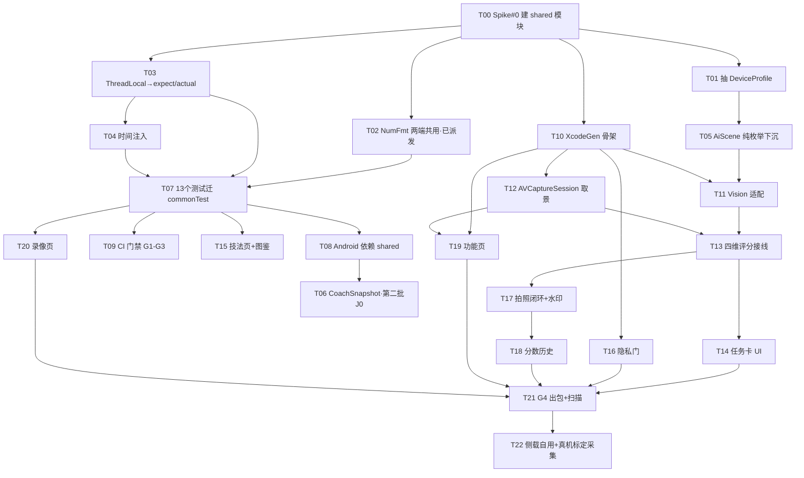

# IOS-ARCH-EXEC · iOS 移植任务分解与工程配置（可直接施工）

> 版本 v1.0 ｜ 作者：高见远（架构师）｜ 基线 `5a6d7c7`（v3.1.0 Android 发布版）
> 上游：`docs/IOS-ARCH.md`（架构设计）、`docs/IOS-PRD.md`（产品定义）、`docs/IOS-TECH-FEASIBILITY.md`（software-architect-2 的工具链/runner 结论，**本文不重复**）
> **只写文档。** 不改任何 Kotlin / Swift / Gradle / XML / YAML。

---

## 0. 施工前必读：5 条已核实事实 + 2 条勘误

### 0.1 已核实事实（我自己跑出来的，不是估算）

| # | 事实 | 值 | 怎么查的 |
|---|---|---|---|
| F1 | 纯 Kotlin（无 `import android*`）文件数（**文件级口径 L1**） | **30 个** | 逐文件扫 `^import android`（**含工程里新增的 `text/NumFmt.kt`、`analysis/FrameStatsCore.kt`** —— 代码在动，数字会变） |
| F2 | 这些文件的总行数 | **8,666 行** | 逐文件 `wc -l` |
| F2b | **类级传递闭包（L2，唯一正确口径）** | **27 个 / 7,786 行** | 解析**显式 import** + **同包引用**（后者不需要 import，扫不出来）。被排除的 3 个即全部 A 类阻塞：`FeatureAdvisor.kt` / `VideoRecommender.kt`（依赖 `DeviceProfile`）+ **`SceneClassifier.kt`（依赖 `AiVisionResult`/`AiScene`，本文原漏）**。⚠️ 口径与数字的权威定义见 **IOS-ARCH §11.2** |
| F3 | 单测文件数 / 用例数 | **13 个 / 217 个 `@Test`** | `app/src/test/java/com/shottuner/app/{analysis,coach,growth,knowledge,sensors,share}` |
| F4 | 单测的 Android 依赖 | **零**（无 android/androidx import、无 Robolectric、无 mock 框架，只用 JUnit4） | `grep -rn "^import android\|Robolectric\|mock"` 全空 |
| F5 | 工具链 | **AGP 8.6.1 / Kotlin 1.9.24 / Gradle wrapper 已在**（`gradlew` 存在） | `build.gradle.kts` |
| F6 | 凭据外置机制已就绪 | `gradle.properties` 被 `.gitignore` 排除、`gradle.properties.example` 已带 `RELEASE_*` 四项模板与 keystore SHA-256 指纹 | `.gitignore` / `gradle.properties.example` |
| F7 | git 基线 | `5a6d7c7`，**无远端**，工作区有 PM 正在改的 `docs/IOS-PRD.md` 与我新增的 `docs/IOS-ARCH.md` | `git log` / `git status` |

### 0.2 勘误（我自己的两处话要更正）

| 项 | 我之前说 | **实际（已用类名映射重算，脚本见 IOS-ARCH §10.1）** |
|---|---|---|
| 纯文件数 | "29 个" | **28 个，是我算术失误**。PM-2 的 28 是对的，我先前暗示"PM 少算了一个"是我错。`device/Brand.kt` 本来就在这 28 个里，且它自包含 |
| 行数 | "PM 的 8,075 未逐一核对" | **PM 的 8,075 完全正确**，逐文件核对后完全吻合。任务说明里的"约 7,748 行"是错的 |
| 可移植口径 | 未区分文件级/类级 | 必须是两层：L1 文件级 28/8,075（**不能用来估工作量**）→ L2 类级闭包 **26/7,336**（唯一正确口径）。**KMP 改造量按 3–4 人日** |

### 0.3 clover 四个决策在设计里的落点

| 决策 | 落点 | 影响 |
|---|---|---|
| **D1 · 端侧识别用 Apple Vision，不引 ML Kit** | `commonMain` 零 ML Kit/Vision 类型 → **`AiScene` 纯枚举直接进 commonMain**（D1 之后**不再**降级为 String，PM-2 指出我的原设计多了一层无谓转换，已改）+ `AiVisionResult` 下沉为纯数据（**T05**）；**平台侧保留标签词表与置信度阈值** | 从"补一条"升为**主路径**。且 Vision 无 Objective-C 依赖 → **`commonMain` 不需要任何 `.cinterop` 绑定**，工程里**零 CocoaPods**（KMP 集成只有 Gradle 一条链路），直击 R5 与 R6 |
| **D2 · 侧载主用 SideStore** | **CI 一律不签名**（§5.2）；7 天续签由 SideStore 设备端 companion 完成 | CI 只出**未签名 ipa**；**Apple ID 绝不进 CI secrets**（已写进 §4.1 的硬规则） |
| **D3 · 第一批不含任何 App Extension** | G4 二进制扫描**提前到第一批**（§4.3）；`project.yml` 只含 1 个 target | Vision 不引第三方 SDK，但**仍需扫描确认没有遥测血统混入**——iOS 没有 Android 侧 `tools:node="remove"` 那层兜底 |
| **D4 · Q6 选 (b)：两端一起修 Locale 缺陷** | `text/NumFmt.kt` **两端共用**（Kotlin 包名沿用 `com.shottuner.app.*` → 两端 import 路径完全一致，**不需要条件编译**）；Android 侧 9 处替换 + de-DE Locale 回归单测 | **该任务已由主理人单独派发给工程师**，见 §2 的 T02 标注 |

---

### 0.4 迁移脚本硬纪律：UTF-8（影响 T01 / T02 / T05 / T07 / T08 的所有搬移与批量改写）

> 来源：PM-2 在 PRD §5.5 提出的产品侧发现 —— **工程源码里已有 3 处非法 UTF-8 字节被固化成 `U+FFFD`**，全在 `MainActivity.kt` 的 KDoc 注释里（功能零影响，但**损坏已永久固化**）。

**实测（我复核）**：损坏点 3 处，全在 `app/src/main/java/com/shottuner/app/MainActivity.kt`：

| 行 | 当前（损坏） | 应为 | 判定依据 |
|---|---|---|---|
| `:512` | `任务痕迹（高亮交点 + 环）` | **`任务痕迹`** | 同句下文「只 `abort()` 不清 Mission…画面上却还挂着一个没有任务在管的灰环」 |
| `:765` | `与 [formatScore] 的第一行同口径` | **`第一行`** | `formatScore` 返回 `"$head\n$dims"`，`head` 正是第一行（`参考分 N · 等级` / `参考分 -- · 有一项未测`） |
| `:2969` | `以前它被归进"沉浸档看不懂的数字"` | **`"沉浸档看不懂的数字"`** | 上下文讲「G1 改动：`tvScoreDetail` 不再跟着档位隐藏」，指的是「沉浸/专业」两档里的沉浸档 |

**⇒ 建议作为独立小改动修掉（3 行、零功能影响、零风险）**：按上表逐字替换。**不要用「容错」方式重写整个文件去「修复」它** —— 那正是下面纪律要禁止的动作。

**四条纪律（所有搬移 / 批量改写脚本必须遵守）**

| # | 纪律 | 原因 |
|---|---|---|
| 1 | **读文件必须严格 UTF-8**：`open(p, encoding='utf-8')` **不加 `errors=` 参数** | `errors='replace'` 会把非法字节**永久固化成 `U+FFFD`**；`errors='ignore'` 会**静默吞掉字节** |
| 2 | **遇到 `UnicodeDecodeError` 立即停下并报告**，不要「换个编码试试」 | 猜编码 = 制造新的损坏。正确做法是**先定位那 3 处已知损坏并修掉**，之后全仓即可严格解码 |
| 3 | **批量改写按字节处理，或「先校验后写入」**：写临时文件 → 严格解码校验通过 → 原子替换 | 直接 `open(w)` 覆盖写一旦中途失败，文件处于半写状态 |
| 4 | ★ **`sed -i` 等按字符处理的工具，必须先确认 locale 是 UTF-8**（`LC_ALL=C.UTF-8`）；**locale 不确定时改用 Python 严格模式** | 在 CP936/GBK locale 下，`sed` 的正则与替换会**按多字节字符重新切分中文** → 批量改写中文文件时静默损坏。**Windows Git Bash 默认可能是 CP936** |

**我自己这次会话的做法（供对照）**：我改文档用的是 `sed -i` + Python。**已自查**：`locale` = `C.UTF-8`，且我用 `grep -c $'\ufffd'` 验证了本次改动过的 5 份文档（`IOS-ARCH.md` / `IOS-ARCH-EXEC.md` / `ARCH-v1.5-merge.md` / `UI-v2-design.md` / `RELEASE-ARCH.md`）—— **全部 0 处损坏**。
→ 但这条纪律仍然要写进规范：**因为下一次在另一台机器、或换了 shell 环境，locale 可能是 CP936**。

**验收**：全部搬移与改写完成后，`grep -rn $'\ufffd' app/src/ shared/src/ docs/` **零命中**（含新增文件）。

---

## 1. 最终模块结构

### 1.1 目录树（具体到文件路径）

```
shottuner/
├── build.gradle.kts                      ← 新增 shared 模块声明
├── settings.gradle.kts                   ← include(":shared")
├── gradle.properties                     ← 不入库（本地/CI secret）
├── gradle.properties.example             ← 新增 shared 相关说明
├── .github/workflows/
│   ├── ci-linux.yml                      ← 新增：G1 静态合规 / G2 commonMain 可编译 / G3 commonTest
│   └── ci-release.yml                    ← 新增：G4 完整出包 + 二进制扫描（macOS，手动/tag 触发）
├── shared/                               ← ★ 新增模块：KMP 共享内核
│   ├── build.gradle.kts                  ← kotlin("multiplatform") 1.9.24
│   │                                       namespace = "com.shottuner.app.shared"
│   │                                       androidTarget + iosArm64 + iosSimulatorArm64
│   └── src/
│       ├── commonMain/kotlin/com/shottuner/app/
│       │   ├── analysis/
│       │   │   ├── CompositionAnalyzer.kt     250 行  ← T02 改格式化
│       │   │   ├── SceneClassifier.kt          137 行
│       │   │   ├── ScoreBoard.kt               364 行
│       │   │   ├── SharpnessMeter.kt           115 行
│       │   │   ├── AiScene.kt                 ★新增 ← T05（纯枚举，8 值 + 中文 label）
│       │   │   └── AiVisionResult.kt          ★新增 ← T05（下沉，纯数据）
│       │   ├── coach/FramingCoach.kt           203 行
│       │   ├── device/
│       │   │   ├── Brand.kt                    244 行  ← iOS 传 Brand.OTHER
│       │   │   └── DeviceProfile.kt            ★新增 ← T01 抽取（LensInfo/VideoCaps/DeviceProfile）
│       │   ├── feature/FeatureAdvisor.kt       311 行  ← T02 改格式化
│       │   ├── growth/
│       │   │   ├── DexEntry.kt                  47 行
│       │   │   ├── MissionEngine.kt            262 行
│       │   │   ├── MissionTask.kt              124 行
│       │   │   ├── ScoreHistory.kt             438 行  ← T04 时间注入
│       │   │   ├── TaskPicker.kt               191 行
│       │   │   └── TechniqueDex.kt             370 行  ← T03/T04
│       │   ├── knowledge/
│       │   │   ├── PhotographyBook.kt         1139 行
│       │   │   ├── PromptEngine.kt             534 行  ← T02 改格式化
│       │   │   ├── PromptScheduler.kt          367 行
│       │   │   ├── PromptSignals.kt            114 行
│       │   │   ├── Technique.kt                123 行
│       │   │   ├── TechniqueBookV15.kt        1322 行
│       │   │   ├── TechniqueMatcher.kt         262 行
│       │   │   └── VideoMovePlanner.kt          80 行
│       │   ├── model/
│       │   │   ├── CompositionHint.kt          63 行
│       │   │   ├── FrameStats.kt                82 行
│       │   │   ├── ManualParams.kt              13 行
│       │   │   └── Recommendation.kt            68 行  ← T02 改格式化
│       │   ├── recommend/ParamRecommender.kt   299 行
│       │   ├── sensors/LevelMath.kt            125 行  ← T02 改格式化
│       │   ├── video/VideoRecommender.kt       428 行  ← T02 改格式化
│       │   ├── text/
│       │   │   └── NumFmt.kt                   ★新增 ← T02（locale 无关定点格式化）
│       │   └── coach/                          （T06 新增 CoachSnapshot.kt，第二批）
│       │       └── CoachSnapshot.kt            ★新增 ← T06（扁平 DTO）
│       ├── commonTest/kotlin/com/shottuner/app/
│       │   ├── analysis/ScoreBoardTest.kt      330 行
│       │   ├── coach/FramingCoachTest.kt       213 行
│       │   ├── growth/{DexStoreTest,MissionEngineTest,ScoreHistoryTest,TaskPickerTest}.kt
│       │   ├── knowledge/{PhotographyBookTest,PromptEngineTest,PromptSchedulerTest,
│       │   │               TechniqueBookV15Test,TechniqueMatcherTest}.kt
│       │   ├── sensors/LevelMathTest.kt        131 行
│       │   └── share/WatermarkTest.kt          253 行  ← 平台相关，见 T07 注
│       ├── androidMain/kotlin/com/shottuner/app/
│       │   └── growth/DexClock.android.kt     ★新增 ← T03（DexClock 整块搬来；★ expect/actual 数量 = 0）
│       └── iosMain/kotlin/com/shottuner/app/   （★ 无 expect/actual 需求 → 可为空）
├── app/                                   ← 现有 Android 模块（保留，逐步瘦身）
│   └── src/main/java/com/shottuner/app/    ← 18 个 Android 文件原地不动
│       └── ... （T08 后 app 依赖 :shared，不再自带那 28 个文件）
└── ios/                                   ← ★ 新增：XcodeGen 工程
    ├── project.yml                         ★新增 ← T10（单一事实来源，不提交 .xcodeproj）
    ├── ShotTuner/
    │   ├── App/            (SwiftUI 视图)
    │   ├── Camera/         (AVFoundation + Vision 适配层)
    │   ├── Info.plist
    │   └── ShotTuner.entitlements
    └── ShotTunerTests/
```

### 1.2 三个关键设计确认

| # | 设计 | 确认理由 |
|---|---|---|
| K1 | **Kotlin 包名沿用 `com.shottuner.app.*` 不改** | 28 个文件的 `package`/`import` 全部是 `com.shottuner.app.*`，**搬进 shared 时一行 import 都不用改，只需移动目录**。改包名 = 28 文件 × N 行 import + `import com.shottuner.app.databinding.*` 的连带风险，收益为零 |
| K2 | **`shared` 的 Gradle `namespace = "com.shottuner.app.shared"`** | KMP 的 namespace 只决定本模块生成的 `R`/`BuildConfig` 归属；**Kotlin 包名与 namespace 无关**，所以 commonMain 代码里仍是 `com.shottuner.app.*`，两者不冲突。若把 namespace 也设成 `com.shottuner.app`，会和 `app` 模块的 `com.shottuner.app.R` / `databinding` 归属歧义 |
| K3 | **`commonMain` 不需要任何 `.cinterop` 绑定** | D1 决定用 Vision → 无 Objective-C 依赖 → 不需要 `cinterop` 生成绑定代码。**这是 Kotlin/Native 编译速度的重要保障**（每个 cinterop 都要生成并编译一层 C 互操作代码） |

### 1.3 `expect/actual` 总清单（**只有 2 个，不许增加**）

| expect 声明 | android actual | ios actual | 用在哪 |
|---|---|---|---|
| **（无）** | — | — | ★ **v1.1：expect/actual 数量 = 0**。`DexClock` 整块搬 androidMain（T03）、`ScoreHistory` 注入 `now`（T04）→ 不需要任何 expect。详见 IOS-ARCH §11.5 |

> **纪律**：`expect` 每多一个，Kotlin/Native 就要多生成一套平台代码（PRD R6 已把编译慢列为中高风险）。**能用入参解决的绝不用 expect** —— 这就是 `ScoreHistory` / `DexClock` 改成注入 `now` 的原因（与 `PromptScheduler` 既有风格同构）。

---

## 2. 迁移任务序列

> **并行标记**：✅可并行 / ⛔必须串行。
> **每个任务的验收都是可执行、可判定的命令或断言。**

### A 组 · 共享内核（**全部不依赖 Mac，Linux runner 即可**）

#### T00 · Spike #0：commonMain 可编译性最小实验 ★第一批第一个任务

| 项 | 内容 |
|---|---|
| 依赖 | 无 |
| 文件 | `shared/build.gradle.kts`、`shared/src/commonMain/kotlin/com/shottuner/app/**`（29 文件搬入）、`settings.gradle.kts` |
| 动作 | ① 建 `shared` 模块（Kotlin 1.9.24，`androidTarget()` + `iosArm64()` + `iosSimulatorArm64()`）；② **原样复制** 28 个文件进去（此步**不改任何一行**）；③ `namespace = "com.shottuner.app.shared"`；④ 跑一次编译，**把报错清单固化成一份基线文档** `docs/spike0-baseline.md` |
| **验收** | ① `./gradlew :shared:compileKotlinIosSimulatorArm64` 的报错集合 **恰好等于 IOS-ARCH §1 的 13 处**（A 类 1 + B 类 9 + C 类 2 + ThreadLocal 1），**不多不少**——多一处说明还有没盘出来的依赖；② Android 侧零变化：`./gradlew :app:assembleDebug` 通过、217 个 `@Test` 全绿 |
| **★ 可证伪判据（写在验收里，不是描述里）** | **若 KMP 编译链本身走不通**（`compileKotlinIosSimulatorArm64` 在 Linux 与 macOS 上都失败，或 Kotlin/Native 工具链无法在无 Mac 环境产出 klib），**立刻停下来重评「KMP 共享内核 vs 纯 Swift 重写内核」，不要在错误路线上继续投 3–4 人日**。判定口径：Linux 上跑不出 klib 且 macOS 不可得 → 判定"走不通"，当场出 1 页结论交 team-lead 决策 |
| 并行 | ⛔ 独占（后续所有任务都依赖它）。**按主理人要求单独排，不与其它任务并行**，产出的基线文档（`docs/spike0-baseline.md`）归档 |
| 量级 | 1 人日 |

> **这一步的价值**：它是整条路线的第一个可证伪点。**不依赖 Mac、不出包、3 分钟一轮、可在 Linux runner 跑。** 若真实报错远多于 13 处 → 说明 KMP 路线的成本被低估，应立刻回头重估排期，而不是继续往前堆。

#### T01 · 抽 `device/DeviceProfile.kt`（A 类跨文件依赖，**必须早于任何 commonMain 编译**）

| 项 | 内容 |
|---|---|
| 依赖 | T00 |
| 文件 | 新增 `shared/.../device/DeviceProfile.kt`；改 `app/.../device/HardwareProbe.kt`（只留 `object HardwareProbe`） |
| 动作 | 把 `LensInfo`(:14-39) / `VideoCaps`(:42-77) / `DeviceProfile`(:86-153) 原样搬进新文件；`DeviceProfile.companion.unknown()` 里的 `Build.*` **移出**到 Android 侧 `HardwareProbe.unknownProfile()`；`LensInfo.label` 的 2 处 `%.1f` 换成 `NumFmt`（若 T02 已完成则直接引用，否则本任务内先内联一个私有实现） |
| **验收** | ① `grep -rn "import android" shared/src/commonMain/device/` **零命中**；② `./gradlew :shared:compileKotlinIosSimulatorArm64` 的报错里 **不再出现 `DeviceProfile`/`VideoCaps`/`LensInfo` 的 unresolved reference**；③ `./gradlew :app:assembleDebug` 通过 + 217 测试全绿（Android 行为零变化） |
| 并行 | ✅ 可与 T02 / T03 并行（但 T05 依赖它） |

#### T02 · `text/NumFmt.kt` + 替换 9 处格式化 ★**已由主理人单独派发，不在本序列内**

| 项 | 内容 |
|---|---|
| 状态 | **已由主理人指派给工程师单独实施**（含 Locale 回归单测）。本序列**不重复列出**，只保留 common 侧形态约束，供 T01 之后搬文件时对齐 |
| common 侧形态约束 | ① 文件最终落在 `shared/src/commonMain/kotlin/com/shottuner/app/text/NumFmt.kt`；② **Kotlin 包名 `com.shottuner.app.text` 不变** → 两端 import 路径完全一致，不需要条件编译；③ **只暴露无 locale 依赖的入口**：`fixed(value, decimals)` / `pct(value)`，**不提供** `format(locale, ...)`（否则调用方会传 `Locale.getDefault()`，德语区 `1,5` 的 bug 原样复现）；④ 回归单测必须含：显式 `de-DE`/`fr-FR` Locale 下输出仍为 `1.5`；`-0.0`→`0`；`decimals=0/1/2`；`0.05`→`0.1`；替换前后输出**逐字相同** |
| 与本序列的接口 | T02 完成后，**T07（测试迁 commonTest）才能带上 `de-DE` 那条新断言**；若工程师先交付 Android 侧版本，common 侧只需把同一个文件搬到 `shared` 下即可 |

**★ 现状（#19 已产出 `text/NumFmt.kt` + `NumFmtTest.kt`）与剩余工作**

`NumFmt` 已实现且**形态完全符合 D5**：包名 `com.shottuner.app.text`、只暴露 `one` / `fixed` / `signed` / `int` 四个 locale 无关入口、**无 `format(locale, ...)` 重载**、16 个单测（含 de-DE / fr-FR 显式切 Locale 的回归、`-0.0` 归一、非有限值占位、科学计数法进位）。
→ **剩余工作只有一件事：切换调用点。** 且 **`signed()` 已经存在**（PM 建议的「补一个带符号入口」已提前做掉）。

**全仓 13 处格式化调用点的权威拆解**（我自己逐行扫出来的，含注释过滤）

| 桶 | 处数 | 调用点 | 处置 |
|---|---:|---|---|
| **① 纯数值（common 边界内）** | **9** | `analysis/CompositionAnalyzer.kt:188`（倾斜角）<br>`device/HardwareProbe.kt:36`（光圈）、`:37`（MP）<br>`feature/FeatureAdvisor.kt:138`（档数）、`:309`（秒）<br>`knowledge/PromptEngine.kt:152`（百分比）<br>`model/Recommendation.kt:63`（快门秒）<br>`sensors/LevelMath.kt:41`（toString）<br>`video/VideoRecommender.kt:328`（快门秒） | **T02 切** → 全部换 `NumFmt` |
| **② 日期格式化** | **3** | `growth/TechniqueDex.kt:265`（`yyyyMMdd`）<br>`diag/Diag.kt:129`（日志时间戳，**已用 `Locale.US`**）<br>`MainActivity.kt:2178`（拍照文件名） | `TechniqueDex` → **T03/T04 的 expect/actual**；`Diag` → **已在 Android 层且已锁 `Locale.US`，不动**；`MainActivity:2178` → Android UI 层，随文件名策略一起处理 |
| **③ 带符号曝光偏差** | **1** | `MainActivity.kt:3007` `String.format("%+.1f", ev)` | ★ **T02 一并切** → `NumFmt.signed(ev, 1)` |
| | **13** | | |

> **③ 为什么必须切**：它不进 commonMain，但它**是用户最常看的数值**（「+0.3 EV」在照片页常驻）。不切就会留下「其它数字都对了，唯独曝光偏差在德语区还是 `+0,3`」的漏网之鱼 —— **口径不一致比小数点错误更伤**（与 D5 同一个道理）。
> **切了不会改行为**：`formatEv` 有 `abs(ev) < 0.05f → "±0"` 的短路，负零不可达；`NumFmt.signed` 对负值手动加 `-`，与 `%+.1f` 的输出一致。

> ⚠️ **给 PM 的拆解订正**（PRD §0.2 按此写）：**13 处的正确分桶是「9 纯数值 + 3 日期 + 1 带符号 EV」**，不是「9 + 2 + 2」—— `MainActivity:2178`（拍照文件名，日期）在那两种分法里被重复计了一次，而 `diag/Diag.kt:129`（日志时间戳，也是日期）一次都没被计入。**总数 13 没错，桶归属要按上表**（`Diag` 那一处已经在 Android 层且已锁 `Locale.US`，不需要任何动作）。

**★ 第 14 类改造：`java.lang.Math`（5 处 / 5 个文件，在 common 边界内）**

`java.lang` 是**自动导入**的 → `import java.*` 扫描必然漏 → **我原设计漏了这一类**（architect-2 指出，已复核确认）。**commonMain 里没有 `Math` 类**（Kotlin 只有 `kotlin.math`）。

| 文件:行 | 调用 | 改法 | 注意 |
|---|---|---|---|
| `analysis/CompositionAnalyzer.kt:160` | `Math.toDegrees(...)` | 自己写 `x * 180.0 / PI` | `kotlin.math` 无 `toDegrees` |
| `analysis/SceneClassifier.kt:85` | `Math.abs(...)` | → `kotlin.math.abs` | 直接换 |
| `model/FrameStats.kt:70` | `Math.log(x)` ×2 | → `kotlin.math.ln`；这里要 log2 → `ln(x) / ln(2.0)` | `kotlin.math.ln` == `Math.log`（自然对数） |
| `model/Recommendation.kt:66` | `Math.round(1.0/sec)` | ⚠️ **不可机械替换，见下** | **用户可见的快门标签** |
| `sensors/LevelMath.kt:69` | `Math.PI` | → `kotlin.math.PI` | 直接换 |

**另 2 处在 Android 层，不进 common，无需改**：`device/OrientationTracker.kt:103/104`、`ui/GuideOverlayView.kt:414`。

**🔴 `Math.round` 的语义陷阱（T02 必修项）**

| 写法 | 返回 | `2.5` | 平局方向 |
|---|---|---|---|
| `java.lang.Math.round(Double)` | `Long` | **3** | **向 +∞** |
| `kotlin.math.round(Double)` | `Double` | **2.0** | **平局向偶数** |

用在 `Recommendation.shutterLabel` → **用户直接看到的 `1/60`、`1/125`**。换错 → `1/2` vs `1/3` 的可见差异。
**正确改法**：显式实现「向 +∞ 取整」，**不要用 `kotlin.math.round`**：`kotlin.math.floor(1.0 / sec + 0.5).toInt()`（`1.0/sec` 恒正，等价）。
> `NumFmt.roundHalfAwayFromZero`（半值**远离零**）对正数与「向 +∞」等价 → 当前安全，但**语义名不同**，将来这个值若可能为负必须重新对齐。**建议在调用处加注释**：「这里要的是向 +∞，不是远离零」。

**★ 两个同名私有 `pct()` 要合并**：`PromptEngine.kt:152` 与 `FeatureAdvisor.kt:305` 各实现了一份。
**处置：不把 `pct()` 加进 `NumFmt`**（`NumFmt` 只做**通用定点格式化**，百分比是语义不是格式）→ **把两处私有实现合并成一个共享 helper**，或直接用 `NumFmt.fixed(value * 100, 0)`。

**★ `NumFmt` 最终要「移动」到 shared，不能「复制」**
`text/NumFmt.kt` 目前在 **Android 模块**（`app/src/main/java/.../text/`）→ 最终必须**移动**到 `shared/src/commonMain/kotlin/com/shottuner/app/text/`。
⚠️ **复制会在 Android 侧产生两个同名类 → dex merge 报 duplicate class**。
✅ 移动后 Android 侧 `import com.shottuner.app.text.NumFmt` **路径不变**（Kotlin 包名沿用 `com.shottuner.app.*`）→ **调用点一行都不用改**。

#### T03 · `DexClock`（SimpleDateFormat + Date + Locale + ThreadLocal）**整块搬进 androidMain**

| 项 | 内容 |
|---|---|
| 依赖 | T00 |
| 文件 | 新增 `shared/src/androidMain/.../growth/DexClock.android.kt`；改 `shared/.../growth/TechniqueDex.kt`（删掉 `object DexClock`）、`app/.../growth/DexStore.kt`（改 import 指向 androidMain 实现） |
| 动作 | ★ **不再用 `expect/actual` 桥接**（architect-2 的方案，比我原设计优）：`DexClock` **只被 `growth/DexStore.kt`（Android 层）使用**（`:136/:173/:216`）→ **整块搬到 androidMain** 即可，common 侧 `TechniqueDex` 保持纯算法。**`ThreadLocal` 不是要「消灭」，是要「搬到它该在的那一层」** —— `java.lang.ThreadLocal` 在 androidMain 里完全可用 |
| **验收** | ① `grep -rnE "SimpleDateFormat\|java\.util\.Date\|java\.util\.Locale\|ThreadLocal" shared/src/commonMain/` **零命中**（`TechniqueDex.kt` 里的 `DexClock` 已移走）；② `grep -rn "DexClock" shared/src/commonMain/` **零命中**；③ `grep -rn "DexClock.today()" app/` 仍能编译（改 import 即可）；④ **`expect/actual` 声明总数 = 0**（`grep -rc "^expect " shared/src/commonMain/` → 0）；⑤ `DexStoreTest`（564 行）全绿 |
| 并行 | ✅ 可与 T01 / T02 并行 |

> **为什么不用 `expect/actual`**：`expect/actual` 每多一个，Kotlin/Native 就要多生成一套平台代码（PRD R6 已把编译慢列为中高风险）。`DexClock` 只有 Android 侧用 → **直接搬走，`expect` 数量从 2 降到 0**。这正是「能用入参解决的绝不用 expect」纪律的完整落地。

#### T04 · 时间注入（2 处 `System.currentTimeMillis()`）

| 项 | 内容 |
|---|---|
| 依赖 | T00、T03 |
| 文件 | 改 `growth/ScoreHistory.kt:153`、`growth/TechniqueDex.kt:272` |
| 动作 | `ScoreHistory` 的公共 API 增 `now: Long` 参数（与 `PromptScheduler` 既有风格一致）；`DexClock.today(now: Long)`；`expect fun currentTimeMillis()` 只作最终兜底 |
| **验收** | ① `grep -rn "System.currentTimeMillis" shared/src/commonMain/` **零命中**（注意：**必须排除注释行**，`PromptScheduler.kt:69` 的注释里就写着它）；② `ScoreHistoryTest`（272 行）全绿且**新增一条**"注入固定 `now` → 窗口边界确定"的断言（原来无法测的时间行为现在可测了）；③ **`expect/actual` 声明总数 = 0**（T03 完成后本任务不引入任何 expect） |
| 并行 | ⛔ 依赖 T03 |

#### T05 · `AiScene` 纯枚举 + `AiVisionResult` 下沉到 commonMain

| 项 | 内容 |
|---|---|
| 依赖 | T01 |
| 文件 | 新增 `shared/.../analysis/AiScene.kt`（**纯枚举，8 个值 + 中文 label**）、`shared/.../analysis/AiVisionResult.kt`（下沉）；改 `app/.../analysis/AiVision.kt`（保留 ML Kit 调用与 `decide()`）、`app/.../analysis/SceneClassifier.kt`、`app/.../coach/FramingCoach.kt`、`app/.../feature/FeatureAdvisor.kt` |
| 动作 | ★ **D1 之后不再把 `AiScene` 降级为 String —— 纯枚举直接进 commonMain**（枚举本身零依赖；真正与平台绑定的是「标签词表」与「置信度阈值」，那两项留在平台侧）。commonMain 承接：`AiScene` 枚举、`AiVisionResult`、`FaceBox`。平台侧保留：Android 的 ML Kit 标签集合 + `decide()` + 阈值；iOS 的 Vision 标识符映射表 + 阈值 |
| **验收** | ① `grep -rn "com.google.mlkit" shared/src/commonMain/` **零命中**（**D1 决策的硬验收**）；② `grep -rn "import com.google\|import android" shared/src/commonMain/` **零命中**；③ Android 侧 217 测试**一个不改就全绿**（行为零变化）；④ `shared` 编译产物里**无 `.cinterop` 生成目录**（D1 带来的一笔额外收益：无 Objective-C 绑定 → Kotlin/Native 编译更快）；⑤ **`AiScene` 在 commonMain 里只有 1 份**，全仓无第二份定义（`grep -rn "enum class AiScene"` 命中数 = 1）；⑥ ★ **A 类第三条阻塞同步关闭**：`analysis/SceneClassifier.kt` **同包引用**（不需要 import，import 扫描扫不出来）`AiScene` / `AiVisionResult` —— 它们定义在 `analysis/AiVision.kt`（import `android.graphics.Bitmap` + ML Kit）→ **本任务把这两个类型下沉到 common 后，`SceneClassifier` 自动回到可搬闭包内**。验收加一条：`grep -rn "AiVisionResult\|AiScene" shared/src/commonMain/analysis/SceneClassifier.kt` 命中且 **commonMain 内无 ML Kit 类型** |
| 并行 | ✅ 可与 T02 / T03 并行 |

#### T06 · `CoachSnapshot` 扁平 DTO ★**PRD §6.2 定稿，已做字段对齐复核；属第二批第一项（PRD J0）**

| 项 | 内容 |
|---|---|
| 依赖 | **T08**（common 已就位；本 DTO 只依赖 common 的领域对象产出，不依赖任何平台代码） |
| 文件 | 新增 `shared/.../coach/CoachSnapshot.kt` |
| 动作 | 按 PRD §6.2 定义扁平 DTO（**字段清单以 PRD 为准，本节是实现侧对齐结果**） |
| **验收** | ① 该文件**不得 import 任何其它 common 领域类**（`grep` 判定，只允许 Kotlin 标准库）；② 新增单测：从 `MissionEngine` + `ScoreBoard` 的真实输出转成 `CoachSnapshot` 的**快照断言**；③ 序列化可行性：Kotlinx-serialization 不引，则提供 `toMap(): Map<String, Any?>` 供 Swift 侧转 Codable（**不要在 common 做 JSON**）；④ **字段名与 PRD §6.2 逐字一致**（见下方清单） |
| 并行 | ⛔ 依赖 T05 |

**最终字段清单（PRD §6.2 定稿 → 实现侧逐字落地）**

```kotlin
// commonMain —— 扁平 DTO，零平台依赖，零领域对象嵌套
class CoachSnapshot(
    val taskTitle: String,        // 当前任务一句话，如「把主体挪到右上交点」
    val action: String,           // 用户该做的动作，如「向右上移动 15cm」
    val score: Int?,              // 总分；null = 未测全 → 显示「参考分 --」（0 分是真 0 分）
    val scoreLabel: String,       // 等级词（良好/一般…）；未测全时为空串
    val hintLine: String,         // 一行建议（锁屏小组件 / 灵动岛最小形态）
    val levelScore: Int?,         // 水平   未测为 null
    val exposureScore: Int?,      // 曝光
    val compositionScore: Int?,   // 构图
    val clarityScore: Int?,       // 清晰
    val isoAdvice: String,        // ISO 建议值文案（common 侧已格式化）
    val shutterAdvice: String,    // 快门建议值文案
    val whiteBalanceAdvice: String, // 色温建议值文案
    val achieved: Boolean         // 任务是否到位（驱动引导环绿/灰）
)
```

**字段对齐复核的 5 条结论（PRD → 实现）**

| # | 结论 | 理由 |
|---|---|---|
| A1 | **删掉我原设计里的 4 个 `measured` 布尔** | PRD 的「四个维度分 `Int?`」里，**`null` 本身已经表达「未测」** → 再加 4 个 `measured` 是冗余，且多出 4 个字段要两端同步（PRD 要防的正是这个） |
| A2 | **四个维度分用具名字段，不用数组** | `levelScore/exposureScore/compositionScore/clarityScore` —— 扩展侧按名取值比按下标安全（加字段不会错位）；PRD 写的是「四个维度分 `Int?` ×4」，具名化不改变语义 |
| A3 | ★ **`CoachSnapshot` 与「复盘卡的三条建议」是两个东西，不要混** | PRD §6.2 的「三项建议参数 = ISO/快门/WB 的**已格式化字符串**」是**扩展侧最小契约**（灵动岛放不下带 tipId 的建议列表）。**App 内复盘卡**要的是「≤3 条建议 + 可点进技巧详情」，那来自 common 已有的 `ScoreResult.suggestions`（带 `tipId`），**走 App 内，不进扩展契约**。若混在一起，扩展侧会出现"想跳技巧详情"的错位需求 |
| A4 | **`achieved` 必须复用 Android `MissionEngine` 的同一套达成判定** | 它是"任务是否到位"，**不是分数达标**。common 化后两端同源；**若两端各判各的，就会出现"App 里说没到位、灵动岛说到位"** —— 正是 PRD §6.2 要防的「4 套口径」 |
| A5 | **三段字符串 + 三项建议参数一律在 common 侧格式化好（locale 无关）**，扩展侧只搬运 | 与 D5 的 `NumFmt` 纪律同源：**格式化的唯一权威在 common**。T02 已派发的 `NumFmt` 正是这条的执行体 → `isoAdvice/shutterAdvice/whiteBalanceAdvice` 必须走 `NumFmt`，**不得在 Swift 侧拼数字** |

**Swift 侧承接（第二批 J1/J2/J3/J5 用）**

```swift
// Swift 侧 Codable DTO：字段名与 Kotlin 侧 camelCase 同名，避免映射表
struct CoachSnapshotCodable: Codable {
    let taskTitle: String
    let action: String
    let score: Int?                 // nil → UI 显示「参考分 --」
    let scoreLabel: String
    let hintLine: String
    let levelScore: Int?
    let exposureScore: Int?
    let compositionScore: Int?
    let clarityScore: Int?
    let isoAdvice: String
    let shutterAdvice: String
    let whiteBalanceAdvice: String
    let achieved: Bool
}
```
> **不要在 Swift 侧做格式化**（不要 `String(format:)`，不要自己拼小数）—— 一律搬运 common 给好的字符串。

#### T07 · 13 个测试文件迁入 `shared/src/commonTest`

| 项 | 内容 |
|---|---|
| 依赖 | T01、T02、T03、T04 |
| 文件 | `shared/src/commonTest/kotlin/com/shottuner/app/**`（13 文件） |
| 动作 | 原样迁入（**F4：全部零 Android 依赖，可逐字搬**）。唯一例外：`share/WatermarkTest.kt`（253 行）测的是 Android 端水印绘制 → **留在 `app` 侧**，不进 commonTest |
| **验收** | ① `./gradlew :shared:testDebugUnitTest` 通过，**用例数 = 217 − WatermarkTest 的用例数**；② `app/src/test` 里对应文件删除后，`./gradlew :app:testDebugUnitTest` 仍全绿；③ **每个用例的断言内容一字未改**（用 `git diff` 判定：只改了文件位置，没改断言）——这一步是"移植没改变行为"的唯一硬证据 |
| 并行 | ⛔ 依赖 T02/T03/T04 |

#### T08 · Android 侧改为依赖 `shared`（app 模块瘦身）

| 项 | 内容 |
|---|---|
| 依赖 | T07 |
| 文件 | `app/build.gradle.kts`（加 `implementation(project(":shared"))`）、`app/src/main/java/com/shottuner/app/**`（删掉已迁走的 28 个文件）、`app/src/test/**`（删掉已迁走的 12 个测试） |
| 动作 | Android 模块从"自带内核"变成"依赖共享模块"。**这是 KMP 的最终形态**——两端共用一份源码 |
| **验收** | ① `./gradlew :app:assembleDebug` 通过；② `git status` 显示 `app/src/main` **净减少 ≥ 8,075 行**；③ APK 体积变化 ≤ +1%（Kotlin runtime 已被现有依赖引入）；④ 217 个测试（迁走的在 `:shared` 跑，Watermark 在 `:app` 跑）**全部通过** |
| 并行 | ✅ 可与 T09 并行 |

#### T09 · CI 门禁 G1 / G2 / G3 上线

| 项 | 内容 |
|---|---|
| 依赖 | T07（**不依赖 T08** —— 门禁先立，迁移再收） |
| 文件 | `.github/workflows/ci-linux.yml`、`tools/ci/check-common-purity.sh`、`tools/ci/check-no-network.sh`、`tools/ci/check-apple-credentials.sh`（新增）、`tools/ci/patterns/network.txt`（新增：禁用符号清单，与脚本分离） |
| 动作 | 见 §4.1 / §4.2 / §4.5 |
| **验收** | ① **故意提交一条违规代码**（在 commonMain 里写 `java.io.File`）→ CI 必须红；② 故意在 `ios/**/*.swift` 里写 `URLSession.shared.dataTask` → G1 必须红；③ 两条都改回来 → 全绿；④ **反向验证（必须绿，不得红）**：把 `URLSession` 这个词分别写进①一条注释、②`docs/**/*.md` 的散文、③`tools/ci/patterns/network.txt` 清单文件本身 → **CI 必须仍然是绿的**（见 §4.5 的三个自引用坑）；⑤ 把 `APPLE_ID`/`APP_SPECIFIC_PASSWORD`/`IssuerID`/`.p8` 任一串写进仓库任意文件 → G1-d 必须红 |
| 并行 | ✅ 可与 T08 并行 |

> **仓库尚未建好这件事，不阻塞本任务。** 当前状态：GitHub 连接器用的是 **GitHub App 集成令牌**，`POST /user/repos` 返回 `403 Resource not accessible by integration` —— 这类令牌**没有创建仓库的权限**，只能操作已存在且已授权给该 App 的仓库；账号 `1912811308-boop` 目前 0 仓库。**建仓库必须走账号自己的 PAT / SSH key，或直接在网页上建**（team-lead 处理中）。**本任务的依赖关系、验收标准、门禁设计都不依赖仓库是否已存在**，照原计划推进即可。

---

### B 组 · iOS 第一批（SwiftUI 侧）

> 顺序依据：**先让相机出画面**（T12），再接算法（T13），再叠交互（T14）。理由：取景是所有反馈的前提，且它的不确定性最高（AVFoundation 的坑最多），越早暴露越好。
> 全部依赖 T10（工程骨架）与 T07（common 可用）。

#### T10 · XcodeGen 工程骨架

| 项 | 内容 |
|---|---|
| 依赖 | T00 |
| 文件 | 新增 `ios/project.yml`、`ios/ShotTuner/Info.plist`、`ios/ShotTuner/ShotTuner.entitlements` |
| 动作 | 单 target（**D3：第一批无任何 App Extension**）；`deploymentTarget iOS 16.1`；`MARKETING_VERSION 3.1.0` / `CURRENT_PROJECT_VERSION 1`（**独立从 1 起算**）；Run Script 调 `:shared:embedAndSignAppleFrameworkForXcode` |
| **验收** | ① `xcodegen generate` 产出 `.xcodeproj` 且 `xcodebuild -list` 能列出 target；② **CI 上生成成功**（这一步在 Linux 上做不了 → 需要 macOS runner → 首次验证可能消耗 1 次 macOS 配额）；③ **`.xcodeproj` 不入库**（`.gitignore` 补 `ios/*.xcodeproj/`）；④ Info.plist 三个权限说明字符串齐全（相机 / 仅添加相册 / 无需麦克风——**因为 Android 版本就不做真实录制**） |
| 并行 | ✅ 可与 A 组并行 |

#### T11 · Apple Vision 场景识别适配层（**D1 的落地，实现规格见 IOS-ARCH §10.2**）

| 项 | 内容 |
|---|---|
| 依赖 | T05、T10 |
| 文件 | `ios/ShotTuner/Camera/VisionSceneDetector.swift`（+ 产出 `VisionSceneMap` 常量表） |
| 动作 | ① `VNDetectFaceRectanglesRequest`（脸数/面积/中心/朝向）→ `AiVisionResult` 的 face 系字段；② `VNClassifyImageRequest` → **Vision 标识符 → `AiScene` 映射表**（规格见 IOS-ARCH §10.2.2/§10.2.3：**前缀匹配 + 多标签聚合 + 独立阈值**，映射表**真机采集后固化**，不凭记忆写）；③ 映射结果直接产出 common 的 `AiScene` 枚举（**无 String 中转**） |
| **验收** | ① 产出的 `AiVisionResult` 字段与 Android 侧**逐字段可对照**（产出一张对照表）；② 同一张测试图，Vision 与 ML Kit 的 `faceCount` / `faceArea` 差异 **< 5%**；③ **零第三方依赖**（`Package.swift` 不存在，或 `dependencies` 为空）；④ 映射表由**真机采集**产出并**锁进测试**（换 Vision revision 时只更新表，不改逻辑）；⑤ **置信度阈值独立标定**（不照搬 Android 的 `0.5f`——Vision 常见 0.77 已是强结果，`0.5f` 会静默返回空结果）；⑥ **`perform(_:)` 不在主线程调用**，且**≤10fps 节流**、与 1Hz 评分管线解耦 |
| **★ 真机约束（PM 已查证并写入 PRD §7.2）** | `VNClassifyImageRequest` **模拟器不可用** → 「分类无结果」在模拟器上是**预期行为不是 bug**。**QA 验收计划必须显式标注真机**，否则会被误判为回归。测试策略：模拟器只跑「不崩溃 + 人脸路径」，分类映射全部真机跑 |
| **★ 标定窗口** | 映射表与阈值**不是靠写代码定出来的**，靠 **T22 的 CAL-1 真机标定采集**（样张 → dump 原始标识符与置信度 → 归族 → 回填 → 锁测试）。**T11 的验收只能验"机制通"，不能验"映射准"** —— 后者归 T22 验收 C |
| 并行 | ✅ 可与 T12 并行 |

#### T12 · AVCaptureSession 取景 + 帧分析

| 项 | 内容 |
|---|---|
| 依赖 | T10 |
| 文件 | `ios/ShotTuner/Camera/CameraSession.swift`、`ios/ShotTuner/Camera/FrameStatsProducer.swift` |
| 动作 | `AVCaptureSession` + `.videoDataOutput`（`CVPixelBuffer` → 降采样 → 统计量）+ `.photoOutput`；产出 **common 的 `FrameStats`**（不是自定义结构） |
| **验收** | ① **★ 同一张固定测试图喂给两套分析器，产出的 `FrameStats` 逐字段差异 ≤ 2%**（`meanLuma`/`centerLuma`/`clipHigh`/`clipLow`/`gridLuma` 各格）；② 取景首帧 < 1.5s；③ 设备能力探测映射到 `DeviceProfile`（`AVCaptureDevice.formats` / `activeFormat` / `videoSupportedFrameRateRanges`），字段一一对应；④ ★ **`CameraCaps` 必须动态重读**（architect-2 查证）：**iOS 的 ISO/快门能力是 `activeFormat` 级、会随分辨率与帧率变**，不像 Android 的传感器级固定 → 每次切换分辨率/帧率/格式后**必须重读**，不能缓存首次值 |
| **★ 已有实现可复用** | 工程里已出现 `analysis/FrameStatsCore.kt`（software-engineer-3 正在做）：它把「一帧 → `FrameStats`」的纯计算从 CameraX 管道里剥了出来，**实时链路与「同一份字节」对齐链路共用同一份实现** → ★ **这正是本任务验收 ① 的基础设施**。T12 应**复用它**，不要另写一套 |
| 并行 | ✅ 可与 T11 并行 |

> **★「同一张图」的输入方式（必须先定义，否则「差异 < 2%」是无法判定或会被误判的标准）**
>
> **错误做法**：两台设备各拍同一场景再比 —— 光照、ISP、白平衡、镜头全不同，比出来的 2% 没有意义。
>
> **正确做法**：**同一份字节喂两套分析器**。
> 1. 建固定测试图集 `docs/fixtures/frame-stats/`：≥6 张 **无损 PNG/JPEG**（亮场景 / 暗场景 / 过曝 / 欠曝 / 有人脸 / 无人脸 / 高纹理），**入 git**（图集必须小，单张 < 200KB）；
> 2. **两端各加一个离线分析入口**，签名相同：
>    - Android：`FrameStatsProducer.computeFromImage(bytes): FrameStats`（纯函数，走 JPEG 解码 → 与 `FrameAnalyzer` 同一套统计代码）
>    - iOS：`FrameStatsProducer.computeFromImage(bytes): FrameStats`（`CGImageSource` 解码 → 同一套统计代码）
> 3. 判定：逐字段差异 ≤ 2%；**允许的例外**：`clipHigh`/`clipLow` 落在阈值附近（±0.02 绝对值）时放宽到 3%，因为 JPEG 是有损格式、阈值本身就是跳变函数；
> 4. **超标时的定位顺序**：① 先用**无损 PNG** 重跑 → 若差异消失，是 JPEG 解码差异（可接受，调阈值）；② 若仍有差异 → 是算法实现差异（真 bug），**必须先修再进 T13**。

#### T13 · 四维评分接线 + 构图引导 + 直方图

| 项 | 内容 |
|---|---|
| 依赖 | T11、T12 |
| 文件 | `ios/ShotTuner/Camera/GuideOverlayView.swift`（Canvas）、`ios/ShotTuner/Camera/HistogramView.swift`（Canvas）、`ios/ShotTuner/Camera/ScoreCoordinator.swift` |
| 动作 | 全部调用 common：`ScoreBoard.score` / `CompositionAnalyzer.analyze` / `SharpnessMeter` / `LevelMath`（CoreMotion 喂 roll/pitch）；引导线与直方图用 SwiftUI `Canvas` 重画（**Android 的 `GuideOverlayView`/`HistogramView` 不进 common**） |
| **验收** | ① iOS 端用 **T12 定义的那份固定测试图集**跑 **commonTest 的同一组 `FrameStats` 输入**，四维分与 Android 端**逐分相同**（不是"接近"，是相同——因为输入相同、算法是同一份 common 代码）；② 水平维度 iOS 恒可测（CoreMotion 必有加速度计），**不出现「未测」**；③ 未测全时显示「参考分 --」不显示假数字；④ **iOS 侧阈值独立存放**（不污染 Android 常量，见 §7 的取舍）；⑤ ★ **本任务只保证「实现一致」，不保证「基线一致」** —— 真实场景下的两端分差由 **T22 的 CAL-2 标定**处理（iPhone 的 ISP/计算摄影会让直方图与锐度分布与 Android 不同），**在此之前不要拿真实拍摄的分差当 bug 修** |
| 并行 | ⛔ 依赖 T12 |

#### T14 · 任务卡 UI + 到位反馈 + 参考分徽标

| 项 | 内容 |
|---|---|
| 依赖 | T13 |
| 文件 | `ios/ShotTuner/Camera/CoachCardView.swift`、`ios/ShotTuner/Camera/ScoreBadgeView.swift`、`ios/ShotTuner/Camera/MissionCoordinator.swift` |
| 动作 | 任务卡按 PRD §6.2 **放顶部安全区下方**（不放中央）；引导环留在画面真实位置；到位震动 `UIImpactFeedbackGenerator`（iOS 无需权限）；参考分徽标在左上角 |
| **验收** | ① 任务卡**不遮挡**目标交点（真机截图判定）；② 到位 → 环变绿 + 震动 + 成绩卡从底部升起；③ 免拍照也能得分（对齐 Android 的 G1 口径） |
| **★ 与 CoachSnapshot 的关系** | **T14 不依赖 T06** —— App 内没有 `ContentState` 的序列化约束，任务卡直接消费 common 的领域对象（`MissionEngine` 输出 + `ScoreBoard`）。**`CoachSnapshot` 是为扩展而生的最小契约，属第二批**（PRD J0）。但**「到位」判定必须同源**：T14 的绿/灰与 `CoachSnapshot.achieved` 必须来自 common 的同一套达成判定，否则会出现「App 说没到位、灵动岛说到位」——即 PRD §6.2 要防的「4 套口径」 |
| 并行 | ⛔ |

#### T15 · 技法页 + 15 分类 + 图鉴进度

| 项 | 内容 |
|---|---|
| 依赖 | T07、T10 |
| 文件 | `ios/ShotTuner/Skill/SkillListView.swift`、`SkillDetailView.swift`、`Dex/TechniqueDexViewModel.swift` |
| 动作 | `NavigationStack` + `List` + `Picker` 分类；83 条与 15 分类全部复用 common |
| **验收** | ① 列表条数 **= 83**、分类 **= 15**（与 Android 一致）；② 图鉴「已解锁 N / 83」；③ **搜索/筛选的判定逻辑在 common**，两端结果一致 |
| 并行 | ✅ 可与 T14 并行 |

#### T16 · 隐私门 + 权限流程 + 关于页双清单

| 项 | 内容 |
|---|---|
| 依赖 | T10 |
| 文件 | `ios/ShotTuner/Onboarding/PrivacyGateView.swift`、`AboutView.swift`、`DoubleListView.swift` |
| 动作 | 首次启动同意页（摘要 / 全文 / 同意并继续 / 暂不同意）；**「暂不同意」进受限模式**（技法页可用，相机与快门禁用）；隐私政策**本地资源非网页**；「个人信息收集清单 / 第三方共享清单」两页 |
| **验收** | ① 未同意时**不请求任何权限**；② 同意状态存 `UserDefaults`（存**版本号**不是布尔值）；③ 不同意 → 技法页/视频页/功能页可用，拍摄页显示引导卡；④ 双清单内容与 `RELEASE-PRD` 口径逐字一致 |
| 并行 | ✅ |

#### T17 · 拍照闭环（拍照 → 相册 → 缩略图 → 复盘卡 → 分享 → 水印）

| 项 | 内容 |
|---|---|
| 依赖 | T13、T10 |
| 文件 | `ios/ShotTuner/Camera/CaptureFlow.swift`、`ios/ShotTuner/Camera/WatermarkRenderer.swift` |
| 动作 | `AVCapturePhotoOutput` → `PHPhotoLibrary.performChanges` + `PHAssetCreationRequest`（**仅添加权限**，不读相册）→ 缩略图 `matchedGeometryEffect` 飞入 → 复盘卡 → `UIActivityViewController`；水印 `Core Graphics` 绘制（**默认关闭**，与 Android `KEY_WATERMARK` 一致） |
| **验收** | ① 照片写入相册，**App 不保留副本**；② 缩略图飞入 ≤400ms；③ 分享走系统分享面板；④ 水印未测全时烧「参考分 --」，**不烧假数字** |
| 并行 | ⛔ |

#### T18 · 分数历史 + 首末对比卡

| 项 | 内容 |
|---|---|
| 依赖 | T07、T17 |
| 文件 | `ios/ShotTuner/Growth/ScoreHistoryStore.swift`（`Application Support`）、`GrowthCurveView.swift` |
| 动作 | `ScoreHistory` 逻辑复用 common（手写 JSON，**零依赖**）；落盘改 `Application Support`（不参与 iCloud 备份）；曲线用 SwiftUI `Path` 自绘，**不引图表库**；环形 **500 条**上限与 Android 一致 |
| **验收** | ① 环形 500 条生效（灌 501 条 → 剩 500）；② 重启 App 数据还在；③ 首末对比卡与 Android 同口径；④ ★ **复盘卡用 common 的 `ScoreResult.suggestions`（带 `tipId`，可点进技巧详情），不用 `CoachSnapshot`** —— `CoachSnapshot` 是扩展侧最小契约，两者不要混（见 T06 的 A3） |
| 并行 | ✅ |

#### T19 · 功能页（FeatureAdvisor + iOS 设备探测）

| 项 | 内容 |
|---|---|
| 依赖 | T01、T12 |
| 文件 | `ios/ShotTuner/Feature/FeatureView.swift`、`ios/ShotTuner/Camera/DeviceCapabilitiesProbe.swift` |
| 动作 | `FeatureAdvisor` 复用 common；**iOS 取消 `Brand` 的 OEM 差异** → 传 `Brand.OTHER`，`BrandGuide.hint()` 自动落到 `else` 兜底文案；设备能力映射到 `DeviceProfile` |
| **验收** | ① 建议条目**与 Android 同输入下逐条一致**（除了品牌提示那一句）；② iOS 上品牌提示显示通用文案，**不出现 Android 菜单路径** |
| 并行 | ✅ |

#### T20 · 录像页（复用 `VideoRecommender`，不做真实录制）

| 项 | 内容 |
|---|---|
| 依赖 | T07 |
| 文件 | `ios/ShotTuner/Video/VideoPlanView.swift` |
| 动作 | 8 种意图 → `VideoRecommender.plan()` 复用；**不做真实录制**（Android 版也没有 → 无需麦克风权限） |
| **验收** | ① 8 种意图的方案与 Android **逐字一致**；② 180° 快门说明保留；③ **Info.plist 无麦克风权限** |
| 并行 | ✅ |

---

### C 组 · 出包与验收

#### T21 · CI G4：完整出包 + 二进制扫描 + 依赖清单

| 项 | 内容 |
|---|---|
| 依赖 | T11–T20 全部 |
| 文件 | `.github/workflows/ci-release.yml`、`tools/ci/scan-binary.sh` |
| 动作 | macOS runner：`embedAndSignAppleFrameworkForXcode` → `xcodegen generate` → `xcodebuild` → 产出**未签名 ipa** → 二进制符号扫描（§4.3）→ 依赖清单落档 |
| **验收** | ① 产出未签名 ipa；② 扫描脚本**零命中**（无第三方 framework、无遥测符号、ATS 未放宽、entitlements 无网络）；③ 产物里 `Frameworks/` 只含 `ShotTunerShared.framework` |
| 并行 | ⛔ |

#### T22 · 侧载自用 3–7 天 + P0 14 项验收

| 项 | 内容 |
|---|---|
| 依赖 | T21 |
| 动作 | SideStore 侧载自用，验证 PRD §5.4 第一批验收标准；**第一批结束不要立刻进第二批**；**并完成两处真机标定采集（见下方子项）** |
| **验收** | ① PRD §5.4 第一批验收清单逐项打勾；② **标定数据回收并回填阈值后，iOS 的四维分与 Android 对同一批图的差异达标**（见下方「验收 C」）；③ 标定结论进 QA 报告（PRD R2 缓解 4），**作为 iOS 版的发版门槛** |
| 并行 | ⛔ |

> **★ T22 的两个真机标定子项（clover 要求明确列出）**
>
> **第一批里有且只有这两处必须真机标定**，因为它们都依赖 clover 的 iPhone 实拍数据，而 T22 的侧载自用期是**整个第一批里唯一有真机在手的时间窗**。
>
> | # | 标定项 | 采集什么 | 回填什么 | 口径出处 |
> |---|---|---|---|---|
> | **CAL-1** | **Vision 分类阈值 + 标识符映射表** | 每张样张的 **Vision 原始输出**：`(identifier, confidence)` 全列表（不是分类结论）+ 期望的 `AiScene` | iOS 侧 Vision 阈值（起始 0.25）+ `VisionSceneMap` 映射表 | IOS-ARCH §10.2；PRD §7.2 |
> | **CAL-2** | **四维评分的 iOS 阈值** | 每张样张的 **原始 `FrameStats`**（`meanLuma`/`clipHigh`/`clipLow`/`gridLuma`/`focusVar`…）+ `roll` + 两端各自算出的四维分 | iOS 侧的曝光/清晰阈值（**独立存放，不污染 Android 常量**） | PRD R2 缓解 2/3 |
>
> **样张要求**（一份照片同时服务两项标定）
> - PRD R2 的 5 个标准场景：**暗光 / 逆光 / 高对比 / 稳定手持 / 运动模糊**，每场景 ≥3 张（不同距离与角度）；
> - CAL-1 另需覆盖 8 个 `AiScene`：**人像 / 合影 / 风景 / 建筑 / 食物 / 宠物 / 花草 / 空镜**；
> - 两端**同拍同一组场景**（PRD R2 缓解 2），iPhone 与 Android 各拍一遍。
>
> **采集脚本形态**（两端各一个入口，同一 schema）
> - iOS：设置页「导出标定包」→ 打包 `manifest.json`（机型/系统/批次号/时间）+ `calibration.json`（逐张的原始统计量与原始识别结果）+ 照片 → `FileProvider`/系统分享导出；
> - Android：同构的「导出标定包」；
> - **导出的是原始统计量，不是分数** —— 分数是结论，原始统计量才是标定的输入。这一条是整个标定能不能做对的关键。
>
> **回收路径**
> ```
> iPhone（SideStore 侧载） ─导出标定包→ clover 汇总到同一目录
> Android（同构入口）      ─导出标定包→ clover 汇总到同一目录
>         ↓
> 工程师用脚本生成「两端对照表」（每场景 × 每维度的分差）
>         ↓
> 回填 iOS 独立阈值 + VisionSceneMap ─→ 再跑一次验证（T22 验收 C）
>         ↓
> 标定结论 → QA 报告（发版门槛）
> ```
>
> **验收 C（iOS 与 Android 的分差达标怎么判）**
> 1. 对照表产出：**每个标准场景 × 每个维度的两端分差**有记录，超差项（|Δ| > 10 分）逐项归因（是 ISP 差异、降噪差异、还是算法口径）；
> 2. **阈值回填后**，对同一批图，iOS 与 Android 的四维分差异 **≤ 8 分/维度、总分差 ≤ 10 分**；未达标则继续调 iOS 阈值，**不得改动 Android 侧常量**；
> 3. `VisionSceneMap` 更新并**锁进测试**（T11 验收 ④）；
> 4. ★ **天花板效应必须给结论**：iPhone 的 ISP 与计算摄影通常让画面比 Android 更干净 → **清晰维度可能普遍接近满分而失去区分度**（PRD R2 缓解 5）。判定方法：同一批图的清晰分**方差**低于阈值即视为区分度不足 → 此时**必须重新定义或重新配权该维度**，这是**评分口径的产品决策**，不是调参 → **上报 team-lead / clover 决策**，不得由工程侧自行改权。
>
> **★ 本子项隐含两处新增工程量（之前不在 22 条任务里，需要补）**
> | # | 工程量 | 归属建议 |
> |---|---|---|
> | E1 | **iOS 侧「导出标定包」入口**（设置页一个开关 → 打包 → 系统分享） | 归 **T17 之后**（拍照闭环已通、文件写入路径已验证） |
> | E2 | **Android 侧「导出标定包」入口**（同构） | ⚠️ **不在 iOS 的 22 条任务里** → 需要单独派给 Android 侧工程师；**两端同拍同场景，两端都要有导出能力，否则 PRD R2 的「两端同拍」无法执行** |
>
> 两处的实现要点一致：**导出原始统计量，不导出分数**（分数是结论，统计量才是标定输入）；schema 两端必须完全相同（建议共用一份 JSON schema 定义）。

> **★ 与 T12 的关系（避免两份文档出现两套说法）**
> | | T12 | T22 标定 |
> |---|---|---|
> | 输入 | **同一份字节**喂两套分析器 | **两端同拍**同一组标准场景 |
> | 排除什么 | **排除拍摄差异** → 判定**算法实现是否一致** | **不排除** → 测出**真实硬件/ISP 差异** |
> | 结论 | 实现一致（应 0 差异） | 基线差异（需重新推导 iOS 阈值） |
> **顺序不能反**：先 T12（实现对得上），再 T22（基线要调）。T12 不通过时，T22 的标定没有意义（会把实现 bug 当成硬件差异标进去）。

#### （第二批，本次不排期）
`T23 Spike #1`（App Group / Extension 存活验证，architect-2 或工程师）→ `T24` Live Activity / Widget / Share Extension / Watch / Action Button。**前提：T22 完成后才启动。**

---

### 2.1 依赖图与并行度



**并行度说明**
- **A 组内部最大并行度 = 3**（T01 / T02 / T03 可同时开工，三者互不碰同一文件）
- **B 组内部最大并行度 = 4**（T11 / T12 / T16 / T19 / T20 中任意组合）
- **A 组与 B 组可完全并行**（T10 只依赖 T00）
- **关键路径**：`T00 → T01 → T05 → T11 → T13 → T14 → T21 → T22`（8 环）

### 2.2 量级估计汇总（**均为量级估计，非查证值**）

| 组 | 任务数 | 量级（人日） | 说明 |
|---|---|---|---|
| A · 共享内核 | 9（T02 已单独派发，不计） | **3–4** | 按 **L2 类级闭包**估（★ 最新实测 **27 文件 / 7,786 行**，含 architect-2 补出的 `SceneClassifier` 同包依赖与 `java.lang.Math` 改造；口径见 IOS-ARCH §11.2）。T00 1 天是主体 |
| B · iOS 第一批 | 11 | **8–12** | T12/T13（相机 + 算法接线）是大头；SwiftUI 相对快，相机踩坑时间不可控 |
| C · 出包验收 | 2 | **1–2** | T22 的 3–7 天是**自然等待**，不计入 |
| **合计** | **22** | **12–18 人日** | 与 architect-2 的预研结论合并后应能给出最终排期 |

---

## 3. iOS 第一批的实现顺序（SwiftUI 侧，为什么是这个顺序）

| 序 | 步 | 为什么排在这 | 验收 |
|---|---|---|---|
| 1 | 工程骨架（T10） | 一切的前提；且"CI 能不能生成 .xcodeproj"是**最早该暴露的不确定性** | `xcodegen generate` + `xcodebuild -list` 通过 |
| 2 | 相机取景 + 帧分析（T12） | **不确定性最高**的一步（AVFoundation 的权限、格式、并发坑最多），越早做越好。取景是所有反馈的前提 | 首帧 <1.5s；`FrameStats` 与 Android 差异 <2% |
| 3 | 场景识别（T11） | 依赖相机出帧，但与评分独立，可与下一步并行 | `faceCount`/`faceArea` 与 ML Kit 差异 <5% |
| 4 | 四维评分接线（T13） | 有了帧统计才有分数；这是**产品的核心可见价值** | 同输入四维分与 Android 逐分相同 |
| 5 | 任务卡 + 到位反馈（T14） | 有了分数与场景才有"教练"的完整闭环 | 卡片不遮挡目标交点；免拍照得分可用 |
| 6 | 隐私门（T16） | **合规硬门槛**，且必须在"开始采集之前"完成。放早不放心晚 | 未同意时不请求任何权限 |
| 7 | 拍照闭环 + 水印（T17） | 拍摄是闭环的最后一环 | 照片入库、无副本、缩略图 ≤400ms |
| 8 | 技法页 + 图鉴（T15） | 纯展示，风险最低，可与前面并行 | 83 条 / 15 分类 / 已解锁 N/83 |
| 9 | 分数历史（T18） | 依赖拍摄产生的数据 | 环形 500 条、重启不丢 |
| 10 | 功能页（T19） | 依赖设备探测结果 | 建议逐条与 Android 一致 |
| 11 | 录像页（T20） | 复用度最高、风险最低，可最早完成但价值靠后 | 8 意图逐字一致；无麦克风权限 |

**三条排序纪律**
1. **不确定的先做**：相机（2）排在 UI（5、8）之前，因为它的返工成本最高。
2. **合规的不能最后做**：隐私门（6）虽然排在中间，但它的**验收是"未同意时不请求权限"**，必须在任何采集代码落地前就能验证 —— 因此 T16 的**代码**要在 T12 之前合入，只把**UI 呈现**排在后面。
3. **同风险的任务并行**：T11/T12/T16/T19/T20 五步互不依赖，可同时开工。

---

## 4. CI 门禁的可执行形态

### 4.1 `.github/workflows/ci-linux.yml`（push / PR，**Linux runner，不占 macOS 配额**）

```yaml
name: ci-linux
on:
  push: { branches: [main] }
  pull_request:
concurrency:
  group: ci-linux-${{ github.ref }}
  cancel-in-progress: true

jobs:
  # ---------- G1 · 静态合规（< 30s） ----------
  g1-static:
    runs-on: ubuntu-latest
    steps:
      - uses: actions/checkout@v4
      - name: G1-a commonMain 纯净性（必须排除注释行！）
        run: |
          set -euo pipefail
          # 关键：先剥掉 // 与 * 开头的注释行，否则 PromptScheduler 的注释里
          # 写着 System.currentTimeMillis，会立刻误红 —— 误红一次，团队就会学会忽略它。
          strip() { sed -E 's://.*::' "$1" | grep -vE '^[[:space:]]*(\*|/\*|//)'; }
          fail=0
          for f in $(git ls-files 'shared/src/commonMain/**/*.kt'); do
            if strip "$f" | grep -nE '^[[:space:]]*import[[:space:]]+(android|androidx|java|javax)\.'; then
              echo "::error file=$f::commonMain 禁止 import 平台/JVM 包"; fail=1
            fi
            if strip "$f" | grep -nE 'System\.currentTimeMillis|String\.format|\.format\(|ThreadLocal|SimpleDateFormat|java\.util\.|java\.io\.'; then
              echo "::error file=$f::commonMain 出现 JVM 专属 API"; fail=1
            fi
          done
          exit $fail
      - name: G1-b 零网络源码门禁（只扫源码，不扫 docs 与门禁脚本自身）
        run: |
          set -euo pipefail
          strip() { sed -E 's://.*::' "$1" | grep -vE '^[[:space:]]*(\*|/\*|//)'; }
          fail=0
          # 扫描范围刻意只有这两处：docs/** 是散文、tools/ci/** 是门禁自身，
          # 把它们扫进来就是「门禁误伤自己」（见 §4.5 的三个坑）。
          for f in $(git ls-files 'ios/**/*.swift' 'shared/src/**/*.kt'); do
            if strip "$f" | grep -nE '\b(URLSession|URLRequest|NSURLConnection|CFNetwork|NWConnection|WebSocket|Data\(contentsOf:)'; then
              echo "::error file=$f::检测到网络 API 调用，违反零网络承诺"; fail=1
            fi
          done
          # L2 配置层：ATS 与 entitlements 是源码里的文本，出包前就能查，不必等 macOS 配额
          if [ -f ios/ShotTuner/Info.plist ]; then
            if grep -q 'NSAllowsArbitraryLoads' ios/ShotTuner/Info.plist; then
              echo "::error::Info.plist 含 NSAllowsArbitraryLoads，ATS 被放宽"; fail=1
            fi
          fi
          if [ -f ios/ShotTuner/ShotTuner.entitlements ]; then
            if grep -qi 'com.apple.security.network' ios/ShotTuner/ShotTuner.entitlements; then
              echo "::error::entitlements 含网络权限"; fail=1
            fi
          fi
          exit $fail
      - name: G1-c 依赖白名单
        run: |
          set -euo pipefail
          # ios/Package.swift 若存在，其 dependencies 必须为空（Vision 是系统框架）
          if [ -f ios/Package.swift ] && grep -qE '\.package\(url:' ios/Package.swift; then
            echo "::error::第一批不允许第三方 Swift 包"; exit 1
          fi
      - name: G1-d 无 Apple 凭据入库（硬规则：CI 一律不签名）
        run: |
          set -euo pipefail
          # 禁用特征串放在独立清单里，脚本本身不写字面量 → 门禁不会命中自己
          PATTERNS="tools/ci/patterns/apple-secrets.txt"
          fail=0
          while IFS= read -r pat; do
            [ -z "$pat" ] && continue
            case "$pat" in \#*) continue;; esac
            hits=$(git ls-files | grep -vE '^(docs/|tools/ci/)' | xargs -r grep -IlE "$pat" 2>/dev/null || true)
            if [ -n "$hits" ]; then
              echo "::error::检测到疑似 Apple 凭据（特征 $pat）: $hits"; fail=1
            fi
          done < "$PATTERNS"
          # 构建配置层也锁死：不允许出现非空签名身份
          if grep -qE 'CODE_SIGN_IDENTITY\s*[:=]\s*["'"'"'][^"'"'"']' ios/project.yml 2>/dev/null; then
            echo "::error::project.yml 出现了非空 CODE_SIGN_IDENTITY"; fail=1
          fi
          exit $fail

  # ---------- G2 · commonMain 可编译性（3–5 min） ----------
  g2-kmp-compile:
    runs-on: ubuntu-latest
    steps:
      - uses: actions/checkout@v4
      - uses: actions/setup-java@v4
        with: { distribution: temurin, java-version: '17' }
      - uses: gradle/actions/setup-gradle@v4      # 内建缓存
      - name: G2 编译 iOS 目标（只出 klib，不需要 Apple linker）
        run: ./gradlew :shared:compileKotlinIosSimulatorArm64 --console=plain
      - name: G2b 编译 Android 目标
        run: ./gradlew :shared:compileDebugKotlinAndroid --console=plain

  # ---------- G3 · commonTest（在 JVM 上跑，不需要模拟器） ----------
  g3-tests:
    runs-on: ubuntu-latest
    steps:
      - uses: actions/checkout@v4
      - uses: actions/setup-java@v4
        with: { distribution: temurin, java-version: '17' }
      - uses: gradle/actions/setup-gradle@v4
      - name: 跑 commonTest（Android 单元测试任务会带上 commonTest 源集）
        run: ./gradlew :shared:testDebugUnitTest :app:testDebugUnitTest --console=plain
      - uses: actions/upload-artifact@v4
        if: always()
        with:
          name: test-reports
          path: |
            shared/build/reports/tests/**
            app/build/reports/tests/**
```

> ### ✅ 悬置项 S1：**已实测解答（2026-10-27）—— 情形 B，但配额担忧大幅缓解**
>
> **这是整份 CI 设计唯一的单点依赖，现已由实测关闭。**
>
> **实测结论**：`compileKotlinIosSimulatorArm64` 在 **Linux runner 上是 `SKIPPED`** ——
> Kotlin/Native 的硬宿主限制：**Apple 目标只能从 macOS 宿主编译**（不是 linker 的问题，是整个 target 的问题）。
>
> | 情形 | 是否成立 | G2 跑在哪 | macOS 配额压力 |
> |---|---|---|---|
> | **A（预期）** | ❌ 不成立 | — | — |
> | **B（翻盘）** | ✅ **成立** | macOS | 见下 —— **比原估乐观得多** |
>
> #### ⚠️⚠️ 本次最贵的教训：Gradle 的 SKIPPED 任务，GitHub 上显示的 conclusion 也是 `success`！
> 第一次跑 CI 时，`:shared:compileKotlinIosSimulatorArm64` 在 Linux 上是 SKIPPED，
> 而 GitHub 的 job conclusion 是 **success** —— **只看结论会误判成「iOS 编译通过」**。
> 是靠翻日志才发现的。**现在所有关键任务都带「反 SKIPPED 断言」**：
> 日志里出现 `SKIPPED` 就 `exit 1`。**以后看 CI 结果，一律要进日志确认关键任务不是 SKIPPED / NO-SOURCE。**
>
> #### ★ 但配额担忧**大幅缓解**（实测，与原估的「10–20 次/月」相反）
>
> | 项 | 原预研估计 | **实测（2026-10-27）** |
> |---|---|---|
> | iOS 编译耗时 | 冷 12–20 分 / 热 3–6 分 | **热 1 分 17 秒**（缓存命中） |
> | runner 供给 | 未考虑 | `macos-latest` 排队 **15 分钟被自动取消**；换 **`macos-14`** 后 **5 分钟内跑完** ✅ |
> | 月度可编译次数 | 10–20 次 | **约 150 次**（200 分钟 ÷ 1.3 分钟） |
>
> → 「macOS 配额是瓶颈」这个判断**不成立**。预研报告里「单次往返 8–20 分钟」的估计也偏悲观了：
> 实际是**改代码 → push → 1–2 分钟拿到编译结果**。剩下的痛点只有「没有断点调试」这一条。
>
> #### 已实施的处置
> 1. **`ios-compile` job**（`macos-14`，**仅 `workflow_dispatch` 手动触发**）：编 `iosSimulatorArm64` + `iosArm64`，
>    带**反 SKIPPED 断言**（macOS 上若还 SKIPPED，说明开关没生效 → 必须让它红）。
> 2. **Linux 的 `common-gate` 改跑 `compileCommonMainKotlinMetadata`** —— 这是**唯一权威的 common 纯度检查**
>    （metadata 编译只允许 common API）。它替代了原来「在 Linux 上编 iOS klib」的定位。
> 3. **新增 `tools/ci/check-common-purity.sh`**（秒级本地自查，24 个特征串）—— 快但不完备，权威仍是 metadata 编译。
> 4. **SideStore 的 7 天重签不需要重新编译**（重签的是同一个 ipa）→ macOS 配额只花在「代码变更后的重新编译」上。
>
> #### ★ metadata 编译当场抓出一个 Android 编译抓不到的 bug（证明这道门禁不可省）
> `ScoreHistory` 里用了 `t.javaClass.simpleName` —— **`javaClass` 是 JVM-only 的 API**，
> 而 **Android 侧编译完全看不出来**（Android 有 javaClass），iOS 上会直接编译失败。
> 若没有这道门禁，它要等到**第一次真机出包**才暴露 —— 那时整个编译周期已经浪费了。已改为 `t::class.simpleName`。
>
> #### ★ T00 可证伪判据：**未触发**（路线成立）
> 「KMP 编译链走不通」这个情形**没有发生** —— 三环境全绿：
> Windows `:shared:compileDebugKotlinAndroid` ✅ / Linux `compileCommonMainKotlinMetadata` ✅ / macOS `compileKotlinIosArm64` ✅。
> **iOS 移植最大的风险（commonMain 不纯）已排除**，剩下只有 Native 特有的语义差异。
>
> #### 另附：CI 首跑连环翻车的三条（已修，值得留档）
> 1. **`gradlew` 没有执行位** → `Permission denied`（exit 126）。根因：**Windows 上 git 的 `core.fileMode` 默认 false**，
>    本地文件有执行位但**提交进仓库的模式是 100644**。修：`git update-index --chmod=+x gradlew` + workflow 里 `chmod +x`。
> 2. **`signingConfigs` 在配置阶段抛异常** → CI 上没有 `gradle.properties`（被 gitignore，含明文口令），
>    于是**连 `assembleDebug` 都构建失败**。修：改成惰性求值（且**空字符串也要当成"缺"**，因为 example 里就是空串，
>    `file("")` 会报 "path may not be null or empty string"）。
> 3. **DNS 把 `github.com` 解析到亚洲节点 `20.205.243.166` 时可能不通**（而 `api.github.com` 通）。
>    备用 IP 段 `140.82.112/113/114/116.3` 与 `20.27.177.113` 都通。

> ### 🔒 CI 硬规则（clover 已拍板，固化在 workflow 注释与 CONTRIBUTING 里）
>
> 1. **Apple ID 与任何 Apple 凭据绝不进 CI secrets**，也不进仓库任何文件。CI 只出**未签名**产物。
> 2. 7 天重签由**设备端 SideStore companion** 完成，CI 不参与。
> 3. 若将来要做「CI 直出可安装包」，必须先由 clover 决定是否购买 **Apple Developer Program**，并改用 App Store Connect API Key（`IssuerID`/`KeyID`/`p8`）——**不得改用 `-allowProvisioningUpdates` + Apple ID**。
> 4. 任何 workflow 里出现 `xcodebuild -allowProvisioningUpdates` 且带 Apple ID 的配置 → **评审直接打回**。

### 4.2 G2 的缓存 key 设计

| 项 | 值 | 理由 |
|---|---|---|
| Gradle 依赖缓存 | `gradle/actions/setup-gradle@v4` 自动管理（key 含 `gradle.lockfile` / `**/*.gradle.kts` 的哈希） | 依赖下载是最大头（Kotlin/Native 预编译产物 ~1GB） |
| Kotlin/Native 预编译缓存 | `~/.konan/**` 单独打一层，key = `konan-${{ runner.os }}-${{ hashFiles('gradle.properties', 'build.gradle.kts', 'shared/build.gradle.kts') }}` | **Kotlin 1.9.24 的 konan 发行版跨项目复用** → 这一层缓存比依赖缓存更值钱 |
| Gradle 构建缓存 | `~/.gradle/caches/build-cache-1`，key 含 `hashFiles('shared/src/**', 'app/src/**')` | 增量编译 |
| **G2 编译结果** | 不缓存（klib 本身由 Gradle 构建缓存接管） | 不要自己造轮子 |

### 4.3 G4 的二进制扫描（`.github/workflows/ci-release.yml`，macOS runner）

> **实现已落地：`tools/ci/scan-binary.sh`。本节保留的是「判据」，不是可复制代码。**
>
> 早期版本这里贴过一段示例实现，**它有真 bug，已删除**。删掉的原因值得记一笔：
> 那段用 `find ... | while read -r fw; do ... fail=1; done`，而管道右侧的 `while` 跑在
> **子 shell** 里 —— 循环里设的 `fail=1` 出了循环就没了，最后 `exit $fail` 永远 `exit 0`。
> 也就是说：**它明明发现了第三方 framework，却仍然报通过**。这是门禁最坏的一种失效：
> 不是漏检，是发现了却说自己没发现。以后写「累积违规计数」的门禁，一律避免管道 + 子 shell，
> 用进程替换（`while ... done < <(...)`）或命令替换（`$(...)`）+ 计数变量。

判据（`scan-binary.sh` 逐条实现，顺序即执行顺序）：

| 编号 | 查什么 | 判据 |
|---|---|---|
| **G4-a** | 内嵌 framework / dylib 白名单 | 递归找 `*.framework` / `*.xcframework` / `*.dylib`，名字必须穷举在 `patterns/binary-frameworks-allow.txt` 里，否则红。**一个都没有也红**（空壳产物会让白名单变成空检查） |
| **G4-b** | 第三方遥测血统 | Mach-O 原始字节 grep `patterns/network-binary.txt`（全平台可跑）；macOS 上再加 `nm -u` 未定义符号核对 |
| **G4-c** | ATS 未放宽 | `plutil -extract` 权威取值（非 `false` 即红）；无 `plutil` 时降级为 XML 文本兜底，**二进制 plist 直接报错而不是猜** |
| **G4-d** | entitlements 无网络 | 扫 `*.entitlements` / `*.xcent`；macOS 上再用 `codesign -d --entitlements` 复核 |
| **G4-e** | 依赖清单落档 | framework 清单 + 每个 Mach-O 的 `lipo -archs` 与符号数，写进 step summary |

**exit code 语义**：`0` 通过 / `1` 违规 / `2` **门禁自身出错**（产物不存在、没有 Info.plist、ipa 解不开、清单缺失）。
`2` 不是通过 —— 「没东西可扫」和「扫了没问题」必须能区分，否则门禁会在它最该起作用的时候静默变绿。

**两条实现约束**（写错会在唯一能跑它的地方挂掉）：

1. **`macOS runner` 的 `/bin/bash` 是 3.2**，而 `tools/ci/lib/common.sh` 要求 bash 4+。
   所以 `scan-binary.sh` **不 source common.sh**，只用 3.2 也支持的语法（无 `mapfile`、
   无关联数组、无 nameref）。其他门禁都跑在 ubuntu（bash 5）上，不受这条约束影响。
2. **白名单里有两个名字：`Shared` 与 `ShotTunerShared`。** 文档这里原本写的是
   `ShotTunerShared.framework`，但 `shared/build.gradle.kts` 的 `baseName` 是 `Shared`，
   **真实产物是 `Shared.framework`**。只放行文档里那个名字 ⇒ 每次真实出包都红。
   两个都放行是**兼容现状**，不是设计意图 —— 要收敛成一个的话，得改 `baseName`
   并同步 XcodeGen 的链接配置与 CI 断言，属于另一件事。


> **一条重要的技术更正**：不要用"扫 `NSURLSession`/`CFNetwork` 符号"来判零网络 —— **Foundation 永远链着这两个符号，必然误报**。真正的门禁是三层：**① G1 源码 grep（主力）② G4-c/d 的 ATS 与 entitlements（配置层）③ G4-b 的第三方遥测符号（供应链层）**。

### 4.4 门禁与任务的关系

| 门禁 | 何时变红 | 对应任务 |
|---|---|---|
| G1-a | T01–T04 任一处漏改（commonMain 残留平台 API） | T07/T09 |
| G1-b | iOS 侧误用网络 API | T11–T20 |
| G1-c | 有人加了第三方 Swift 包 | 第一批全程 |
| G2 | common 代码在非 JVM 目标上编不过 | T00–T08 |
| G3 | 移植改变了行为（测试断言挂） | T07 |
| G4-b/c/d | 引入遥测血统 / 放宽 ATS / 加了网络 entitlement | 第一批全程 |

### 4.5 两条硬规则的落地位置（clover 指定进 T09）

> 仓库一旦建好，`.github/workflows/` 下的文件就是 CI 的执行依据。这两条规则**不能只写在 README 里**（README 没人看），**必须有可执行的落地位置**。

#### 规则一 · CI 一律不签名

| 落地位置 | 内容 | 为什么放这里 |
|---|---|---|
| `.github/workflows/ci-release.yml` **文件头注释** | 三行硬规则：① 出未签名产物；② Apple 凭据一律不进 secrets；③ 7 天重签由设备端 companion 完成 | 任何人打开这个文件第一眼就看到 |
| **`tools/ci/check-apple-credentials.sh`（新增，G1-d 步骤调用）** | 扫全仓库（排除 `docs/**`、`.git/`、`build/`）是否出现 Apple 凭据特征串：`APPLE_ID`、`APP_SPECIFIC_PASSWORD`、`APPLE_APP_SPECIFIC_PASSWORD`、`IssuerID`、`BEGIN PRIVATE KEY`、`.p8`、`CODE_SIGN_IDENTITY\s*=\s*["\'][^"\'\s]`（非空身份）→ **命中即构建失败** | ★ **这条才是真正的保障**，README 只是一句承诺。**凭据一旦入库，CI 才有能力用它 —— 必须机器拦，不是人拦** |
| `ios/project.yml` | `CODE_SIGNING_ALLOWED: NO` + `CODE_SIGN_IDENTITY: ""` | 构建配置层锁死 |
| G1-d 的**反向验收** | 故意提交一个含 `APPLE_ID=xxx@yy.com` 的文件 → 必须红；删掉 → 必须绿 | 证明这条门禁真的会红 |
| `README.md` / `CONTRIBUTING.md` | 一节「为什么不签名」 | 给人看的 |

> ⚠️ **注意**：`check-apple-credentials.sh` 自己就含 `APPLE_ID`、`IssuerID` 这些字面量（作为 grep 参数）→ **脚本会命中自己**。解法：① 把禁用特征串放进**独立清单文件** `tools/ci/patterns/apple-secrets.txt`，脚本读清单不写字面量；② 扫描时排除 `tools/ci/**`。**两个都做**（双保险）。

#### 规则二 · 零网络门禁不能用 Foundation 符号判定

| 层 | 判据 | 落地位置 | 跑在哪 |
|---|---|---|---|
| **L1 源码层（主力）** | grep `URLSession`/`URLRequest`/`NSURLConnection`/`CFNetwork`/`NWConnection`/`WebSocket`/`Data(contentsOf:)` | `tools/ci/check-no-network.sh`，扫描范围**只限** `ios/**/*.swift` 与 `shared/src/**/*.kt` | Linux（G1） |
| **L2 配置层** | `ios/ShotTuner/Info.plist` 的 `NSAppTransportSecurity` 未放宽；`ShotTuner.entitlements` 无 `com.apple.security.network` | **同一支脚本，扫仓库里的 plist/entitlements 源文件** → ★ **不需要出包，Linux 就能跑** | Linux（G1） |
| **L3 供应链层（二进制）** | 第三方遥测符号 + `Frameworks/` 清单 | `tools/ci/scan-binary.sh` | **macOS（G4）** |

> ★ **L2 从"出包后检查"前移到"仓库内静态检查"是一个改进**：ATS 与 entitlements 是**源码里的文本**，出包前就能查，不必等 macOS 配额。这样 macOS 配额只花在真正的供应链层（只有二进制里才有的信息）。
> ⚠️ **L3 绝不能扫 `NSURLSession`/`CFNetwork` 符号** —— Foundation 永远链着这两个，必然误报。**红一次的 CI 门禁等于没有门禁。**

#### ★ 三个「门禁误伤自己」的坑（T09 验收第 ④ 条要逐条验证）

| # | 坑 | 现象 | 解法 |
|---|---|---|---|
| 1 | **注释行** | `PromptScheduler.kt:69` 的注释里写着 `System.currentTimeMillis`（原文是"禁止使用"）→ 纯净性 grep 立刻误红 | 扫描前先 `sed` 剥掉 `//` 与 `*` 开头行 |
| 2 | **文档散文** | `docs/IOS-ARCH.md` 里成段出现 `URLSession`/`CFNetwork`（在解释为什么不能扫它们）→ 零网络 grep 误红 | 扫描范围**只限** `ios/**/*.swift` + `shared/src/**/*.kt`；`docs/**` 一律不扫 |
| 3 | **门禁脚本自身** | `check-no-network.sh` 的 grep 参数里就写着 `URLSession`；`check-apple-credentials.sh` 里写着 `APPLE_ID` → 脚本命中自己 | ① 禁用符号清单放进**独立文件**（`tools/ci/patterns/*.txt`），脚本只读清单不写字面量；② 扫描时排除 `tools/ci/**` |

> 这三个坑是同一类问题的三个变体：**门禁会把自己当成违规者**。**每加一条门禁，都必须同时问一句"这条规则会不会命中它自己、它的说明书、或者它的历史"**。

---

## 5. GitHub Actions 侧的具体配置

### 5.1 仓库策略与 macOS 配额（**这是排期的真正约束**）

| 项 | 内容 |
|---|---|
| 账号 | `1912811308-boop`（2026-10-18 新建，0 仓库） |
| 仓库 | **私有** `shottuner`（主理人已定） |
| **当前状态（2026-10-18）** | ⚠️ **仓库尚未建成**。GitHub 连接器用的是 **GitHub App 集成令牌**，`POST /user/repos` 返回 `403 Resource not accessible by integration` —— 这类令牌**没有创建仓库的权限**，只能操作已存在且已授权给该 App 的仓库；账号 `1912811308-boop` 当前 0 仓库。**建仓库必须走账号自己的 PAT / SSH key，或直接在网页上建**（team-lead 处理中）。**这不阻塞任何任务**：门禁文件是纯文本，先在本地写好即可，仓库就位后一次提交即生效 |
| 落地命令 | `gh repo create shottuner --private --source=. --remote=origin --push`（在 `5a6d7c7` 基线上执行；`.gitignore` 已排除 `dist/` `work/` `gradle.properties` `*.jks` `local.properties`） |
| **CI 的硬约束** | GitHub 私有仓库的 Actions 包含额度：**Linux 2,000 分钟/月，macOS 200 分钟/月**（macOS 按 10× 折算） |
| **结论** | **macOS runner 每月只有约 200 分钟**。所以：**push/PR 只跑 Linux 那一档**（含 `compileCommonMainKotlinMetadata` 这个权威的 common 纯度检查），iOS 编译与出包只在 `workflow_dispatch` 手动触发时跑。**这正是四档门禁分层的意义**——它把 macOS 配额留给"真的要出包"的那一刻 |

**推论（要写进排期）**：iOS 侧每天能拿到的"真机可装包"数量受 macOS 配额限制 → **调试节奏不能依赖"改一点出一次包"**。对策是 §4.1 的 G2/G3 在 Linux 上 3–8 分钟一轮，**绝大多数缺陷在 commonTest 阶段就被拦下**，根本不用出包。

### 5.2 免费 Apple ID 的 CI 签名方案：结论是 **CI 一律不签名**（clover 已拍板：不买 Developer Program）

| 方案 | 可行性 | 结论 |
|---|---|---|
| **A · CI 用 `xcodebuild -allowProvisioningUpdates` + 免费 Apple ID** | ❌ 不可行 | ① 需要把 Apple ID（甚至 app-specific 密码）放进 CI secrets —— **凭据泄露 = 任何人可签任意包**，且我们的零信任叙事会崩；② 免费账号的 provisioning profile **7 天过期**，CI 每次都要续签，脆弱且吃 Apple 的每日额度；③ 免费账号不支持 `exportOptionsPlist` 的自动分发流程 |
| **B · CI 出未签名 ipa，本机 SideStore 签（D2 决定）** | ✅ **采用** | ① CI **不接触任何 Apple 凭据**；② SideStore 的设备端 companion 用**手机本地保存**的 Apple ID 凭据，每 7 天自动重签并覆盖安装；③ 用户在手机上直接更新，**不需要每 7 天手动去 CI 拉包** |
| C · 付费 Apple Developer Program（99 USD/年）+ CI 用 App Store Connect API Key（`IssuerID` + `KeyID` + `p8`）签名 | ⚠️ 技术上可行，但**需要 clover 掏钱** | 换来 1 年期 profile + CI 直出可安装包，不再有 7 天限制。**这是一个花钱换心安的决策点，请 clover 判断**——若不采纳，走 B 即可，功能上无损失 |

**B 方案下 CI 的职责边界（写死，避免以后有人"顺手"加签名）**
```
CI 负责：编译 → 出未签名 .app → 打包未签名 .ipa → 上传 artifact
CI 不负责：签名、provisioning profile、任何 Apple 账号操作
SideStore 负责：设备端用本机凭据签名 + 每 7 天自动续签 + 覆盖安装
```

### 5.3 `ios/project.yml` 骨架（Windows 上纯文本维护，CI 上生成 `.xcodeproj`）

```yaml
# ios/project.yml —— 单一事实来源。.xcodeproj 不入库。
name: ShotTuner
options:
  bundleIdPrefix: com.shottuner
  deploymentTarget:
    iOS: "16.1"
  createIntermediateGroups: true
  groupSortPosition: top

settings:
  base:
    SWIFT_VERSION: "5.9"
    MARKETING_VERSION: "3.1.0"     # 与 Android 营销版本严格一致
    CURRENT_PROJECT_VERSION: "1"    # iOS 构建号独立递增，从 1 起
    ENABLE_USER_SCRIPT_SANDBOXING: NO   # Run Script 写 xcconfig 需要
    CODE_SIGNING_ALLOWED: NO      # CI 出未签名包；本机用 SideStore 签
    CODE_SIGN_IDENTITY: ""
    CODE_SIGNING_REQUIRED: NO

targets:
  ShotTuner:
    type: application
    platform: iOS
    sources:
      - path: ShotTuner
    settings:
      base:
        PRODUCT_BUNDLE_IDENTIFIER: com.shottuner.app
        INFOPLIST_FILE: ShotTuner/Info.plist
        CODE_SIGN_ENTITLEMENTS: ShotTuner/ShotTuner.entitlements
        TARGETED_DEVICE_FAMILY: "1,2"
    preBuildScripts:
      # 方案 B：直调 gradle 产物，不经 CocoaPods → 与第三方 SDK 完全解耦
      - name: "Embed KMP framework"
        basedOnDependencyAnalysis: false
        script: |
          set -euo pipefail
          cd "$SRCROOT/.."
          # 产物已存在且比源码新就跳过，避免每次 Xcode 构建都触发 gradle
          FRAMEWORK="shared/build/xcode-frameworks/$(basename $SRCROOT)/shared.framework"
          if [ -d "$FRAMEWORK" ]; then
            NEWEST_SRC=$(find shared/src -name '*.kt' -newer "$FRAMEWORK" -print -quit || true)
            if [ -z "$NEWEST_SRC" ]; then
              echo "KMP framework 已最新，跳过 gradle"; exit 0
            fi
          fi
          ./gradlew :shared:embedAndSignAppleFrameworkForXcode
    info:
      path: ShotTuner/Info.plist
      properties:
        CFBundleDisplayName: 光影调参
        UILaunchScreen:
          UIColorName: LaunchBackground
        UISupportedInterfaceOrientations:
          - UIInterfaceOrientationPortrait
        # 权限说明（PRD §7.1 逐条中文）
        NSCameraUsageDescription: "用于在本应用内取景、拍照，并在你的手机本地计算曝光与构图参考值。画面不会离开你的手机。"
        NSPhotoLibraryAddUsageDescription: "仅在你主动按下快门时，把照片保存到你的相册。应用不读取相册里的其他内容。"
        # 注意：没有 NSMicrophoneUsageDescription —— 本应用不做真实录制
        ITSAppUsesNonExemptEncryption: false
```

**两个必须注意的坑**
1. `CODE_SIGNING_ALLOWED: NO` 是 CI 出未签名包的关键；但**本机若想用 Xcode 直接跑**，需要临时去掉这行并在 Xcode 里选自己的 Team。**建议：`.xcodeproj` 由 CI 生成，本机开发者也用同一套 `project.yml`**（避免"我这边能跑，CI 跑不了"）。
2. `ENABLE_USER_SCRIPT_SANDBOXING: NO` —— Xcode 15+ 默认开启脚本沙箱，会**阻止 Run Script 写 xcconfig**（`embedAndSignAppleFrameworkForXcode` 需要写）。不写这一行，KMP 集成会在 Xcode 构建时静默失败。

### 5.4 产物与版本命名

| 产物 | 命名 | 说明 |
|---|---|---|
| 未签名 ipa | `ShotTuner-ios-3.1.0(build1)-unsigned.ipa` | 与 Android 的 `dist/` 命名风格对齐 |
| Android 基线 | `ShotTuner-android-3.1.0.apk` | 已有 |
| 依赖清单 | `dependency-manifest.txt` | 由 G4-b 落档，随产物一起发布 |
| 源码指纹 | `commit-5a6d7c7.txt` | 装包后自查用 |

---

## 6. 与 architect-2 预研的衔接（不重复，只引用）

| 议题 | 归 architect-2 | 本文引用点 |
|---|---|---|
| Kotlin/Native 交叉编译到 Apple 目标的**宿主要求**（Linux 能否编 klib） | ✅ | §4.1 的 G2 待确认点 |
| macOS runner 配额与替代方案（Xcode Cloud / 付费额度） | ✅ | §5.1 已按"200 分钟/月"排期，若有更优方案以其为准 |
| Mac 获取 / 本地出包方案 | ✅ | §5.3 的 `.xcodeproj` 生成流程与之无关（CI 生成） |
| CI 工具链版本矩阵（JDK / Xcode 版本钉死） | ✅ | 本文的 workflow 里 `java-version: 17` 需与其对齐 |
| **commonMain 边界 / 抽取 / expect 清单 / 任务序列** | — | 本文 §1–§3 |
| **CI 门禁的实现细节** | — | 本文 §4 |

---

## 7. 决策记录（clover / team-lead 已拍板）

| # | 事项 | 决策 | 记录 |
|---|---|---|---|
| 1 | **Apple Developer Program（99 USD/年）** | **不买** | 走 SideStore 方案 B：CI 出未签名 ipa，设备端 7 天自动续签，功能零损失。付费账号记为**可选**决策点，**不是阻塞项** |
| 2 | **macOS 配额 200 分钟/月** | **接受** | G2/G3 在 Linux 上拦下绝大多数缺陷；只有 G4 出包 + 二进制扫描用 macOS。按 13–20 人日、每周 1–2 次出包估 ≈ 40–160 分钟/月，在配额内。**S1 已实测解答（2026-10-27）**：iOS 编译**必须 macOS 宿主**（Linux 上是 SKIPPED），但**实测 iOS 编译只要 1 分 17 秒**、换 `macos-14` 后 5 分钟内能排到 runner → 月度可编译约 150 次，**配额不构成瓶颈**。详见 §4.1 的 S1 段 |
| 3 | **Q6 Locale 缺陷** | **(b) 两端一起修** | `text/NumFmt.kt` 两端共用（包名沿用 `com.shottuner.app.*` → 无需条件编译）；Android 侧 9 处替换已**单独派发**给工程师，独立验收，不混进 KMP 大重构；必加 de-DE / fr-FR Locale 回归单测 |
| 4 | **Spike #0 的可证伪判据** | 写进验收标准 | 若 KMP 编译链本身走不通 → **立刻重评「KMP vs 纯 Swift 重写内核」**，不在错误路线上继续投 3–4 人日 |
| 5 | **纯文件口径** | L1 文件级 → **L2 类级闭包**（★ 权威见 IOS-ARCH §11.2；**代码在推进，数字会变**） | KMP 改造量按 **3–4 人日**排。⚠️ **口径必须解析「同包引用」**（不需要 import，扫 import 会漏）→ L2 比 L1 少 3 个文件（`FeatureAdvisor`/`VideoRecommender`/`SceneClassifier`） |
| 6 | **CoachSnapshot 字段对齐** | **已完成**（PM 已定稿 PRD §6.2，我做了实现侧对齐复核） | 复核结论写进 T06：① 删掉我原设计里的 4 个 `measured` 布尔（`Int?` 的 null 已表达未测）；② 四维分改**具名字段**（`levelScore/exposureScore/compositionScore/clarityScore`），扩展侧按名取值更安全；③ ★ **`CoachSnapshot`（扩展侧最小契约，ISO/快门/WB 三件套）与「复盘卡三条建议」（`ScoreResult.suggestions`，带 tipId 可跳转）是两个东西，不要混**；④ `achieved` 必须复用 `MissionEngine` 的同一套达成判定，否则会出现「App 说没到位、灵动岛说到位」；⑤ 三段字符串与三项建议参数一律 common 侧格式化好（走已派发的 `NumFmt`），扩展侧只搬运。**T06 因此移到第二批（PRD J0），T14 不再依赖它** |
| 7 | **iOS 侧评分阈值** | **独立存放，不污染 Android 常量** | 两端算法同源但标定不同（PRD R2）；iOS 的阈值单独一处，改动不影响 Android |
