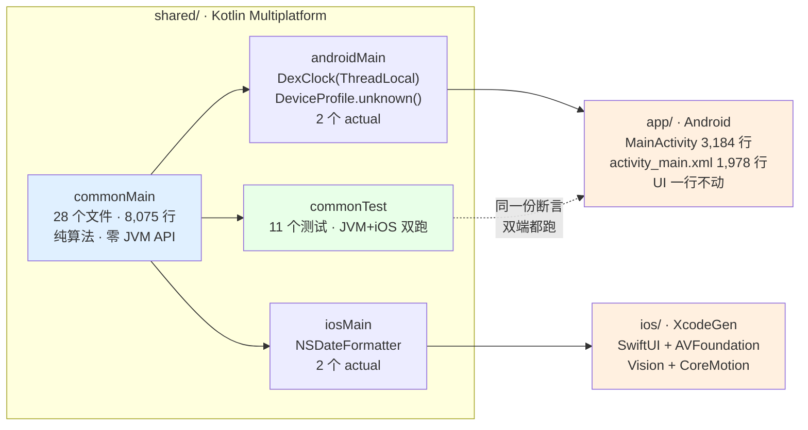
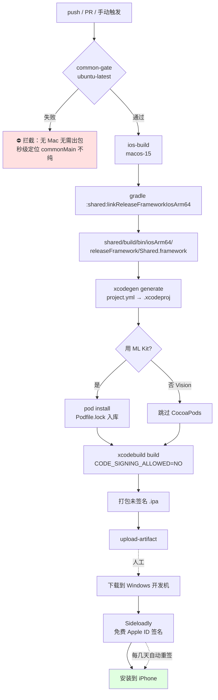

# IOS-TECH-FEASIBILITY · iOS 移植技术可行性预研报告

> 版本 v1.0 ｜ 作者：高见远（架构师 / software-architect-2）｜ 日期：2026-10-23
> 目标读者：主理人、PM（software-product-manager-2）、架构（software-architect）、工程（software-engineer）
> 基线代码：`D:/AI学习/Claw/shottuner` `com.shottuner.app` v3.1.0（47 个 main 源文件 / 15,535 行 / 13 个测试文件）
> **本文只做可行性预研，不改任何代码，不写完整架构设计。** 架构与任务分解在 PRD 之后由 software-architect 主导。
> 配套文档：`docs/IOS-PRD.md`（PRD）、`docs/IOS-ARCH.md`（架构，software-architect 出）。本文与 IOS-ARCH 的分工见 §0.3。

---

## 0. 一页纸结论

### 0.1 六问六答

| # | 问题 | 结论 | 依据强度 |
|---|---|---|---|
| 1 | KMP 拆分可行吗？ | ✅ **可行，但有 2 个文件必须先做跨文件抽取**（`DeviceProfile` 三兄弟、`AiVisionResult`/`AiScene`）。28 个候选文件里 **18 个零改动可搬**、10 个需改写（合计 8,075 行，与 PM 报告的行数完全吻合） | 查证值（逐文件扫 import + 全量 AST 级文本扫描） |
| 2 | Android 手动曝光能 1:1 搬到 iOS 吗？ | ✅ **能，且 iOS 端更简单**。`AVCaptureDevice.setExposureModeCustom(duration:iso:completionHandler:)` 是 Android `CONTROL_AE_MODE_OFF + SENSOR_SENSITIVITY + SENSOR_EXPOSURE_TIME` 的直接等价物，且是**设备级**锁定（预览与成片天然一致），而 Android 侧需要给 Preview/ImageCapture 各写一遍 CaptureRequest | 查证值（Apple 官方 API 文档） |
| 3 | Compose Multiplatform 还是原生 SwiftUI？ | ✅ **选 SwiftUI + 只共享逻辑层（KMP）**。现有 Android UI 是 View + viewBinding（**不是 Compose**），选 CMP 等于把 4,000+ 行已发布的 View 代码重写一遍 | 查证值（代码实测 + JetBrains 官方稳定性声明） |
| 4 | GitHub Actions 能出 ipa 吗？ | ✅ **能出包，但签名不能放 CI**。CI 产出**未签名** ipa，签名与 7 天续签放在**开发机**用 Sideloadly（Windows 原生支持，免费 Apple ID + 自动续签守护进程） | 查证值（Sideloadly 官方 + Apple 官方账号文档） |
| 5 | 包体会多大？ | **量级估计 5–12 MB**（SwiftUI + 薄 KMP framework + Vision），显著小于 Android 的 40.4 MB（Android 的大头是 ML Kit 内置模型） | 量级估计 |
| 6 | 最大风险是什么？ | **不是技术，是「无 Mac 的调试回路」+「免费账号的 7 天签名 treadmill」+「App Group 被免费账号禁用（→ Widget/Live Activity 共享数据做不了）」** | 查证值 |

### 0.2 三个必须让主理人知道的「结论修正」

| # | 常见认知 | 实测结论 |
|---|---|---|
| 1 | 「`CompositionAnalyzer` / `SharpnessMeter` 依赖 Bitmap，iOS 要重写或用 Vision」 | ❌ **两者都不碰 Bitmap**。`CompositionAnalyzer` 只吃 `FrameStats.grid: FloatArray`，`SharpnessMeter` 只吃 `FloatArray` 灰度块 → **算法逐字可搬**。且 **Vision 的 `VNDetectHorizonRequest` 是更差的替代**（官方实测 39 张样张只检出 47%，且水平照片常返回 nil；结构张量法对任意主方向边缘都有效） |
| 2 | 「`java.lang.ThreadLocal` 在 Native 上行为不同，要专门评估」 | ❌ **不是行为差异，是根本不存在**。`kotlin.native.concurrent.ThreadLocal` 是**注解**不是类；Kotlin 2.4 的 `kotlin.concurrent` 公共 API 里也**没有** `ThreadLocal` 类。→ 结论：**不是要"评估行为"，是要拆文件**。`DexClock` 整块搬进 `androidMain`，common 侧只留纯算法 |
| 3 | 「28 个纯文件可以直接进 commonMain」 | ❌ **有 2 处跨文件 Android 依赖**，按 import 扫不出来（同一个包内引用不需要 import）。`SceneClassifier` → `AiVision.kt`（ML Kit 文件）、`FeatureAdvisor`/`VideoRecommender` → `HardwareProbe.kt` |

### 0.3 与 `docs/IOS-ARCH.md` 的分工（防止两份文档打架）

| 议题 | 本文（可行性） | IOS-ARCH（怎么做） |
|---|---|---|
| 工具链版本矩阵、CI runner 选型、Mac 获取方案 | ✅ 本文 §4 / §6 | — |
| commonMain 内容边界、依赖抽取 | 给**事实与约束**（§1） | ✅ 定**边界与规则** |
| `expect/actual` 清单 | 给**每个 expect 的 platform 实现依据**（§1.4 / §2） | ✅ 定清单（2 个） |
| Compose vs SwiftUI | ✅ 本文 §3 **给明确结论** | — |
| 门禁具体实现 | 给 runner 层能力边界（§4） | ✅ 给门禁实现 |
| 评分基线标定 | 指出前置依赖（§2.5） | ✅ |
| App Group 存活验证 | ✅ 本文 §6.4 **给风险定级** | ✅ Spike #1 |

> **给 software-architect 的修正（v2 · 已全部被采纳并落地）**：
> 1. 纯文件数基线是 **28**（零 `import android.*`），其中 **27** 个连 `java.*` 也没有；第 28 个是 `growth/TechniqueDex.kt`。IOS-ARCH §1.5 的「29，差 1 个是 device/Brand.kt」是多算了一个（Brand.kt 本来就在 PM 的 28 个清单里）→ 已改为「28」，并采纳了「**数字随工程推进会变，以重跑脚本为准**」的纪律 ✅
> 2. IOS-ARCH §1.2 的 B 类清单**漏了 `java.lang.Math`**。实际还有 **5 处 / 5 个文件**（`CompositionAnalyzer`、`SceneClassifier`、`FrameStats`、`Recommendation`、`LevelMath`）——`java.lang` 是自动导入的，按 `import java.*` 扫必然漏。→ 「10 文件 13 处」已修正为 **15 文件 18 处** ✅
> 3. **`Math.round` 语义陷阱**已写进 T02 验收（向 +∞ vs 平局向偶数）✅
> 4. **第三条跨文件 Android 依赖**（`SceneClassifier` → `AiVision.kt`）已升为 A 类必做 ✅
> 5. **ThreadLocal 方案**已采纳我的（整块 `DexClock` 搬 androidMain）→ **expect/actual 从 2 降到 0** ✅
>
> **🔴 我自己写错并订正的一处**：§1.1 的 A2 行原写「`FaceBox`(:28) 定义在 ML Kit 文件里」，暗示 `SceneClassifier` 引用了它 —— **不准确**。经复核，`SceneClassifier` **只引用 `AiVisionResult` 与 `AiScene`**（:37, :46-48），`FaceBox` 虽同在 `AiVision.kt` 但未被它引用。（这条是 software-architect 指出的，采纳。）
>
> **🔴 我在复核架构的修改时发现的一处错误**：架构把 `Math.toDegrees` 的改法写成「kotlin.math 无 toDegrees → 自己写 `x*180.0/PI`」—— **不对**：`kotlin.math.toDegrees(Double/Float)` **是 Common API**（kotlinlang.org API 参考已核实），应直接用。同理 `Math.log` 可用 `kotlin.math.log`（`kotlin.math.log2` 亦为 Common），不必绕成 `ln(x)/ln(2.0)`（绕法虽等价但多一次除法、且与原 `Math.log` 的语义不完全一致）。
>
> **🔴🔴 本轮新发现（架构与我此前均未覆盖）**：`analysis/FrameStatsCore.kt` 用 `java.nio.ByteBuffer` —— **P4 类陷阱**，直接卡住 T12。详见 §1.3.1。
> 3. IOS-ARCH §2.2 建议用 `expect fun formatYmd`，**方向对，但 ThreadLocal 的处理需要修正**：ThreadLocal 本身不是要"消灭"，而是要**跟着 `DexClock` 一起搬进 androidMain**（androidMain 里 `java.lang.ThreadLocal` 完全可用）。common 侧只留 `TechniqueDex` 纯算法。

---

## 1. KMP 模块拆分方案（基于真实目录结构）

### 1.0 现状事实（查证值）

> ⚠️ **数字随工程推进会变，以「重跑扫描脚本」为准，不要写死。**
> 本节数字采集于 **2026-10-24 00:30**（工程正被并行修改：`NumFmt` 接线中、`FrameStatsCore` 新增）。
> 下方表格同时给出**基线值**（本文主要结论所依据的快照）与**当前实测值**，差异原因逐条标注。

```
app/src/main/java/com/shottuner/app/     47 个 .kt / 15,535 行（基线快照）
├── MainActivity.kt          3184 行   ← UI + 业务 + 相机胶水 全塞一起
├── ShotTunerApp.kt            55 行
├── analysis/   (7)  AiVision 320 / CompositionAnalyzer 250 / FrameAnalyzer 398 / FrameStatsCore 400★新增
│                     / SceneClassifier 137 / ScoreBoard 364 / SharpnessMeter 115
├── camera/     (1)  CameraEngine 315
├── coach/      (1)  FramingCoach 203
├── device/     (3)  Brand 244 / HardwareProbe 393 / OrientationTracker 131
├── diag/       (1)  Diag 162
├── feature/    (1)  FeatureAdvisor 311
├── growth/     (8)  DexEntry 47 / DexStore 256 / MissionEngine 262 / MissionTask 124
│                     / ScoreHistory 438 / ScoreHistoryStore 108 / TaskPicker 191 / TechniqueDex 370
├── knowledge/  (8)  PhotographyBook 1139 / PromptEngine 534 / PromptScheduler 367 / PromptSignals 114
│                     / Technique 123 / TechniqueBookV15 1322 / TechniqueMatcher 262 / VideoMovePlanner 80
├── model/      (4)  CompositionHint 63 / FrameStats 82 / ManualParams 13 / Recommendation 68
├── recommend/  (1)  ParamRecommender 299
├── screen/     (3)  CoachOverlay 312 / ScreenCaptureService 355 / ScreenStats 175
├── sensors/    (2)  LevelMath 125 / LevelSensor 99
├── share/      (2)  ShareKit 97 / Watermark 424
├── text/       (1)  NumFmt 182 ★新增（locale 无关格式化）
├── tile/       (1)  CameraTileService 50
├── ui/         (2)  GuideOverlayView 511 / HistogramView 115
└── video/      (1)  VideoRecommender 428
app/src/test/java/com/shottuner/app/     13 个测试文件 / 3,843 行（纯 JVM 单测）+ NumFmtTest 183★新增
app/src/main/res/layout/activity_main.xml   1,978 行
```

**两个统计口径的对齐**（这决定了 PRD 里「29 个纯文件」到底指多少）：

| 口径 | 基线（2026-10-23） | 当前实测（2026-10-24 00:30） | 说明 |
|---|---:|---:|---|
| 零 `import android.*` | **28** | **30** | = PM 报告口径。新增 `NumFmt.kt`、`FrameStatsCore.kt` |
| 零 `import (android\|androidx\|java\|javax)` | **27** | **28** | 差的那 2 个是 `growth/TechniqueDex.kt`（`SimpleDateFormat`/`Date`/`Locale`）与 🔴 **`analysis/FrameStatsCore.kt`（`java.nio.ByteBuffer`）** |
| L1 总行数 | **8,075**（与 PM 报告完全吻合 ✅） | **8,670** | 增量 = `NumFmt` 182 + `FrameStatsCore` 400 + P2 改写净增 |
| 其中带 JVM import 的文件 | 1（`TechniqueDex`） | **2**（+`FrameStatsCore`） | ⚠️ **P4 新增，见 §1.3.1** |

### 1.1 🔴 阻塞项：跨文件 Android 依赖（按 import 扫不出来）

「零 android import」≠「自包含」。同包内引用**不需要 import**，所以下面 3 条用 import 扫描扫不出来：

| # | 依赖方 | 被依赖方（文件） | 被依赖方的 Android 依赖 | 后果 |
|---|---|---|---|---|
| **A1** | `feature/FeatureAdvisor.kt:5`、`video/VideoRecommender.kt:5` | `device/HardwareProbe.kt` | `LensInfo`(:14)、`VideoCaps`(:42)、`DeviceProfile`(:86) 三个**纯数据类**与 `object HardwareProbe`(:162, Android-only) **同文件**，该文件 import 了 `Context`/`SurfaceTexture`/`CameraCharacteristics`/`CameraManager`/`Build`/`Size` | commonMain 编译时顺着 import 找到 Android 文件 → **失败** |
| **A2** | `analysis/SceneClassifier.kt`（同包，无 import，:37 `AiVisionResult`、:46-48 `AiScene`） | `analysis/AiVision.kt` | `AiScene`(:13)、`AiVisionResult`(:44) 定义在**ML Kit 文件**里，该文件 import `android.graphics.Bitmap` + `com.google.mlkit.*` | 同上 → **失败**。⚠️ **这是 IOS-ARCH §1.1 未列出的第三条**（见 §1.7 订正：本条**只涉及 `AiVisionResult` 与 `AiScene`**，`FaceBox` 虽也定义在 `AiVision.kt`，但 `SceneClassifier` 并未引用它） |
| **A3** | `growth/DexEntry.kt`（同包，无 import，:41-43 引用 `TechniqueDex.SOURCE_V15`/`SOURCE_BOOK`） | `growth/TechniqueDex.kt` | `SimpleDateFormat`/`Date`/`Locale`/`ThreadLocal` | **不是独立阻塞**：`TechniqueDex.kt` 改写后 DexEntry 自然解锁。但它是**改写顺序的依赖约束**：DexEntry 必须排在 TechniqueDex 之后 |

**修法（沿用工程既有的「纯内核 + 平台侧 Store」分家模式，非新发明）**：

```
A1 → 抽 device/DeviceProfile.kt   （LensInfo + VideoCaps + DeviceProfile 三个纯数据类）
     DeviceProfile.companion.unknown() 留在 androidMain（它用了 Build.MANUFACTURER 等）
A2 → 抽 analysis/AiVisionModels.kt （AiScene + AiVisionResult + FaceBox，纯数据）
     object AiVision（真正跑 ML Kit 的）留在 androidMain
```

**A2 的额外收益**：`AiScene` 枚举（PORTRAIT/GROUP/LANDSCAPE/ARCHITECTURE/FOOD/PET/FLOWER…）下沉成纯数据后，iOS 侧可以**直接复用同一套 SceneType 映射**，不用重写 `SceneClassifier.classify(s, ai)` 的融合逻辑——这正是 IOS-ARCH §2.5 的方向，我把它的**必要性等级**从"可选改造"提升到"**A 类阻塞，必做**"。

### 1.2 逐文件判定表（28 个文件，全部给出结论）

> 判定方法：对每个文件做**剔除注释与字符串字面量后**的正文扫描 + 类型引用闭包分析（`class`/`object`/`interface` 声明 → 文件映射 → 同包/跨包引用）。
> 「直接搬得走」= 文件本身零改动即可进 commonMain。**注意：`DeviceProfile`/`AiVisionResult` 的跨文件抽取（A1/A2）是它们的前置条件，不计入本文件的改动量。**

| # | 文件 | 行数 | 判定 | 具体原因（正文行号） |
|---|---|---:|---|---|
| 1 | `knowledge/TechniqueBookV15.kt` | 1322 | ✅ **直接搬** | 只依赖 `model.SceneType`（纯枚举） |
| 2 | `knowledge/PhotographyBook.kt` | 1139 | ✅ **直接搬** | 同上 |
| 3 | `knowledge/PromptEngine.kt` | 534 | ⚠️ **改写** | `:152` `"%.0f".format(...)` → JVM-only |
| 4 | `growth/ScoreHistory.kt` | 438 | ⚠️ **改写** | `:153` `System.currentTimeMillis()`（`java.lang.System`，Kotlin/Native 无此类） |
| 5 | `video/VideoRecommender.kt` | 428 | ⚠️ **改写** | `:328` `"%.1fs".format(...)` + **A1 跨文件依赖** |
| 6 | `growth/TechniqueDex.kt` | 370 | 🔴 **重度改写** | `SimpleDateFormat`×3、`java.util.Date`、`java.util.Locale`、`java.lang.ThreadLocal`、`:272` `System.currentTimeMillis()` → **整块 `DexClock` 搬去 androidMain** |
| 7 | `knowledge/PromptScheduler.kt` | 367 | ✅ **直接搬** | 正文零 JVM API。`:69` 的 `System.currentTimeMillis` **只出现在注释里**，且注释原文恰恰是"一次都不许调" → 该文件的时钟注入设计**已经是对的** |
| 8 | `analysis/ScoreBoard.kt` | 364 | ✅ **直接搬** | 只依赖 `model` + `sensors.LevelMath` + `analysis.SharpnessMeter` |
| 9 | `feature/FeatureAdvisor.kt` | 311 | ⚠️ **改写** | `:138`、`:309` 两处 `.format(...)` + **A1 跨文件依赖** |
| 10 | `recommend/ParamRecommender.kt` | 299 | ✅ **直接搬** | 用 `kotlin.math.pow`/`ln`/`abs`/`roundToInt`/`roundToLong` —— **全部是 Common API** |
| 11 | `knowledge/TechniqueMatcher.kt` | 262 | ✅ **直接搬** | 只依赖 `model.SceneType` |
| 12 | `growth/MissionEngine.kt` | 262 | ✅ **直接搬** | 只依赖 `kotlin.math.abs` + 同包纯类。`:22` 的 `java.time` **只在注释里** |
| 13 | `analysis/CompositionAnalyzer.kt` | 250 | ⚠️ **改写** | `:159` `Math.toDegrees(...)`（`java.lang.Math`）+ `:188` `"%.0f".format(...)`。**不碰 Bitmap** ✅ |
| 14 | `device/Brand.kt` | 244 | ✅ **直接搬** | 零 import。`Brand.OTHER` + `hint()` 的 `else` 兜底 → iOS 传 `Brand.OTHER` 即可复用全部品牌文案 |
| 15 | `coach/FramingCoach.kt` | 203 | ✅ **直接搬** | 只依赖 `model.CompositionHint` + `kotlin.math.abs` |
| 16 | `growth/TaskPicker.kt` | 191 | ✅ **直接搬** | 只依赖 `analysis.ScoreBoard`/`Recommendation` + `kotlin.math` |
| 17 | `analysis/SceneClassifier.kt` | 137 | ⚠️ **改写** | `:85` `Math.abs(...)` + **A2 跨文件依赖** |
| 18 | `sensors/LevelMath.kt` | 125 | ⚠️ **改写** | `:41` `"%.2f".format(...)` + `:69` `Math.PI` |
| 19 | `growth/MissionTask.kt` | 124 | ✅ **直接搬** | 只依赖 `analysis` + `model` |
| 20 | `knowledge/Technique.kt` | 123 | ✅ **直接搬** | 只依赖 `model.SceneType` |
| 21 | `analysis/SharpnessMeter.kt` | 115 | ✅ **直接搬** | **零 import**，只吃 `FloatArray` 灰度块 → **不碰 Bitmap** ✅ |
| 22 | `knowledge/PromptSignals.kt` | 114 | ✅ **直接搬** | 只依赖 `model.SceneType` |
| 23 | `model/FrameStats.kt` | 82 | ⚠️ **改写** | `:70` `Math.log(...)` ×2 |
| 24 | `knowledge/VideoMovePlanner.kt` | 80 | ✅ **直接搬** | 零 import |
| 25 | `model/Recommendation.kt` | 68 | ⚠️ **改写** | `:63` `String.format("%.1fs", sec)` + `:64` `Math.round(1.0/sec).toInt()`（**语义陷阱，见 §1.3**） |
| 26 | `model/CompositionHint.kt` | 63 | ✅ **直接搬** | 零 import |
| 27 | `growth/DexEntry.kt` | 47 | ✅ **直接搬** | 依赖 `analysis.ScoreDimension`（纯枚举）+ A3（TechniqueDex 改写后自动解锁） |
| 28 | `model/ManualParams.kt` | 13 | ✅ **直接搬** | 零 import |
| — | `device/HardwareProbe.kt` | 393 | 🔴 **拆分** | 抽 3 个纯数据类出去（A1），其余留 androidMain |
| — | `analysis/AiVision.kt` | 320 | 🔴 **拆分** | 抽 3 个纯数据类出去（A2），其余留 androidMain |

**汇总**：

| 分组 | 文件数 | 行数 | 占比 |
|---|---:|---:|---:|
| ✅ 直接搬得走 | **18** | **5,332** | 66% |
| ⚠️ 必须改写 | **10** | **2,743** | 34% |
| 合计（28 个候选） | 28 | **8,075** | 100% |

### 1.3 「看起来纯 JVM 但在 Kotlin/Native 上会炸」的逐项核查

> 这一节直接回答任务书里点名的每一项。**结论列写「查证」的是有 API 文档/源码树依据的；写「推断」的是需要 Spike 实证的。**

| 检查项 | 在本仓的实际情况 | Kotlin/Native 上的真相 | 结论 |
|---|---|---|---|
| `java.lang.Math` | **5 处 / 5 文件**：`CompositionAnalyzer:159` `Math.toDegrees`、`SceneClassifier:85` `Math.abs`、`FrameStats:70` `Math.log`×2、`Recommendation:64` `Math.round`、`LevelMath:69` `Math.PI` | `java.lang` 是 **JVM 自动导入**，commonMain 里没有 `Math` 类。Kotlin 官方文档明确：`kotlin.math` 提供 Common 版本（`toDegrees`/`abs`/`log`/`round`/`PI` 全部是 Common API，已逐一核对 kotlinlang.org API 页的平台标签） | 🔴 **必炸。IOS-ARCH 未列此项**。改法：`Math.toDegrees`→`kotlin.math.toDegrees`（**语义完全一致**）、`Math.abs`→`kotlin.math.abs`（一致）、`Math.log`→`kotlin.math.log`（一致）、`Math.PI`→`kotlin.math.PI`（同一个 double 常量，一致）、`Math.round`→ **语义不等价，见下** |
| 🔴 `Math.round` 语义陷阱 | `Recommendation.kt:64`：`"1/" + Math.round(1.0/sec).toInt()` → 生成用户可见的快门标签 `1/125`、`1/60` | `java.lang.Math.round(Double)` 返回 `Long`，**四舍五入时向 +∞ 取整**；`kotlin.math.round(Double)` 返回 `Double` 且**平局向偶数取整**。例：`Math.round(2.5)=3`，`kotlin.math.round(2.5)=2.0` | 🔴 **不能机械替换**。虽然快门档位（1/2、1/4、1/8、1/15、1/30…）极少正好落在 .5，但这是**用户可见文案**且有单测 → 改写时必须**显式实现"向 +∞ 取整"**（`floor(x + 0.5)`），不能用 `kotlin.math.round` 一换了事 |
| `java.lang.ThreadLocal` | **1 处**：`TechniqueDex.kt:252` `object : ThreadLocal<SimpleDateFormat>() { override fun initialValue() ... }` | ① `java.lang.ThreadLocal` 是 JVM 类，commonMain **无**；② `kotlin.native.concurrent.ThreadLocal` 是**注解**（`@Target(PROPERTY, CLASS)`，标记对象为线程局部），**不是类，无法 `object :` 继承**；③ Kotlin 2.4 `kotlin.concurrent` 公共 API 里只有 `Atomic*` + `Volatile` + JVM-only 的 `getOrSet` 扩展，**没有 `ThreadLocal` 类** | 🔴 **必炸，但不是"行为差异"，是"根本不存在"**。正确处理见 §1.4 |
| `java.text.SimpleDateFormat` + `java.util.Date` + `java.util.Locale` | `TechniqueDex.kt:7-9` import + `:253`、`:265` 使用 | Kotlin/Native 标准库**不提供 `java` 包**（已核对 Kotlin 仓库 `kotlin-native/runtime/src/main/kotlin/kotlin/` 目录树，无 `java` 子目录） | 🔴 **必炸**。iOS 侧用 `NSDateFormatter` |
| `java.io.File` | 仅出现在 **Android 侧文件**：`ScoreHistoryStore.kt:5`、`Diag.kt:5`、`camera/CameraEngine.kt:28`、`share/ShareKit.kt:8`、`share/Watermark.kt:9` | Kotlin 官方文档明说：common code 里**不能**用 `java.io.File`，因为 JDK 类在 native 上不存在 | ✅ **不影响 common 候选集**（这 5 个文件本来就全是 Android 侧）。⚠️ 注意 **`ScoreHistory.kt` 本身不碰文件 IO**（只做 JSON 序列化），IO 在 `ScoreHistoryStore.kt` 里——任务书假设「`ScoreHistory.kt` 有文件读写」**与代码不符** |
| `java.nio.ByteBuffer` | `screen/ScreenStats.kt:33`（Android 侧） | JVM-only | ✅ 不影响 common 候选集 |
| `System.currentTimeMillis()` | **真实调用 2 处**：`ScoreHistory.kt:153`、`TechniqueDex.kt:272`。另 3 处（`PromptScheduler:69`、`MissionEngine:22`、`MissionTask:62`）**只在注释里** | `java.lang.System` 在 Kotlin/Native 上不存在 | 🔴 真实调用 2 处必炸。**注释里的 3 处不是阻塞**——它们恰恰在声明"禁止使用"，说明调度器的时钟注入设计已经是对的 |
| `kotlin.math.*` | `hypot`(含 Float 重载)、`pow`(Int/Double 两种)、`ln`、`log`、`abs`、`min`、`sqrt`、`roundToInt`、`roundToLong`、`toDegrees`、`PI` | **全部是 Common API**（已逐一核对 kotlinlang.org API 页的平台标签均为 Common） | ✅ **安全**。`recommend/ParamRecommender.kt` 整个文件只用 `kotlin.math` → 直接搬 |
| `kotlin.collections.*` | `HashMap`、`LinkedHashMap`、`ArrayList`（`ScoreHistory.kt` 的 JSON 解析器）、`HashSet` | 全部 Common | ✅ **安全**。`ScoreHistory.kt` 的手写 JSON 解析器（438 行里的 ~150 行）**是可直接复用的资产** |
| `Float.isFinite()` / `Double.isFinite()` / `isNaN()` | `ScoreBoard:167`、`SharpnessMeter:86/108`、`TaskPicker:149/157/168`、`LevelMath:65/66/119` | `kotlin` 顶层函数，平台标签 **Common / JVM / Native**（已核对 API 页） | ✅ **安全**。⚠️ 但 `LevelMath.kt:69` 的 `Math.PI` 是 `java.lang.Math` 的，要单独改 |
| `java.util.Locale` | `TechniqueDex.kt:9`（`Locale.US`）、`Diag.kt:9` | JVM-only | 🔴 随 TechniqueDex 一起搬走 |
| `kotlinx.serialization` | **本仓完全未使用**（`ScoreHistory.kt:17-21` 的注释标题就是「为什么没用 org.json」，手写 JSON 序列化） | — | ✅ **不需要引入**。零新依赖这条纪律可以守住 |
| `kotlin.time` / `java.time` | 只在注释里（`MissionEngine:22`） | — | ✅ 不阻塞 |
| `kotlinx-coroutines` | 本仓**完全未使用**（全仓零 import） | — | ✅ **建议 iOS 共享层也不引入**：共享层全是纯同步计算，无 I/O 无并发 → 省掉一个依赖，也省掉 Kotlin/Native 协程 runtime 的包体与 `suspend` 跨语言桥接的复杂度（见 §3.4） |
| `kotlin.io.path.Path` | 未使用 | Kotlin 1.5+ 提供 Common 版 Path API | ➖ 不需要 |

### 1.3.1 🔴🔴 新增陷阱（P4 类）：`FrameStatsCore.kt` 的 `java.nio.ByteBuffer` —— **T12 的地基有雷**

> 这是报告定稿期间工程新增文件带来的**新发现**，且**直接卡住 T12**（架构的 iOS 任务分解把它当作跨端对齐的基础设施）。

`analysis/FrameStatsCore.kt`（400 行，新建）把「一帧 → FrameStats」从 CameraX 管道里剥了出来，设计意图非常好（实时链路与「同一份字节」对齐链路共用同一份实现）。它自己的注释写道：

> 「本类**不依赖任何 Android 类型**（无 Bitmap / 无 ImageProxy），因此可以直接跑 JVM 单测，也是跨端对齐时唯一需要逐字对齐的东西。」

**这句话对 Android 成立，对 KMP 不成立。** 它的 import 是：

```kotlin
import com.shottuner.app.model.FrameStats
import java.nio.ByteBuffer      // ← 🔴 JVM-only
import kotlin.math.abs / max / min
```

**`java.nio.ByteBuffer` 在 Kotlin/Native 上不存在**（已核对 Kotlin 仓库 `kotlin-native/runtime/src/main/kotlin/kotlin/native/` 目录树：无 `java.nio`；且 Kotlin 官方多平台文档明说 native 上 JDK 类不可用）。→ **这个文件现在放进 `commonMain` 会直接编译失败**，而它的定位恰恰是「iOS 与 Android 共用的唯一核心」。

**这不是「文件摆放」问题，是「签名里带了平台类型」问题** → 需要 P4 类改写（§1.4）。

**它实际只用了 ByteBuffer 的 3 个能力**，全部是**绝对索引读取**，所以抽象成本极低：

| 用到的能力 | 出现位置 | 抽象后 |
|---|---|---|
| `duplicate()` + `rewind()` | :112-115 | **不再需要**（绝对索引读不移动游标；`duplicate()` 在这里只是防御性拷贝） |
| `capacity()` | :147, :189, :193, :331 | `BytePlane.size`（**必须保持与 `capacity()` 完全同义**，否则越界判定行为会变） |
| `get(index): Byte` | :148, :190-194, :341 | `BytePlane.get(index)`（**必须保持「有符号 Byte」语义** —— 代码里靠 `.toInt() and 0xFF` 转无符号，适配器不能改成返回 Int） |

**✅ 推荐改法（commonMain 加一个 4 行接口，两端各写一个适配器，零拷贝、零行为变化）**：

```kotlin
// commonMain —— 新增
interface BytePlane {
    /** 可读字节总数；语义必须与原 ByteBuffer.capacity() 一致 */
    val size: Int
    /** 绝对索引读取；返回有符号 Byte（与 ByteBuffer.get(Int) 同语义） */
    operator fun get(index: Int): Byte
}
```

```kotlin
// androidMain —— 适配现有 CameraX 平面
fun ByteBuffer.asBytePlane(): BytePlane = object : BytePlane {
    private val buf = duplicate().apply { rewind() }
    override val size: Int get() = buf.capacity()
    override fun get(index: Int): Byte = buf.get(index)
}
```

```kotlin
// iosMain —— 适配 CVPixelBuffer 的 Y/U/V 平面
// （用 platform.CoreVideo / CoreMedia 的 CVPixelBufferGetBaseAddressOfPlane）
```

**为什么推荐接口而不是「改成 `ByteArray` + 拷贝」**：
- `ByteArray` 方案每帧要拷贝 Y 平面（640×480 = 307 KB，30 fps ≈ 9.2 MB/s memcpy）+ 逐行处理 `rowStride` → **多一次拷贝、多一份 stride 处理逻辑**，且**拷贝本身就是新的行为差异源**（对齐链路尤其敏感）。
- 接口方案**零拷贝**，且 Android 适配器与现有 `ByteBuffer` 语义**逐位等价** → 「实时链路与对齐链路共用同一份实现」的设计意图**完全保留**。

**代价**：Kotlin/Native 里每次 `get()` 是接口虚调用。实测负载约 19,200 次 Y 采样 + 色度采样 / 帧（`TARGET_SAMPLES_X=160` × `TARGET_SAMPLES_Y=120`），30 fps 下约 60 万次/秒 —— Native 的直接虚调用完全吃得下，**不构成性能问题**。

> **给 T12 的结论**：T12「用固定输入图片跑出同一套统计量」的**算法部分已经就绪**（`FrameStatsCore` 逐行搬自 `FrameAnalyzer.compute()`，常量与阈值都保持不变），但**在 P4 改写完成前它进不了 commonMain**，iOS 侧也无从调用。→ **T12 的前置条件里要加一条 P4**。

### 1.4 四个"必须改写"的模式归类（每类一个统一解法，不要逐处打补丁）

| 模式 | 涉及文件 | 统一解法 | 是否需要 `expect/actual` |
|---|---|---|---|
| **P1 · `Math.*` → `kotlin.math.*`**（5 文件 / 5 处） | CompositionAnalyzer, SceneClassifier, FrameStats, LevelMath, Recommendation | 直接换 import + 函数名；**`Recommendation:64` 的 `Math.round` 单独处理**（§1.3 语义陷阱） | ❌ 不需要 |
| **P2 · `.format(...)` → locale 无关格式化器**（5 文件 / 6 处） | CompositionAnalyzer:188, FeatureAdvisor:138/309, PromptEngine:152, Recommendation:63, LevelMath:41, VideoRecommender:328 | 新增 `text/NumFmt.kt`（约 40 行，纯 Kotlin）：`fixed(value, decimals)` / `pct(value)`，**永远用 `.`、不带千分位、不带 locale 分隔符** | ❌ 不需要 |
| **P3 · 时间与日期**（2 文件） | ScoreHistory:153, TechniqueDex（整个 `DexClock`） | ① `ScoreHistory.recentSeries(days)` 改为**注入 `now: Long`**（IOS-ARCH §2.3 方向正确）；② `DexClock` 整块（`SimpleDateFormat`/`Date`/`Locale`/`ThreadLocal`）**搬进 `androidMain`**，common 侧只保留 `TechniqueDex` 纯算法 + `TechniqueDex` 调一个注入进来的 `today: String` | ✅ **1 个 `expect`**：`expect fun formatYmd(millis: Long): String`（Android actual 保留现有 `ThreadLocal<SimpleDateFormat>` 实现 —— **在 androidMain 里 `java.lang.ThreadLocal` 完全可用，不需要消灭它**；iOS actual 用 `NSDateFormatter`） |
| **P4 · 签名里的平台类型 → 抽成 common 接口**（1 文件 / 4 处） | `analysis/FrameStatsCore.kt`（`java.nio.ByteBuffer`） | 见 §1.3.1：新增 `interface BytePlane { val size; operator fun get(index): Byte }`，两端各写一个**零拷贝**适配器 | ❌ **不需要 expect/actual**（接口在 common，适配器在各自平台层） |

> **P4 与 P1/P2/P3 的本质区别**：P1–P3 都是「**函数体内的** JVM API」，改成 common 可用的写法即可；**P4 是「函数签名里的」平台类型**，函数体再干净也进不了 commonMain。→ **扫描工具必须同时扫 import 和函数签名**，否则会漏掉这一类。

**P2 的顺带收益（值得写进 PRD）**：现有 `String.format` 走**默认 Locale**，德语等用逗号作小数点的地区 `"%.1f"` 会输出 `1,5` 而不是 `1.5`。中文用户无感知，但 **iOS 面向全球时这是可见缺陷**。新的 `NumFmt` 一并修掉。

**P2 的输出等价性硬要求**：`Recommendation.shutterLabel`（`"1/60"` / `"0.5s"`）和 `VideoRecommender.shutterLabel` 是**用户直接看到的文案**，改写后**输出必须逐字不变**。建议在改写前先把现有输出固化成快照测试（`app/src/test` 已有 `Recommendation` 相关断言可扩展）。

**P1/P2 改写后**：`commonMain` 里这 10 个文件 + 18 个直接搬的文件 = **28 个文件全部零 JVM API**，且只剩 **1 个 `expect`**（`formatYmd`）+ **1 个 `expect`**（`currentTimeMillis`，若 IOS-ARCH 决定保留）= **2 个 expect**（与 IOS-ARCH §4.4 一致 ✅）。

### 1.5 ⚡ 落地进展同步：`NumFmt` 已由并行任务实现（2026-10-24 00:10）

> 本节是**预研完成后、报告定稿前**的一次实地核对结果，说明 §1.4 的 P2 改写**已经不是纸面方案**。

在写本文期间，仓库里已出现并行实现（我本人**未创建、未修改**这两个文件）：

| 文件 | 行数 | 状态 |
|---|---:|---|
| `app/src/main/java/com/shottuner/app/text/NumFmt.kt` | 171 | 新增（未提交） |
| `app/src/test/java/com/shottuner/app/text/NumFmtTest.kt` | 183 | 新增（未提交），13 个 `@Test` |

**核对结论：接口与语义基本对齐，但有 3 处需要收口**：

| # | 项 | 现状 | 建议 |
|---|---|---|---|
| 1 | ✅ **半值舍入语义** | 实现里显式写了 `roundHalfAwayFromZero`（余数 ≥ 0.5 进位），并**在注释里点明了「JVM 的 `Math.round` 与 Kotlin 的 `round` 语义不同」** | ✅ **与本文 §1.3 的语义陷阱完全对上**。但要注意一个细节：`java.lang.Math.round` 是**向 +∞ 取整**，而实现是**半值远离零** —— 对**负数**两者不同（`Math.round(-2.5) = -2`，半值远离零 = -3）。本仓唯一受影响的调用点 `Recommendation.shutterLabel` 的输入 `1.0/sec` **恒为正**（`sec > 0`），因此**当前等价**；但若将来有负数输入需重新对齐 |
| 2 | ⚠️ **缺少 `pct()`** | 实现暴露 `one()` / `fixed()` / `int()` / `UNDEFINED` / `MAX_DECIMALS`，**没有 `pct()`** | `PromptEngine.kt:152` 的 `private fun pct(value: Float) = "%.0f".format(value.coerceIn(0f,1f)*100f)` 与 `FeatureAdvisor.kt:305` 的 `private fun pct(v: Float?)` 是**两个文件里各自实现的同名私有函数**（重复代码）→ 建议统一改调 `NumFmt`，**不要**在 `NumFmt` 里再加 `pct()`（保持 `NumFmt` 只做通用定点格式化，百分比语义留在调用方） |
| 3 | ⚠️ **文件位置** | 落在 `app/src/main/java/.../text/`（**Android 模块内**） | 按 §1.5 的目标结构，它最终应落在 **`shared/src/commonMain/kotlin/com/shottuner/app/text/`**（这样 iOS 侧才能共用）。当前在 Android 模块内**也能用**（`app` 依赖 `shared`，反之不行）→ **迁移时需移动目录，不是复制**（复制会导致 dex merge 报 duplicate class） |
| 4 | ✅ **KMP 纯净性** | 只 import `kotlin.math.floor` | ✅ 已是纯 common 代码，可直接进 `commonMain` |

**对 §1.4 P2 的影响**：P2 从「设计」降级为「**接线**」—— 剩 6 处 `.format` 调用点（`CompositionAnalyzer:188`、`FeatureAdvisor:138/309`、`PromptEngine:152`、`Recommendation:63`、`LevelMath:41`、`VideoRecommender:328`）替换为 `NumFmt` 调用即可。**替换前必须先跑一次现有输出快照比对**（`Recommendation.shutterLabel` 的 `"1/60"` / `"0.5s"` 是用户直接看到的文案）。

**📌 落地核对（写本文时的实时 git diff）**：P2 接线**已在进行中**，`CompositionAnalyzer` / `FeatureAdvisor` / `PromptEngine` / `Recommendation` 四个文件已改为调用 `NumFmt`。核对结果：

| 检查项 | 结果 |
|---|---|
| 改写是否保持输出不变 | ✅ `CompositionAnalyzer` 用 `NumFmt.fixed(abs(tilt), 0)` 替代 `"%.0f".format(...)`，**格式串语义一致**（原 `"%.0f"` = 0 位小数 → `fixed(v, 0)`） |
| `NumFmt` 是否是纯 common 代码 | ✅ 只 import `kotlin.math.floor` |
| ⚠️ **P1 是否已处理** | ❌ **未处理，且这正是我 §1.3 标记的语义陷阱所在**：`Recommendation.kt` 的 `"1/" + Math.round(1.0 / sec).toInt()` **原样保留**，`CompositionAnalyzer:159` 的 `Math.toDegrees(...)` 也仍在。**这两个是 P1，与 P2 是不同的两类改写**（P2=locale 格式化、P1=java.lang.Math），P2 的完成**不代表** commonMain 已经纯净化 → **Spike #0 之前必须把 P1 也做完**，否则 commonMain 依然编不过 |

> → 这条正好印证了 §1.4 的分类价值：**把 `Math.*` 和 `.format` 分成 P1/P2 两类、各给统一解法**，可以避免"P2 做完就以为 commonMain 干净了"的误判。

### 1.7 📐 复核纪律（本轮教训，建议进代码评审规范）

这轮复核里，**我与 software-architect 各漏了一次**，而且两次的**根因相同** —— 所以值得写进规范：

| # | 失误 | 根因 | 教训 |
|---|---|---|---|
| 1 | 我漏了 `java.lang.Math` 5 处（PM 与 IOS-ARCH 也都漏了） | `java.lang` 是**自动导入**的 → 按 `import java.*` 扫**必然漏** | **扫描必须同时覆盖「显式 import」与「自动导入包」**（`java.lang.*` 全部成员） |
| 2 | 我漏了 `SceneClassifier` → `AiVision.kt` 的同包引用 | 同包引用**不需要 import** → 按 import 扫**必然漏** | **必须做「类名 → 定义文件」映射 + 剥注释/字符串后的正文扫描**（我第一版脚本就踩了这个坑，得出过「L2 = 7 个文件」的荒谬结果） |
| 3 | 架构漏了 `FaceBox` 也被 `SceneClassifier` 引用（**我写错了，已订正**） | 我把「同文件定义」当成了「被引用」 | **「定义在某文件」≠「被某文件引用」** → 必须查**引用点**而非定义点 |
| 4 | 架构的 `Math.toDegrees` 改法有误（他说「kotlin.math 无 toDegrees」） | 未核 API 平台标签 | ⚠️ **`kotlin.math.toDegrees(Double/Float)` 是 Common API**（kotlinlang.org API 参考已核实）→ 应当直接用，**不需要手写 `x*180.0/PI`** |

**→ 三条纪律**：

1. **扫描工具自己要先被验证**：拿**已知答案**（基线 28 个文件 / 8,075 行，且与 PM 报告吻合）当基准校准脚本，再拿去扫新代码。我第一版脚本因为「注释里的类名被当成依赖」而得出荒谬结果 —— **脚本错了，结论会错得更离谱**。
2. **数字不写死**：工程在并行演进，文件数/行数随时会变。所有文档里凡是写死数字的地方，都要标注**采集时间**并附「**以重跑脚本为准**」。
3. **判定标准分两类，别混**：
   - **A 类 = 文件摆放**（纯文件依赖了不纯文件）→ 靠**引用闭包**发现
   - **P1–P3 = 函数体内的 JVM API** → 靠**正文扫描**发现
   - **P4 = 签名里的平台类型** → 靠**扫 import + 函数签名**发现
   → **P2 做完不代表 commonMain 干净了**（P1 还没做）；**函数体干净也不代表能进 commonMain**（P4 还在签名里）。这两条最容易误判。

### 1.8 目标目录结构（精简版）



> 图示要点：**绿色的 commonMain 是全部共享价值所在**（算法 + 单测）；橙色的两端是各自原生实现（Android 保留 View、SwiftUI 从零写）。`commonTest` 的存在让「iOS 端算法行为与 Android 一致」这件事**不需要真机就能验证** —— 这是无 Mac 条件下最重要的质量保障。

```
shottuner/
├── app/                                  ← 现有 Android 模块，保留（UI 一行不动）
├── shared/                               ← 新增 KMP 模块
│   ├── build.gradle.kts                  ← kotlin("multiplatform") 2.x
│   │                                      androidTarget() + iosArm64() + iosSimulatorArm64()
│   └── src/
│       ├── commonMain/kotlin/com/shottuner/app/
│       │   ├── analysis/    ScoreBoard, CompositionAnalyzer, SceneClassifier, SharpnessMeter,
│       │   │                + AiVisionModels.kt（新增：AiScene/AiVisionResult/FaceBox 下沉）
│       │   ├── coach/       FramingCoach
│       │   ├── device/      Brand, DeviceProfile.kt（新增：LensInfo/VideoCaps/DeviceProfile 抽出）
│       │   ├── feature/     FeatureAdvisor
│       │   ├── growth/      MissionEngine, MissionTask, TaskPicker, ScoreHistory, TechniqueDex(纯部分), DexEntry
│       │   ├── knowledge/   8 个文件全搬
│       │   ├── model/       CompositionHint, FrameStats, ManualParams, Recommendation
│       │   ├── recommend/   ParamRecommender
│       │   ├── sensors/     LevelMath
│       │   ├── text/        NumFmt.kt（新增：locale 无关格式化）
│       │   └── video/       VideoRecommender
│       ├── commonTest/     ← 现有 13 个测试中可搬的搬（ScoreBoardTest/FramingCoachTest/
│       │                      MissionEngineTest/PromptEngineTest/PromptSchedulerTest/
│       │                      ScoreHistoryTest/TaskPickerTest/TechniqueBookV15Test/
│       │                      TechniqueMatcherTest/PhotographyBookTest/LevelMathTest）
│       ├── androidMain/    ← DexClock(SimpleDateFormat+ThreadLocal), DeviceProfile.unknown(),
│       │                      actual formatYmd / actual currentTimeMillis
│       └── iosMain/        ← actual formatYmd(NSDateFormatter) / actual currentTimeMillis(NSDate)
└── ios/                                   ← 新增 XcodeGen 工程（project.yml 为单一事实来源）
```

**包名策略**：Kotlin 包名**沿用 `com.shottuner.app.*`**（不改包名）→ 28 个文件搬进 `shared` 时**一行 import 都不用改**，只需移动目录。`shared` 的 Gradle `namespace` 用 `com.shottuner.app.shared`（只影响它生成的 `R`/`BuildConfig`，commonMain 不引用）。

**测试迁移收益（重要）**：现有 13 个测试 / 3,843 行全是**纯 JVM 单测**，其中 11 个直接对应 common 候选文件。搬进 `commonTest` 后，**它们同时在 JVM 和 iOS Native 上跑** → 这是"iOS 端算法行为与 Android 一致"的**最便宜的验证手段**，且**不需要 Mac**（JVM 部分在 Windows 上就能跑）。IOS-ARCH §5.0.6 提到 commonTest 迁移范围，这就是具体清单。

---

## 2. Android 专属能力的双端映射表

### 2.1 相机栈（核心）

| Android 现状（文件:行） | iOS 对应物 | 差异点 & 结论 |
|---|---|---|
| `camera/CameraEngine.kt` — CameraX `PreviewView` + `ProcessCameraProvider.bindToLifecycle` | `AVCaptureSession` + `AVCaptureVideoPreviewLayer`（SwiftUI 里用 `UIViewRepresentable` 包一层） | SwiftUI 没有官方预览层，必须 `UIViewRepresentable` 包 `AVCaptureVideoPreviewLayer`。**可控，不构成风险** |
| `CameraEngine.kt:167-172` — `ImageAnalysis` + `ImageProxy`（`OUTPUT_IMAGE_FORMAT_YUV_420_888`, 640×480, `STRATEGY_KEEP_ONLY_LATEST`） | `AVCaptureVideoDataOutput`，`videoSettings = [kCVPixelFormatType_420YpCbCr8BiPlanarFullRange]`，`alwaysDiscardsLateVideoFrames = true` | ✅ **1:1 可映射**。`420YpCbCr8BiPlanarFullRange` 的 **plane 0 就是 Y（亮度）**，与 Android `YUV_420_888` 的 plane 0 语义一致 → `FrameAnalyzer` 的直读 Y 平面算法**逻辑可照搬**，只需把 `ImageProxy.planes[0]` 换成 `CVPixelBufferGetBaseAddressOfPlane(0, 0)` + `CVPixelBufferGetBytesPerRowOfPlane(0, 0)` |
| `FrameAnalyzer.kt:90-92` — `rowStride`/`pixelStride` 处理 | iOS 的 Y 平面**pixelStride 恒为 1**（8-bit），只有 `bytesPerRow` 可能 > width | ✅ **iOS 更简单**：不需要 `pixelStride` 除法，只需按 `bytesPerRow` 跳行。**注意**：iOS 需用 `FullRange` 而非 `VideoRange`，否则 Y 值是 16–235 而非 0–255，**直方图与评分阈值全部要重标**。这是最容易埋雷的一处，PRD 必须把 `FullRange` 写成硬约束 |
| `CameraEngine.kt:174-175, 226` — `Preview` + `ImageCapture`（存 `File`） | `AVCapturePhotoOutput`，`AVCapturePhotoCaptureDelegate` 落盘 | ✅ 1:1 |
| `camera/CameraEngine.kt` — `Camera2Interop.Extender` + `CONTROL_AE_MODE_OFF` + `SENSOR_SENSITIVITY` + `SENSOR_EXPOSURE_TIME` | `AVCaptureDevice.setExposureModeCustom(duration: CMTime, iso: Float, completionHandler:)`，前置 `lockForConfiguration()` / 后置 `unlockForConfiguration()` | ✅ **完全等价，见 §2.2 专项** |
| `CameraEngine.kt:204-207` — `CONTROL_AWB_MODE_AUTO`（注释：手动 RGB 增益跨机型差异极大） | 保持 `AVCaptureDevice.whiteBalanceMode = .continuousAuto` | ✅ **完全一致**。Android 侧 `supportsManualWb = false` 硬编码 → iOS 侧同样不做手动白平衡，**零差距** |
| `CameraEngine.kt:278-309` `readCapabilities()` — `SENSOR_INFO_SENSITIVITY_RANGE`、`SENSOR_INFO_EXPOSURE_TIME_RANGE`、`CONTROL_AE_AVAILABLE_MODES`、`LENS_INFO_AVAILABLE_FOCAL_LENGTHS` | `AVCaptureDevice.activeFormat.minISO/maxISO`、`activeFormat.minExposureDuration/maxExposureDuration`、`isExposureModeSupported(.custom)` | ⚠️ **iOS 能力是"每 activeFormat"的，不是"每传感器"的**。切换分辨率/帧率会改变 activeFormat → **能力值必须动态重读**，不能像 Android 那样开机读一次存起来。这是 `CameraCaps` 在 iOS 上的语义差异，PRD 的「参数建议」功能必须处理 |
| `CameraEngine.kt:278-309` — `focalLengthMm`（等效焦距） | `AVCaptureDevice.activeFormat` 无焦距 API；需 `AVCaptureDevice.formats` + `CMVideoFormatDescription` 解析 | ⚠️ **iOS 无直接等价**。`FeatureAdvisor`/`VideoRecommender` 里的「等效焦距」文案在 iOS 侧要么走 `AVCaptureDevice.videoZoomFactor` 近似，要么**留空**。需要产品决策（低优先级） |
| `camera/CameraEngine.kt:132-161` `takePicture(outputFile: File)` | `AVCapturePhotoOutput.capturePhoto` + `PHPhotoLibrary` / `FileManager` | ✅ 1:1；iOS 存 `Application Support` 目录 |
| `hardware/HardwareProbe.kt:162-393` — `CameraManager` 枚举镜头/焦距/OIS | `AVCaptureDevice.DiscoverySession` + `AVCaptureDevice.formats` | ⚠️ 部分能力（多摄枚举、OIS 状态）iOS 无等价 → iOS 侧 `DeviceProfile` 字段需允许 unknown |

### 2.2 ★ 手动曝光专项：iOS 能否 1:1 对上 Android？

> 这是「参数建议」功能的地基，必须结论明确。

**Android 现状**（`camera/CameraEngine.kt:195-222`）：

```kotlin
extender.setCaptureRequestOption(CONTROL_AE_MODE, CONTROL_AE_MODE_OFF)   // 关掉自动曝光
extender.setCaptureRequestOption(SENSOR_SENSITIVITY, m.iso)              // 手动 ISO
extender.setCaptureRequestOption(SENSOR_EXPOSURE_TIME, m.shutterNs)      // 手动快门(纳秒)
// 白平衡保持 AUTO
// 且必须给 Preview 和 ImageCapture 各写一遍，否则预览是手动档、成片回落到自动档
```

**iOS 对应物**（Apple 官方 API，已核对文档）：

```swift
// isExposureModeSupported(.custom) 先查能力（等价 Android 的 CONTROL_AE_AVAILABLE_MODES 判定）
try device.lockForConfiguration()
device.setExposureModeCustom(duration: CMTime(value: shutterNs, timescale: 1_000_000_000),
                             iso: Float(iso)) { _ in
    device.unlockForConfiguration()
}
// AVCaptureDevice.autoExposureDuration / AVCaptureDevice.autoISO 是"特殊值"，可做部分手动
```

**结论：✅ 能 1:1 对上，且 iOS 侧实现更简单。**

| 维度 | Android | iOS | 对齐性 |
|---|---|---|---|
| 手动 ISO | `SENSOR_SENSITIVITY`（Int） | `setExposureModeCustom(iso: Float)` | ✅ 同一 ISO 标度，数值可 1:1 转换 |
| 手动快门 | `SENSOR_EXPOSURE_TIME`（Long 纳秒） | `setExposureModeCustom(duration: CMTime)` | ✅ 同一物理量，`CMTime(value: ns, timescale: 1e9)` 精确无损 |
| 关闭 AE | `CONTROL_AE_MODE_OFF` | `setExposureModeCustom` 本身就是锁定 | ✅ |
| 白平衡 | `CONTROL_AWB_MODE_AUTO`（硬编码） | `whiteBalanceMode = .continuousAuto` | ✅ 双方都不做手动 WB，**无差距** |
| EV 补偿 | 未用（用 ISO/快门直接表达） | `exposureTargetOffset` / `setExposureTargetBias` | ➖ 不需要 |
| **作用范围** | ⚠️ **per-CaptureRequest**：必须给 Preview 和 ImageCapture 各写一遍，漏了就不一致（代码注释里已踩过这个坑） | ✅ **per-device**：锁一次，整个 session 的预览与拍照都生效 | ✅ **iOS 天然一致，Android 侧是易错点** |
| 能力查询 | `SENSOR_INFO_SENSITIVITY_RANGE` / `SENSOR_INFO_EXPOSURE_TIME_RANGE`（传感器级，固定） | `activeFormat.minISO/maxISO` / `min/maxExposureDuration`（**format 级，会随分辨率帧率变**） | ⚠️ **唯一实质差异** → iOS 侧 `CameraCaps` 必须动态刷新 |

**给 PRD 的直接结论**：参数建议功能（`recommend/ParamRecommender.kt` → `model/Recommendation.kt` 的 `iso`/`shutterNs`/`kelvin`）**可以在 iOS 上完整落地**，输出格式与 Android 完全一致，**不需要降级**。唯一要在 iOS 侧额外做的是「**当前 activeFormat 能力钳制**」（推荐值超出当前 format 的 ISO/快门范围时要钳制，就像 `ParamRecommender.quantizeIso`/`quantizeShutter` 现在做的那样）。

**iOS 手动白平衡（若将来要做）**：Apple 提供 `setWhiteBalanceModeLocked(withTemperatureAndTintValues:handler:)` + `AVCaptureDevice.WhiteBalanceTemperatureAndTintValues(temperature:tint:)`，并有 `deviceWhiteBalanceGains(for:)` 做转换；也提供 `setWhiteBalanceModeLocked(with: WhiteBalanceGains, completionHandler:)` 直接锁 RGB 增益（需 `isLockingWhiteBalanceWithCustomDeviceGainsSupported`）。**注意 iOS 是「色温+色调」模型，不是 Android 的「RGB 增益矩阵」模型** → `Recommendation.kelvin` 可以映射到 `temperature`，但 tint（绿/品红偏移）Android 侧没有对应概念 → **需要产品决策**。当前 Android 侧 `supportsManualWb = false`，**所以这一项本次不做，不构成缺口**。

### 2.3 图像分析 / AI

| Android 现状 | iOS 对应物 | 差异点 & 结论 |
|---|---|---|
| `analysis/AiVision.kt:118` `analyze(bitmap, onResult)` — ML Kit `ImageLabeling`（`com.google.mlkit:image-labeling:17.0.9`）+ `FaceDetection`（`16.1.6`），**离线模型打进 APK** | **首选 Vision 框架**：`VNClassifyImageRequest`（iOS 13+，系统内置，离线）+ `VNDetectFaceRectanglesRequest` | ✅ **强烈建议改用 Vision 而非 ML Kit**。理由：① **Vision 是系统框架，零 CocoaPods 依赖** → CI 链路少一整层（见 §4.3）；② 零包体增量（ML Kit iOS 的内置模型是实打实的几 MB～十几 MB）；③ 离线，**天然满足"零网络"**；④ 无版本耦合（ML Kit iOS 要求 iOS 15.5+ / Xcode 13.2.1+，Vision 只要 iOS 13+） |
| `AiVision.kt` — ML Kit 的人脸框 `FaceBox(left/top/right/bottom)` | `VNFaceObservation.boundingBox`（归一化 CGRect，**左下原点**，与 Android 的左上原点**相反**） | ⚠️ **坐标系必须翻转**，否则人脸位置判反。这是 A2 抽取 `FaceBox` 时要处理的 |
| `AiVision.kt` — ML Kit `headEulerY` | Vision `VNFaceObservation.yaw` | ⚠️ **语义近似但不等价**（ML Kit 是头部欧拉角，Vision 是 yaw 角）。`AiVisionResult.headEulerY` 目前只有 `FaceBox` 在用，实际影响面小，但要标定 |
| `AiVision.kt` — ML Kit 标签集 → `AiScene` 枚举 | `VNClassifyImageRequest` 标签集（如 `dog`/`cat`/`food`/`building`/`flower`…）→ 映射到 `AiScene` | ⚠️ **标签集不同**，映射表要重新标定 → **Spike 任务**。`SceneClassifier` 的融合逻辑（人脸硬证据优先、逆光例外、AI 置信度 ≥0.85 或规则 <0.60 才改判）**可以逐字复用**（它是纯 Kotlin） |
| `camera/CameraEngine.kt:46` `onBitmap: ((Bitmap) -> Unit)?`，每 45 帧出一张降采样位图给 AI | iOS：从 `CVPixelBuffer` 直接用 `CIImage(cvPixelBuffer:)` 渲染成 `CGImage`，**不需要真的构造 Bitmap** | ✅ 更省。可用 `VNImageRequestHandler(cvPixelBuffer:orientation:)` **直接吃 pixelBuffer**，完全跳过位图转换 |
| `analysis/FrameAnalyzer.kt:337-350` `buildBitmap()`（`Bitmap.createBitmap` + `Matrix` 旋转） | iOS 不需要（走 `CIImage`/直接 pixelBuffer） | ✅ iOS 侧删除这段逻辑 |

### 2.4 传感器 / 姿态

| Android 现状 | iOS 对应物 | 差异点 & 结论 |
|---|---|---|
| `sensors/LevelSensor.kt:37-38` — `TYPE_GRAVITY`，无则退回 `TYPE_ACCELEROMETER` | `CMDeviceMotion.gravity`（已是**重力分量**，无需再滤）→ `CMMotionManager.startDeviceMotionUpdates(using: .xArbitraryZVertical)` | ✅ **iOS 更准**：`CMDeviceMotion.gravity` 直接给重力向量，Android 的 `TYPE_GRAVITY` 是传感器融合出来的。`LevelMath.solve(gx,gy,gz,rotationDegrees)` 的算法可**逐字复用** |
| `device/OrientationTracker.kt:49` — `TYPE_ROTATION_VECTOR` + `getRotationMatrixFromVector` | `CMDeviceMotion.attitude`（pitch/roll/yaw）**或** `CMRotationMatrix` | ✅ 等价。⚠️ **坐标系定义不同**：Android 的 `rotationMatrix[6..8]`（ux,uy,uz）与 iOS `CMRotationMatrix` 的列序**不一致** → `LevelMath` 的 `solve()` 入参约定要重新对齐（这是 `sensors/LevelMath.kt` 进 commonMain 后的**唯一语义改动点**，其余逻辑不变） |
| `device/OrientationTracker.kt` — `screen.orientation` 0/90/180/270 | iOS 用 `UIDevice.orientation` 或直接用 `CMDeviceMotion.gravity`（**已含设备坐标系**，无需再按屏幕旋转重排） | ✅ iOS 路径更短。但 `LevelMath.solve()` 里的 `quarter` 旋转分支**在 iOS 侧应被跳过**（因为 gravity 已经是设备坐标系）→ 建议 iOS 侧走一个**精简版** `solve`，或把 `rotationDegrees` 参数保留但传 0 |
| `sensors/LevelSensor.kt:54` — `SENSOR_DELAY_GAME` | `CMMotionManager` 的 `deviceMotionUpdateInterval`（建议 1/30 s ≈ 33 ms） | ✅ 1:1 |

### 2.5 ★ 评分链路的双端一致性（PRD P0-I11 的前置条件）

这是**产品最关心的"iOS 打分和 Android 一模一样吗"**，技术答案如下：

| 环节 | Android 输入 | iOS 输入 | 能否一致 |
|---|---|---|---|
| Y 平面亮度 | CameraX `YUV_420_888` plane 0，**0–255 全范围** | `kCVPixelFormatType_420YpCbCr8BiPlanarFullRange` plane 0，**0–255 全范围** | ✅ **必须用 FullRange**。若误用 `VideoRange`（16–235），直方图与所有亮度阈值全错 |
| 降采样网格（构图用） | `FrameAnalyzer` 自建网格 | 同一套算法，`bytesPerRow` 换 `rowStride` | ✅ 算法逐字可搬 |
| 中心区拉普拉斯方差（清晰度） | `analysis/SharpnessMeter.kt`（纯 `FloatArray`） | **同一份代码** | ✅ **完全一致，零标定** |
| 结构张量构图/地平线 | `analysis/CompositionAnalyzer.kt`（纯 `FloatArray`） | **同一份代码** | ✅ **完全一致，零标定**。❌ **不要换成 Vision 的 `VNDetectHorizonRequest`**（检出率低、水平照片常 nil、语义不同） |
| 场景分类（规则部分） | `analysis/SceneClassifier.kt` 的 `classify(s)` | **同一份代码** | ✅ 完全一致 |
| 场景分类（AI 融合部分） | ML Kit 标签 → `AiScene` | Vision 标签 → `AiScene`（**映射表需重新标定**） | ⚠️ **唯一需要真机标定的环节** |
| 四维打分与阈值 | `analysis/ScoreBoard.kt` | **同一份代码** | ✅ 完全一致，阈值零改动 |

**结论**：**评分链路的 90% 由 commonMain 的同一份 Kotlin 代码保证，天然一致**；唯一变量是 AI 标签映射。这把「iOS 评分基线标定」从一个"全量重标"任务缩小成"**一个标签映射表的标定**"。PRD 的 P0-I11 工作量可以据此下调。

### 2.6 无等价物的 Android 能力（必须产品决策，不能技术绕过）

| Android 能力 | 文件 | iOS 现状 | 影响 & 建议替代 |
|---|---|---|---|
| **截屏分析教练**（分析别的 App 的画面给建议） | `screen/ScreenCaptureService.kt`（355 行，MediaProjection 前台服务）、`screen/ScreenStats.kt` | ❌ **iOS 无等价物**。iOS 沙箱禁止截取他 App 画面 | 🔴 **这是 iOS 版最大的产品缺口**：Android 版的差异化之一是"在微信里截屏问构图"，iOS 上做不到。**只能**：① 砍掉；② 改成"导入照片分析"（`PHPickerViewController` 选图 → 复用同一套 `FrameStats`/`ScoreBoard`）——**技术上 90% 可复用，强烈建议走这条**。需 PM 决策 |
| **悬浮窗教练**（`TYPE_APPLICATION_OVERLAY`，盖在其他 App 上） | `screen/CoachOverlay.kt`（312 行）、`ui/GuideOverlayView.kt`（511 行） | ❌ **iOS 无等价物**（系统级浮窗不存在） | 🔴 同上，只能在**本 App 相机界面内**做引导层（SwiftUI overlay 叠在 `AVCaptureVideoPreviewLayer` 上，**技术上完全可行且体验更好**）。跨 App 悬浮教练**必须砍掉** |
| **快捷设置磁贴**（`TileService`，下拉通知栏一键开相机教练） | `tile/CameraTileService.kt`（50 行） | ❌ **iOS 无等价物**（iOS 没有通知栏快捷磁贴） | 🟡 iOS 的对应物是 **Widget**（主屏/锁屏）、**Live Activity**（灵动岛/锁屏实时）、**快捷指令 Action**、**控制中心控件**（iOS 18+）。但 **Widget/Live Activity 需要 App Group 共享数据 → 免费账号被禁用（§6.4）** → 在当前账号约束下**实际做不了带数据的 Widget** |
| **音量键快门** | `MainActivity.kt` | ❌ iOS 无音量键快门 | 🟡 替代：屏幕快门按钮 / Action 按钮（iPhone 15 Pro+ 有）/ 音量键在 iOS 是**系统音量**，不可劫持 |
| **振动反馈**（`Vibrator`） | `MainActivity.kt` `VibrationEffect` | ⚠️ iOS 有 `UIImpactFeedbackGenerator` / `UINotificationFeedbackGenerator` | ✅ 1:1 可做（且 iOS 的触感更细腻）。⚠️ 注意：**iOS 上振动是"轻/中/重/选择/成功/警告"语义，不是时长语义** → `VibrationEffect.createOneShot(15ms)` 要映射到 `UIImpactFeedbackGenerator(.light)`，**没有 15ms 精度的时长控制** |
| **文件分享**（`FileProvider` + `share/ShareKit.kt`） | 97 行 | `UIActivityViewController` | ✅ 1:1 |
| **成绩水印**（`share/Watermark.kt`，424 行，`Bitmap`+`Canvas`+`Paint` 合成） | 424 行 | ⚠️ **纯 Kotlin 绘制逻辑无法直接复用**（`android.graphics.Canvas/Paint/Typeface` 是 Android API）。但 `WatermarkTest.kt`（253 行）说明其**布局逻辑有测试保护** → 可把布局参数抽成纯数据，iOS 侧用 SwiftUI `ImageRenderer` 复刻 | 🟡 中等工作量。**不是阻塞** |
| **零网络合规资产** | `AndroidManifest.xml:39-44` `tools:node="remove"` 摘掉 `INTERNET`/`ACCESS_NETWORK_STATE` | ❌ **iOS 没有等价机制**（App 天然有网络能力） | 🔴 **合规资产的实现方式必须换**（见 §6.3）。这不是"iOS 上也有零网络"，而是"iOS 上零网络要靠**不写网络代码 + CI 二进制扫描**来保证"。**PRD 的 R? 零网络条款在 iOS 侧需要改写实现口径**，这是给 PM/法务的硬提醒 |

---

## 3. Compose Multiplatform vs 原生 SwiftUI —— 明确结论

### 3.1 事实基线

| 维度 | 事实 | 来源 |
|---|---|---|
| 现有 Android UI 技术栈 | **View + viewBinding**，**不是 Compose**。`activity_main.xml` 1,978 行 + `MainActivity.kt` 3,184 行 + 3 个自绘 View（`GuideOverlayView` 511 / `HistogramView` 115 / `Watermark` 424 / `CoachOverlay` 312） | 代码实测 |
| Compose Multiplatform iOS 状态 | **Stable**（CMP 1.8.0，2025-05 发布）；当前 Stable 覆盖 Android / iOS / Desktop，Web 仍 Beta | JetBrains 官方 |
| CMP 的已知短板 | JetBrains 官方 FAQ 明说：Compose Multiplatform 的 UI **画在 canvas 上**，系统组件外观更新不会自动跟随；iOS 平台手势/文本选择等原生交互需要**自己补**（`UIKitView` 嵌入原生控件） | JetBrains FAQ / KMP 官方文档 |
| Kotlin/Native 产物形态 | 编译为**静态链接的 native 二进制**（`.framework` / `.xcframework`），无 VM、无解释器、无 JNI 桥 | Kotlin 官方 |

### 3.2 ✅ 结论：**选原生 SwiftUI + 只共享逻辑层（KMP）**

**理由（按权重排序）**：

1. **⚠️ 选 CMP 要把已发布的 Android UI 整体重写 —— 这是本决策的决定性因素。**
   现有 UI 是 View + XML（1,978 行布局 + 3,184 行 Activity + 4 个自绘 View ≈ **4,000+ 行**）。改 CMP 意味着：布局全部重写成 `@Composable`、3 个 `Canvas`/`Paint` 自绘 View 全部重写、`viewBinding` 全部废弃。**双倍工作量**，而且 **Android v3.1.0 是已上架的 40 MB 正式版**——重写 UI 是一次高风险的回归工程，而收益是"iOS 端 UI 少写一遍"，但 iOS UI **无论选哪个方案都要从零写**（SwiftUI 也要写全新的）。**CMP 并没有省掉 iOS UI 的工作量，它省掉的是 Android UI 的工作量——而 Android UI 已经存在且已发布。**

2. **共享层里没有 UI，全是纯算法。** 28 个候选文件没有一个是 UI 文件（UI 全在 `ui/` `screen/` `tile/` `share/` 里，全是 Android 专属）。**KMP 共享逻辑层的价值 100% 在算法复用上，与 UI 框架无关。**

3. **包体**：CMP 要静态链接 Skia/Metal + Compose runtime，量级估计比"纯 SwiftUI + 薄 KMP framework"**多 10–15 MB**。Android 版已经 40.4 MB，iOS 版没必要再背这个包袱。

4. **原生手感白拿**：滑动回弹、文本选择、系统手势、键盘行为、Dynamic Island 适配——SwiftUI 全是免费的；CMP 这些**要自己补**，而且补得再好也是"接近原生"。

5. **构建速度**：CMP iOS 还要编 Compose 编译器插件与 Skia 绑定，冷编译更慢。Kotlin/Native 冷编译本来就慢（§4.6），能省则省。

6. **本项目的真实工作量在相机/传感器/AI，不在 UI**：iOS 侧必须新写 `AVCaptureSession` 取帧、`CMDeviceMotion` 姿态、Vision/ML Kit 推理、SwiftUI 相机页 —— **这些 CMP 一点忙都帮不上**。

### 3.3 被否方案的代价（明确写出来，便于主理人复核）

| 方案 | 代价 | 结论 |
|---|---|---|
| **CMP（Compose Multiplatform）** | ① Android UI 重写 4,000+ 行，**双倍工作量 + 已发布版本回归风险**；② 包体 +10–15 MB（量级估计）；③ iOS 原生交互需手工补；④ iOS 侧相机/传感器代码**一行都省不下来**；⑤ Compose 编译器插件拖慢冷编译 | ❌ 否 |
| **纯 SwiftUI，无 KMP** | 算法逻辑在 Kotlin/Swift 各写一遍 → `ScoreBoard`/`MissionEngine`/`TechniqueDex`/`ParamRecommender`/`CompositionAnalyzer` 等 8,000 行逻辑**双份维护**，两端必然漂移；Android 端已验证过的 3,843 行单测**无法在 iOS 侧复用** | ❌ 否 |
| ✅ **SwiftUI + KMP 共享逻辑层** | ① iOS UI 从零写（**无论哪个方案都要写**）；② 需要一层 ObjC/Swift 桥接（§3.4）；③ 需要 2 个 `expect/actual` | ✅ **采纳** |

### 3.4 混合方案下 Swift 如何调用 `commonMain`（关键实现细节）

**导出机制**：Kotlin/Native 把 `shared` 编成 `.framework`，自动生成 ObjC 头文件 `Shared.framework/Headers/Shared.h`；Swift 用 `import Shared` 即可调用。

| Kotlin 侧写法 | Swift 侧看到什么 | 注意事项 |
|---|---|---|
| `object ScoreBoard { fun score(...): ScoreResult }` | `ScoreBoard.shared.score(...)`（Kotlin object 导出为 ObjC 类的 `shared` 单例属性） | ✅ 单例安全 |
| 顶层函数 `fun foo()` | `SharedKt.foo()` | 建议**全部包进 object**，避免 `SharedKt.` 前缀污染 Swift |
| `data class ShotRecord(val timestamp: Long, val total: Int?, ...)` | `SharedShotRecord(timestamp:timestamp:total:...)` 构造器 + 属性 | `Int?` → `NSNumber?`；可选值在 Swift 侧要 `nil` 判断 |
| `enum class ScoreDimension { LEVEL, ... }` | `SharedScoreDimension.level` 等 | ✅ |
| `List<String>` | `[String]`（桥接 `NSArray<NSString*>`） | ✅ |
| `FloatArray`（如 `FrameStats.grid`） | `KotlinFloatArray`（**不是** `[Float]`，桥接成 NSArray of NSNumber） | ⚠️ **性能差、类型别扭** → 见下方「边界 DTO」建议 |
| `suspend fun` | ObjC 导出为带 `completionHandler` 的方法 | ⚠️ **建议共享层不出现 `suspend`**（§1.3：本仓零协程、共享层全同步计算，无需引入 `kotlinx-coroutines`） |

**★ 边界 DTO 建议（重要）**：`FrameStats` 里有 `histogram: FloatArray(256)` + `grid: FloatArray` + `skinGrid: FloatArray` —— 这些**不适合跨语言边界传**（ObjC 桥接成 NSArray of NSNumber，拷贝 + 类型装箱开销大，Swift 侧也难用）。

**建议**：commonMain 额外提供一个**扁平 DTO**（例如 `CoachSnapshot`，全部是 `Int`/`Float`/`String`/`Boolean` 标量字段），由 Kotlin 侧在内部完成统计 → 评分 → 文案的全部计算，Swift 侧只接收这个 DTO 直接渲染。

这与 IOS-ARCH §9 第 5 条（`CoachSnapshot` 扁平 DTO 供 Live Activity/Widget/Watch 共用）**是同一个设计**，我从"跨语言边界性能"角度补上了独立理由：**它同时解决了 ObjC 数组桥接的性能问题**。

**同步性检查**：评分是纯计算（`ScoreBoard.score` 无 I/O、无 IO 等待），**在相机帧回调线程上同步调用完全可行**（Android 现在就是这么做的）。iOS 侧从 `AVCaptureVideoDataOutput` 的 sample buffer 回调里直接调 Kotlin → 取 `CoachSnapshot` → 丢给主线程更新 SwiftUI 状态。**不需要任何异步桥接，不需要协程。**（唯一要确认的是 60fps 下 `ScoreBoard.score` 的耗时是否 < 16 ms——Android 侧现有代码已经证明可行，iOS 侧算法完全相同。）

---

## 4. CI 构建链路（GitHub Actions macOS runner）—— 可行性验证

### 4.1 总体可行性结论

| 环节 | 可行性 | 说明 |
|---|---|---|
| macOS runner 上跑 Xcode 构建 | ✅ **可行** | `macos-15` runner 自带 Xcode + `brew` + CocoaPods |
| XcodeGen 生成 `.xcodeproj` | ✅ **可行** | `project.yml` 是纯文本，**Windows 上可维护**，CI 上 `xcodegen generate` |
| Gradle 在 macOS 上编 Kotlin/Native framework | ✅ **可行** | 任务名与产物路径见 §4.2 |
| ML Kit iOS（CocoaPods） | ⚠️ **可行但增加一层** | 官方明确：**ML Kit iOS 仅以 CocoaPods 形式提供**；要求 Xcode ≥13.2.1、iOS ≥15.5、仅 64 位。**建议改用 Vision 框架直接跳过这一层**（§2.3） |
| **CI 内签名 + 7 天自动续签** | ❌ **不可行（且不应该）** | 见 §4.4、§4.5 |
| 产物交付 | ✅ **CI 出未签名 ipa，开发机侧签** | Sideloadly 原生支持 Windows + 免费 Apple ID + **自动续签守护进程** |

### 4.2 XcodeGen 与 Gradle 产物（具体到路径与任务名）

**XcodeGen 骨架**（`ios/project.yml`，**这是单一事实来源，`.xcodeproj` 不提交**）：

```yaml
name: ShotTuner
options:
  bundleIdPrefix: com.shottuner
  deploymentTarget: { iOS: "16.1" }     # Live Activity 需要 16.1；见 §6.4
  createIntermediateGroups: true
configs:
  Debug: debug
  Release: release
settings:
  base:
    SWIFT_VERSION: "5.9"
    MARKETING_VERSION: "3.1.0"           # 单一来源：version.properties
    CURRENT_PROJECT_VERSION: "1"
    # 关键：KMP framework 由 Run Script 嵌入，xcodebuild 需能找到它
    FRAMEWORK_SEARCH_PATHS: ["$(SRCROOT)/../shared/build/xcode-frameworks/$(CONFIGURATION)/$(PLATFORM_NAME)"]
targets:
  ShotTuner:
    type: application
    platform: iOS
    sources: [ShotTuner]
    settings:
      base:
        PRODUCT_BUNDLE_IDENTIFIER: com.shottuner.app
        INFOPLIST_FILE: ShotTuner/Info.plist
        ENABLE_USER_SCRIPT_SANDBOXING: NO   # Run Script 访问 ../shared 必需
    info:
      path: ShotTuner/Info.plist
      properties:
        NSCameraUsageDescription: "用于实时取景与构图评分"
        NSPhotoLibraryAddUsageDescription: "用于保存拍摄结果"
    preBuildScripts:
      - name: "Build & Embed KMP framework"
        basedOnDependencyAnalysis: false
        script: |
          cd "$SRCROOT/.."
          ./gradlew :shared:embedAndSignAppleFrameworkForXcode
```

**Gradle 任务名（**已按 Kotlin 官方文档与实际工程核对**）**：

| 目的 | 任务名 | 产物路径 |
|---|---|---|
| 真机 release framework | `./gradlew :shared:linkReleaseFrameworkIosArm64` | `shared/build/bin/iosArm64/releaseFramework/Shared.framework` |
| 模拟器 debug framework | `./gradlew :shared:linkDebugFrameworkIosSimulatorArm64` | `shared/build/bin/iosSimulatorArm64/debugFramework/Shared.framework` |
| 模拟器 release framework | `./gradlew :shared:linkReleaseFrameworkIosSimulatorArm64` | `shared/build/bin/iosSimulatorArm64/releaseFramework/Shared.framework` |
| Xcode 调用入口（Run Script 用这个） | `./gradlew :shared:embedAndSignAppleFrameworkForXcode` | `shared/build/xcode-frameworks/$(CONFIGURATION)/$(PLATFORM_NAME)/` |
| 打 xcframework（可选，便于分发） | `./gradlew :shared:assembleXCFramework` | `shared/build/XCFrameworks/release/Shared.xcframework` |

> ⚠️ **任务书里写的 `linkDebugFrameworkIosSimulator` 是旧名**。Kotlin 1.5 之后模拟器目标拆成 `iosSimulatorArm64`（Apple Silicon）与 `iosX64`（Intel），**正确任务名是 `linkDebugFrameworkIosSimulatorArm64`**。写错任务名在 CI 里表现为 "task not found"，排查成本不低。

### 4.3 KMP 与 CocoaPods 的集成方式（两个选项，推荐第二个）

| 方案 | 做法 | 评价 |
|---|---|---|
| **方案 A：KMP 的 CocoaPods 插件** | `shared/build.gradle.kts` 应用 `kotlin("native.cocoapods")` → 生成 `shared.podspec` → iOS 端 `pod 'shared', :path => '../shared'` | 可行。但 `pod install` 需要 `.xcodeproj` 先存在 → 顺序变成 `xcodegen generate` → `pod install` → `xcodebuild`（**用 `.xcworkspace` 而非 `.xcodeproj`**），且 Podfile.lock 要入库 |
| ✅ **方案 B：Run Script + `embedAndSignAppleFrameworkForXcode`**（IOS-ARCH 已选） | Run Script 直调 gradle 产出 framework 并嵌入 | ✅ **推荐**：与 CocoaPods **完全解耦** → **若改用 Vision 框架（§2.3），整条 CI 链路里 CocoaPods 可以整个删掉**（无 `Podfile`、无 `Podfile.lock`、无 `pod install`、无 CocoaPods 缓存要管），链路最短、最好定位问题 |

**我额外建议的一条**：**iOS 侧优先用 Vision 框架替代 ML Kit**。这不只是包体和离线的原因，更是**CI 复杂度**：ML Kit iOS 只能用 CocoaPods（官方明确），会强制引入 `pod install` + `.xcworkspace` + `Podfile.lock` + CocoaPods 缓存 + ML Kit 与 Xcode 版本耦合（iOS 15.5+ / Xcode 13.2.1+）。改用 Vision 后，**KMP 集成与 ML Kit/CocoaPods 完全无关**，"ML Kit 存不存在都不影响 KMP 集成"这条 IOS-ARCH 的优势才能真正兑现。

**代价**：Vision 的标签集与 ML Kit 不同，`AiScene` 映射表需重标（§2.5）→ **一个 Spike 任务**。且 Vision 的 `VNClassifyImageRequest` 分类精度在美食/宠物细分上弱于 ML Kit 的专用模型 → 若实测不达标，再按 IOS-ARCH 的降级路径引 ML Kit（commonMain 已零 ML Kit，引入成本可控）。

### 4.4 ★ 免费 Apple ID 签名：CI 内签不了，也不该签

**Apple 官方对免费账号（Personal Team）的能力表**（查证值）：

| 能力 | 免费账号 | 付费账号（$99/年） |
|---|---|---|
| 真机安装运行 | ✅ | ✅ |
| **描述文件有效期** | **7 天** | 1 年 |
| **分发证书（Distribution cert）** | ❌ | ✅ |
| App Store / TestFlight | ❌ | ✅ |
| 注册设备数 | 3 | 100/设备族/年 |
| 注册 App ID 数 | 10（7 天过期） | 无限 |
| 单设备同装 App 数 | 3 | 无限 |
| **App Groups / iCloud / 推送 / Sign in with Apple / 关联域名** | ❌ | ✅ |
| App Store Connect API | ❌ | ✅ |

**为什么 CI 内签名不可行**：
1. `xcodebuild -allowProvisioningUpdates` 要求 Xcode 有一个**已登录的开发者账号会话**（在本地 keychain 里），CI 的临时 runner 上没有；Apple 会返回 `Unable to log in with account` / `Your session has expired`。
2. 即使能登录，**免费账号没有分发证书**，只能签"开发签名"给注册过的设备 UDID——而 UDID 注册需要设备在 Xcode 上被枚举过（CI 拿不到）。
3. **App Store Connect API Key 只对付费账号开放** → 免费账号**没有任何非交互式的签名凭据**可用。
4. Apple ID 凭据进 CI secrets = **把"能签任意 App"的能力交给 CI 环境**，这是安全上不可接受的做法（IOS-ARCH §3.2 已明确 "Apple ID 绝不能进 CI secrets"，本报告完全同意并给出机制）。

**✅ 正确的分工**：

```
CI（GitHub Actions，macOS runner）
  └── 产出【未签名】的 .ipa  ← CODE_SIGNING_ALLOWED=NO
        ↓  下载到 Windows 开发机
开发机（Sideloadly / SideStore / AltStore）
  └── 用【免费 Apple ID】签名 + 安装到 iPhone
  └── Sideloadly 的自动刷新守护进程每几天自动重签 →【7 天过期问题被工具解决】
```

**Sideloadly 的关键能力（已核实官方功能页）**：① **Windows 7+ 原生支持**（不需 Mac）；② **免费 Apple ID 可用**；③ **Automatic App Refreshing** —— 后台守护进程**每隔几天自动重签**，正好覆盖 7 天过期；④ 支持 Wi-Fi 侧载（首次 USB 配对后）；⑤ 可在 Windows 上读取设备系统日志。

→ **这彻底解决了"无 Mac + 免费账号 + 7 天过期"的三重约束**：CI 只负责"编出未签名包"，签名与续签完全在开发机本地闭环。

**剩余的一次性人工步骤**（每台新设备，iOS 16+）：
1. 手机「设置 → 隐私与安全性 → 开发者模式」开启（需重启手机）
2. 首次安装后「设置 → 通用 → VPN 与设备管理」信任 Apple ID 证书
（这两步各 1 分钟，只需做一次）

### 4.5 完整 workflow 骨架



> 图示要点：**签名与安装完全在 CI 之外**（虚线段），CI 只负责「编出未签名包」。这是「免费账号 + 无 Mac」约束下唯一可行的分工（见 §4.4）。

```yaml
# .github/workflows/ios-build.yml
name: iOS Build
on:
  push: { branches: [main] }
  pull_request: { branches: [main] }
  workflow_dispatch:
concurrency: { group: ios-${{ github.ref }}, cancel-in-progress: true }

jobs:
  common-gate:                      # 门禁 G2/G3：不需要 Mac，可在 Linux runner 上跑
    runs-on: ubuntu-latest
    steps:
      - uses: actions/checkout@v4
      - uses: actions/setup-java@v4
        with: { distribution: temurin, java-version: 17 }
      - uses: gradle/actions/setup-gradle@v4      # 自动缓存 ~/.gradle
      - run: ./gradlew :shared:compileKotlinIosSimulatorArm64   # 元数据编译，验证 commonMain 纯净性
      - run: ./gradlew :shared:jvmTest                          # 复用现有 JVM 单测

  ios-build:
    needs: common-gate
    runs-on: macos-15
    steps:
      - uses: actions/checkout@v4
      - uses: actions/setup-java@v4
        with: { distribution: temurin, java-version: 17 }
      - uses: gradle/actions/setup-gradle@v4
      - uses: actions/cache@v4
        with:
          path: ~/.konan
          key: konan-${{ runner.os }}-${{ hashFiles('gradle/libs.versions.toml') }}
      - name: Select Xcode
        run: sudo xcode-select -switch /Applications/Xcode_16.app
      - run: brew install xcodegen
      - name: Generate Xcode project
        run: cd ios && xcodegen generate
      # 若保留 ML Kit/CocoaPods，取消下面两行注释并先提交 Podfile.lock
      # - run: pod install --repo-update
      - name: Build (unsigned)
        run: |
          xcodebuild -project ios/ShotTuner.xcodeproj -scheme ShotTuner \
            -configuration Release -sdk iphoneos \
            -derivedDataPath ios/build CODE_SIGNING_ALLOWED=NO CODE_SIGNING_REQUIRED=NO \
            build
      - name: Package unsigned ipa
        run: |
          cd ios/build/Build/Products/Release-iphoneos
          mkdir -p Payload && cp -R ShotTuner.app Payload/
          zip -qry ShotTuner-unsigned.ipa Payload
      - uses: actions/upload-artifact@v4
        with: { name: ShotTuner-unsigned-ipa, path: ios/build/Build/Products/Release-iphoneos/ShotTuner-unsigned.ipa }
```

### 4.6 缓存设计与 CI 时长预估

| 缓存 | 路径 | key 设计 | 大小量级 |
|---|---|---|---|
| Gradle 依赖 | `~/.gradle/caches` + `~/.gradle/wrapper` | `gradle-${{ runner.os }}-${{ hashFiles('**/gradle-wrapper.properties', '**/*.gradle.kts', 'gradle/libs.versions.toml') }}` | 数百 MB～1 GB |
| **Kotlin/Native 工具链 + 编译缓存** | `~/.konan` | `konan-${{ runner.os }}-${{ hashFiles('gradle/libs.versions.toml') }}` | **~1.5–2 GB（最大头）**。含 LLVM + konan 工具链 + klib 增量缓存 |
| Xcode DerivedData | `~/Library/Developer/Xcode/DerivedData` | `dd-${{ hashFiles('ios/project.yml') }}` | 数百 MB |
| CocoaPods | `~/Library/Caches/CocoaPods` + `Pods/` | `pods-${{ hashFiles('ios/Podfile.lock') }}` | 数百 MB（**改用 Vision 后可删**） |

**CI 时长预估（量级估计）**：

| 场景 | Kotlin/Native | xcodebuild | 其他 | 合计 |
|---|---:|---:|---:|---:|
| **冷启动**（无任何缓存） | 5–8 min（含 1.5–2 GB 工具链下载） | 2–4 min | 2–3 min（Gradle 依赖解析 + xcodegen） | **≈ 12–20 min** |
| **热缓存** | 1–3 min（增量链接） | 1–2 min | <1 min | **≈ 3–6 min** |
| 仅 `common-gate`（Linux） | 2–4 min | — | <1 min | **≈ 3–5 min** |

> 依据：Kotlin 官方文档指出 Kotlin/Native 编译器缓存自 1.6 起默认开启（调试模式约 200% 提速）；「GitHub Actions for iOS CI/CD」实测典型 iOS 项目完整 workflow 8–12 min（**含签名**）；Kotlin/Native 冷编译需下载约 1.5–2 GB 工具链是社区一致观测。

**GitHub Actions 配额的真实约束（重要，容易被忽略）**：

| Runner | 对 2000 分钟/月免费额度的消耗倍率 | 实际可用 macOS 分钟 |
|---|---:|---:|
| Linux | 1× | 2000 |
| Windows | 2× | 1000 |
| **macOS** | **10×** | **200** |

→ **免费私有仓库每月只有 ~200 macOS 分钟**。按热缓存 5 min/次算 = **约 40 次构建/月**；冷缓存 15 min/次 = 约 13 次/月。
→ **建议**：① 把 `common-gate` 放 Linux（§4.5 已如此设计）—— 它拦住绝大多数"commonMain 编不过"的错误，不消耗 macOS 配额；② macOS 构建只在 `push to main` / `workflow_dispatch` 触发，不在每个 PR 上跑；③ 若仓库设为 **public**，GitHub-hosted runner **完全免费不限量**（macOS 也免费）→ **这是最省心的解法**，但要考虑仓库是否愿意公开。
→ 超额后 macOS 单价约 **$0.062/min**（2026-01 后的价格）。

### 4.7 零网络合规在 iOS 上的实现口径（给 PRD/法务的硬提醒）

Android 版的"零网络"是**清单级**的（`tools:node="remove"` 摘掉 `INTERNET`），**iOS 没有等价机制**。iOS 上的等效保证只能靠三层：

1. **代码层**：iOS 侧**不写任何网络代码**（不引入 URLSession/Ktor/OkHttp 等）——这是可审计的（代码 review 门禁）。
2. **产物层**：CI 对 `.app` 做**二进制扫描**，检查是否链接了网络相关符号/框架（`NSURLSession`、`CFNetwork`、`Network.framework`、`libcurl` 等）→ 这就是 iOS 版的"INTERNET removed"等价物。IOS-ARCH §6 已提到"G4 出包+二进制扫描"，**建议明确把"网络符号扫描"单列为一条 iOS 门禁**。
3. **声明层**：`Info.plist` 里**不声明**任何需要网络的 ATS 例外；`PrivacyInfo.xcprivacy` 隐私清单如实申报（不申报 tracking）。

→ **给 PM 的结论**：iOS 版仍然可以对外宣称"不联网"，但**技术实现从"系统权限阻断"变成"代码与产物审计"**，两者的可证明性不同。**隐私政策的表述需要相应调整**（不能再说"系统层面不具备联网能力"）。这是本次移植里**唯一一个需要产品/法务层面重新决策的合规项**，不要等到上架前才发现。

---

## 5. 包体积与性能预估

> 本节数字**除标注「查证值」外均为量级估计**，用于判断量级关系，不作为验收标准。

### 5.1 iOS 包体预估

| 组成 | 量级估计 | 说明 |
|---|---|---|
| SwiftUI App 本体（代码 + 资源 + 图标） | 3–6 MB | SwiftUI 无自带运行时（系统提供）；资源主要是 AppIcon 与少量图片 |
| Kotlin/Native runtime（静态链接） | 1.5–3 MB | 只链接可达代码；本仓共享层全是纯算法，链接面小。⚠️ 官方有 "Kotlin/Native runtime 静态链接显著增大包体" 的已知说法，**具体值以 Spike #0 产出的 framework 实际大小为准** |
| Kotlin 共享层业务代码 | 0.3–0.8 MB | 8,075 行纯算法 + 83 条技法文案数据 |
| **Vision 框架** | **0 MB** | 系统框架，不进包 |
| ML Kit iOS（若引入） | +10–20 MB | 内置模型是实打实的体积 ⚠️ 量级估计 |
| Compose Multiplatform（若引入） | +10–15 MB | Skia/Metal + Compose runtime ⚠️ 量级估计 |

**结论**：

| 方案 | iOS 包体预估 | 对比 Android 40.4 MB（查证值：`dist/ShotTuner-3.1.0-release.apk` = 40,365,414 字节） |
|---|---:|---|
| ✅ **SwiftUI + KMP 薄 framework + Vision** | **5–12 MB** | **约为 Android 的 1/4～1/3** |
| SwiftUI + KMP + ML Kit iOS | 15–30 MB | 与 Android 同量级 |
| SwiftUI + KMP + CMP | 20–40 MB | 与 Android 同量级 |

**Android 40 MB 为什么大**：大头是 ML Kit 的**内置 TFLite 模型**（`image-labeling` + `face-detection`）与 AndroidX 依赖；且 `isMinifyEnabled = true` 下仍需保留 ML Kit 的 `-keep` 规则。**iOS 侧用 Vision 替代 ML Kit 是包体差异的主因**（不是 KMP 造成的）。

### 5.2 性能

| 维度 | 结论 | 依据 |
|---|---|---|
| **冷启动** | iOS 侧应**优于** Android | Kotlin/Native 无 VM、无 JIT、无类加载；Android 侧要付 ART 启动 + ML Kit 模型加载成本 |
| **Kotlin/Native 运行时初始化** | 需实测 | 静态链接的 runtime init 在 app 启动时执行。⚠️ 本仓共享层有 `by lazy` 初始化（`TechniqueDex.entries`/`index`、`v15Ids`）→ **已是惰性的，不会在启动时触发**；但 83 条技法表的首次构建有成本 → **建议 iOS 侧在启动后空闲时预热**（或干脆不预热：首次进入图鉴页时构建，量级估计 <10 ms） |
| **逐帧评分耗时** | **与 Android 完全相同** | 同一份 Kotlin 代码。`ScoreBoard.score` 是纯算术，`CompositionAnalyzer` 是 O(rows×cols) 网格遍历，`SharpnessMeter` 是 O(center²) —— 三者都在 640×480 输入上跑，Android 侧现有代码已证明可跑满帧。**唯一新增开销是 ObjC 边界传递** → §3.4 的扁平 DTO 建议就是为了消除它 |
| **Kotlin/Native 编译速度（开发迭代）** | ⚠️ **慢，是真实痛点** | Kotlin/Native 每次改动都要重新走 LLVM 优化 + 链接，冷编译分钟级。**缓解**：① CI 上用 `commonTest` 快速验证算法（JVM，秒级）；② 真机侧载包用 release framework（链接更快、体积更小）；③ 把共享层的改动尽量收敛在算法文件（少碰 expect/actual） |
| **Swift 侧性能** | 与原生一致 | SwiftUI + AVFoundation 均为原生实现；Vision 推理走系统硬件加速 |

---

## 6. 风险与「做不了」的清单

> 概率评级：**高** = 大概率发生且影响主流程；**中** = 可能发生有降级；**低** = 小概率但需预案。

### 6.1 无 Mac 环境下的迭代效率（**最高优先级的风险**）

**量化（查证值 + 量级估计混合）**：

| 环节 | 单次耗时 | 备注 |
|---|---:|---|
| Windows 上改 Swift 代码 → 提交 | 1–3 min | 本地 |
| GitHub Actions 排队 | 0–5 min | 高峰期可更长 |
| CI 构建（热缓存） | 3–6 min | 量级估计（§4.6） |
| 下载 artifact | 1–2 min | |
| Sideloadly 签名 + 安装到手机 | 2–4 min | 量级估计 |
| **单次回路合计** | **≈ 8–20 min** | ⚠️ **量级估计** |
| 首次配对 / 开发者模式 / 信任证书 | +10 min | **每台新设备一次性** |

**→ 每改一行 Swift UI，往返 8–20 分钟，且全程无断点。**

**更糟的是「无法本地断点调试」**：
- ❌ 不能在 Xcode 里下断点、看变量、单步
- ❌ 不能用 Xcode 模拟器（需要 macOS）
- ❌ 不能用 Instruments（性能分析）
- ✅ 唯一能拿到的是**设备系统日志**（Sideloadly 的 "Device System Logs" 功能可读）

**缓解措施（按性价比排序）**：

| # | 措施 | 效果 |
|---|---|---|
| **M1** | **把所有算法逻辑放在 commonMain，用 JVM 单测在 Windows 本地验证** | ⭐⭐⭐ **决定性措施**。现有 3,843 行测试全部可复用；改一个阈值 → 本地 `./gradlew :shared:jvmTest` 秒级反馈，**完全绕开 CI 与设备**。这正是把逻辑层做成 KMP 的**真正收益**（不只是代码复用，是**可调试性**） |
| **M2** | Swift 侧尽量薄（只做渲染 + 相机胶水），且**所有分支逻辑下沉到 Kotlin** | Swift 代码量越少，需要 CI 往返的次数越少 |
| **M3** | Swift 侧加结构化日志（`os_log` / `print` 带统一前缀），配合 Sideloadly 读设备日志 | 把「不能断点」换成「能看日志」 |
| **M4** | 把需要真机才能验的部分（相机、姿态、AI）**收敛成少量可枚举的场景**，一次 CI 跑完所有场景并把结果写成 artifact | 把 N 次往返压成 1 次 |
| **M5** | 预算允许时租一台**云 macOS**（如 MacStadium / Coder / AWS EC2 Mac）做交互式调试 | 唯一能恢复完整调试体验的路。M5 可与 §6.2 合并 |

**⚠️ 替代方案的可行性核查（任务书点名）**：

| 方案 | 可行性 | 结论 |
|---|---|---|
| **GitHub Codespaces** | ❌ **不支持 macOS** | Codespaces 只有 Linux/Windows 镜像。**这条路不通** |
| **GitHub Actions macOS runner** | ✅ 可用，但**只能跑 CI，不能交互式调试** | 已在用 |
| **Xcode Cloud** | ❌ **不可用** | Xcode Cloud 是 Apple Developer Program（**付费 $99/年**）的权益，免费账号没有 |
| **自建 GitHub Actions macOS runner** | ⚠️ 需要一台 Mac（一次性投入） | 如果最终要长期做 iOS，**买一台二手 Mac mini 可能是性价比最高的一次性投入**（同时解决交互调试 + 本地出包 + CI 加速） |
| **云 macOS 租赁**（MacStadium / Coder / AWS EC2 Mac） | ✅ 可行 | 按小时计费，适合"只在需要交互调试时开"的用法。⚠️ AWS EC2 Mac 有 24 小时最短使用时长 |

### 6.2 ★ 付费 vs 免费 Apple ID 的战略决策（建议主理人尽早拍板）

| 维度 | 免费账号 | **付费账号（$99/年 ≈ ¥720/年）** |
|---|---|---|
| 描述文件有效期 | 7 天 | **1 年** |
| 分发证书 | ❌ | ✅ |
| **App Groups** | ❌ | ✅ |
| 注册设备 | 3 | 100/设备族/年 |
| App ID | 10（7 天过期） | 无限 |
| TestFlight / App Store | ❌ | ✅ |
| App Store Connect API Key | ❌ | ✅ → **CI 内非交互签名成为可能** |
| 推送 / iCloud | ❌ | ✅ |
| 对本项目的直接影响 | ① 每天/隔天要重新侧载；② **Widget/Live Activity 带共享数据做不了**；③ CI 只能出未签名包 | ① 一次签名用一年；② **Widget/Live Activity 可做**；③ CI 可直接产出可安装包 |

**我的建议（供主理人决策）**：**$99/年是本项目 iOS 路线上性价比最高的一笔支出**。理由：它一次性消除「7 天续签 treadmill」「App Group 被禁导致 Widget/Live Activity 做不了」「CI 无法签名」三个问题，而这三个问题正好卡在 iOS 版差异化功能（Live Activity 实时教练、Widget 快捷入口）的实现路径上。

**但要诚实说明**：即使付费，**无 Mac 的调试回路问题（§6.1）依然存在** —— 付费解决的是"签名与能力"，不解决"调试体验"。所以**M1（逻辑下沉 + JVM 本地单测）仍然是第一优先**，与账号选型无关。

### 6.3 「零网络」在 iOS 上的实现缺口（产品/法务硬提醒，见 §4.7）

🔴 **高风险**：Android 版"摘掉 INTERNET 权限"是**系统级不可绕过**的保证；iOS 版只能靠"代码不写网络 + CI 二进制扫描"。**若 iOS 侧不把这条门禁做实，"不联网"的对外承诺在 iOS 上就没有技术支撑**。

**缓解**：① commonMain 与 iOS 原生层**都不引入任何网络库**；② CI 增加"网络符号扫描"门禁（查 `NSURLSession`/`CFNetwork`/`Network`/`libcurl` 等）；③ 隐私政策的 iOS 表述单独改写。

### 6.4 App Group / Extension 存活（**免费账号下高概率做不了**）

**已核实的限制**：免费 Personal Team **不支持 App Groups**（Apple 官方能力表 + 多个社区实测：`None of the valid provisioning profiles allowed the specified entitlements: com.apple.security.application-groups`）。

**受影响的功能**（PRD 里用来替代 Android 悬浮窗/磁贴的方案）：

| 功能 | 是否需要 App Group | 免费账号下 |
|---|---|---|
| **Widget**（主屏/锁屏快捷入口，替代磁贴） | ✅ 需要（App 与 Extension 共享数据） | ❌ **做不了带数据的 Widget** |
| **Live Activity**（灵动岛/锁屏实时教练，替代悬浮窗） | 🟡 传递 `ContentState` **不需要** App Group；但 Extension target 本身仍需注册 | ⚠️ **Live Activity 本体可能可行**，需 Spike 验证 Extension target 在免费账号下的存活 |
| 主 App 内部功能 | ❌ 不需要 | ✅ 不受影响 |
| iOS 16+ 的 WidgetKit 新特性 | — | — |

**建议**：
1. **Spike #1 必须早做**（不需要出包全流程，只需在真机上装一个带 Extension target 的最小 App，验证免费账号下 Extension 能否存活）→ **这是 PRD 里"Widget/Live Activity 替代方案"的可行性前提**。
2. **PRD 侧准备双路径**：主路径（免费账号可行：主 App 内引导 + 锁屏 Live Activity），降级路径（付费账号：完整 Widget）。
3. **短期不承诺 Widget**，先做 Live Activity（如果它成立）。

### 6.5 其他技术风险

| # | 风险 | 概率 | 影响 | 降级路径 |
|---|---|---|---|---|
| R1 | **iOS 相机取帧的 Y 平面色彩范围搞错**（误用 `VideoRange` 16–235） | **中** | 🔴 全部亮度阈值失效、评分全错、用户可见 | `420YpCbCr8BiPlanarFullRange` 写进工程规范；**Spike 里第一件事就是打印 Y 平面 min/max 验证是 0–255** |
| R2 | **iOS 的 ISO/快门能力随 activeFormat 变化**，而 Android 是传感器级固定 | **高** | 参数建议可能给出当前 format 下不可执行的值 | `CameraCaps` 在 iOS 侧**动态读取** `activeFormat`；`quantizeIso`/`quantizeShutter` 复用（它们已经带钳制逻辑 ✅） |
| R3 | **Vision 的 `VNClassifyImageRequest` 标签映射不准** | 中 | AI 融合的改判逻辑失效（但规则路径仍工作 → 评分不崩，只是场景判定退化） | 映射表 Spike + 标定；必要时引 ML Kit（commonMain 已解耦，引入成本可控） |
| R4 | **人脸框坐标系翻转**（Vision 左下原点 vs Android 左上原点） | 中 | 人像场景判定错、`faceArea` 错 | A2 抽取 `FaceBox` 时在 iOS actual 里翻转 |
| R5 | **Kotlin/Native 冷编译慢**拖慢迭代 | **高** | 开发体验差（但不影响 CI 出包） | §6.1 M1；CI 缓存 `~/.konan` |
| R6 | **GitHub Actions macOS 配额（10× 倍率）耗尽** | 中 | CI 排队或超额计费 | `common-gate` 放 Linux；macOS 只在 main/手动触发；或仓库转 public |
| R7 | **`.format` 改写引入用户可见文案变化**（`1/60` 变 `1/61`） | 中 | 用户发现参数建议不对 | 改写前把现有输出固化为快照测试；`Recommendation.shutterLabel` 逐字比对 |
| R8 | **`Math.round` 语义替换引入 off-by-one** | 中 | 同上 | §1.3 的显式"向 +∞ 取整"实现 + 单测 |
| R9 | **iOS 侧振动无法做 15ms 时长控制** | 低 | 触感略粗 | 映射到 `UIImpactFeedbackGenerator` 语义档位 |
| R10 | **等效焦距在 iOS 无等价 API** | 低 | `FeatureAdvisor` 的焦距文案在 iOS 显示为空 | 产品决策：留空 or 用 `videoZoomFactor` 近似 |
| R11 | **Kotlin 版本升级与 AGP 8.6.1 的兼容性**（现有 Kotlin 1.9.24；KMP 需要 ≥1.9，但 `kotlin("multiplatform")` 2.x 才稳） | 中 | 构建配置返工 | 建议 **Kotlin 2.x + AGP 8.6.1 组合在 CI 上先跑通**（纯构建验证，不需要 Mac） |
| R12 | **免费账号下 Extension target 不可用** | **高** | Widget 方案落空 | §6.4 |

### 6.6 「做不了」的硬清单（必须让 PM 知道并做产品决策）

| # | Android 有 / iOS 做不到 | 性质 | 建议 |
|---|---|---|---|
| **N1** | **分析其他 App 的画面（MediaProjection 截屏）** | iOS 沙箱禁止，**无技术绕法** | 🔴 改「导入照片分析」：`PHPickerViewController` → 复用同一套 `FrameStats`/`ScoreBoard`（**技术上 90% 可复用**） |
| **N2** | **盖在其他 App 上的悬浮窗（TYPE_APPLICATION_OVERLAY）** | iOS 无系统级浮窗 | 🔴 只做**本 App 相机界面内**的引导层；跨 App 教练**砍掉** |
| **N3** | **通知栏快捷磁贴（TileService）** | iOS 无此交互 | 🟡 替代物（Widget/Live Activity/快捷指令）**部分被 App Group 限制挡住**（§6.4） |
| **N4** | **音量键快门** | iOS 音量键属系统 | 🟡 屏幕快门 / iPhone 15 Pro+ Action 按钮 |
| **N5** | **系统级"不允许联网"的强制阻断** | iOS 无此机制 | 🟡 改为代码审计 + 二进制扫描（§4.7），**隐私政策表述需同步调整** |
| **N6** | **7 天签名的无限续签自动化（在 CI 内）** | 免费账号无分发证书、无 ASC API Key | 🟡 改由**开发机 Sideloadly 自动刷新守护进程**解决（§4.4） |
| **N7** | **本地 Xcode 断点调试 / 模拟器 / Instruments** | 需要 macOS | 🟡 用 M1（逻辑下沉 + JVM 单测）+ 云 Mac 租赁缓解（§6.1） |
| **N8** | **App Groups（免费账号）** | 免费账号不支持该 entitlement | 🟡 主路径不做 Widget；或升级付费账号（§6.2） |

---

## 7. 给团队的交接建议（下一阶段该做什么）

### 7.1 立刻可以做的（**不需要 Mac、不需要出包、3 分钟一轮**）

| # | 任务 | 产出 | 谁做 |
|---|---|---|---|
| **S0 / Spike #0** | **commonMain 可编译性最小实验**：建 `shared` 模块，把 18 个「直接搬」文件原样搬进去，加 A1/A2 抽取，加 `text/NumFmt.kt`，在 **Linux runner** 上 `./gradlew :shared:compileKotlinIosSimulatorArm64` + `jvmTest` | **独立证伪或证实「这 28 个文件能否进 commonMain」** | 架构 + 工程 |
| **S1** | **A1/A2 跨文件抽取**（`DeviceProfile` 三兄弟、`AiVisionResult`/`AiScene`）—— 与 IOS-ARCH §2.4/§2.5 一致 | commonMain 能编过 | 工程 |
| **S2** | **P1/P2/P3 三类改写**（`Math.*`→`kotlin.math.*`、`format`→`NumFmt`、`DexClock` 整块搬 androidMain） | 28 个文件零 JVM API | 工程 |
| **S3** | **签名链路验证（无 Mac）**：Windows 上装 Sideloadly + iTunes/Apple 驱动 → 侧载一个**别的**免费账号 ipa → 验证 7 天过期 + 自动刷新 | 证明 §4.4 的签名方案成立 | 工程 |
| **S4** | **Spike #1**：免费账号下 Extension target 能否存活（Live Activity / Widget） | 决定 PRD 的 Widget 路径 | 工程 |

> **强烈建议先做 S0**，理由与 IOS-ARCH §8 的交接一致：**无论 KMP 路线最终是否走通，S0 的产出都是一次高质量的依赖解耦重构**，而且它不依赖 Mac、不依赖出包、不依赖签名。

### 7.2 需要真机的（排期靠后）

| # | 任务 | 依赖 |
|---|---|---|
| S5 | iOS 相机取帧 Y 平面范围验证（0–255 vs 16–235，§6.5 R1） | S0 完成 |
| S6 | iOS 姿态坐标系对齐（`CMDeviceMotion.gravity` → `LevelMath.solve`） | S0 完成 |
| S7 | Vision 标签 → `AiScene` 映射标定 | S0 完成 + Vision 选型确认 |
| S8 | iOS 评分基线对照（与 Android 同场景同参数打分比对） | S5+S6+S7 |
| S9 | 侧载实机跑通主流程（相机 → 取景 → 评分 → 拍照 → 分享） | S0 + S3 + S5 |

### 7.3 需要主理人/PM 决策的（**建议在 PRD 定稿前拍板**）

| # | 决策项 | 选项 | 我的建议 |
|---|---|---|---|
| **D1** | **Apple 账号**：免费 vs $99/年 | 免费 / 付费 | 🔴 **付费**（§6.2）。它消除三个卡点：7 天续签、App Group、CI 签名 |
| **D2** | **Android 端 UI 技术栈**：维持 View / 改 Compose | 维持 / 改 | ✅ **维持 View**。改 Compose = 4,000+ 行重写 + 已发布版本回归风险，且对 iOS 无收益（§3.2） |
| **D3** | **iOS 端 AI**：Vision / ML Kit | Vision / ML Kit | ✅ **先 Vision**（零 CocoaPods、零包体、离线），映射不准再引 ML Kit（commonMain 已解耦） |
| **D4** | **截屏分析（N1）**：砍 / 改导入照片分析 | 砍 / 改 | ✅ **改导入照片分析**（复用 90% 的评分链路），保住这个差异化 |
| **D5** | **跨 App 悬浮教练（N2）** | 砍 / 降级为 App 内引导 | ✅ **砍掉跨 App，只做 App 内**。iOS 上没有等价物，别在 PRD 里承诺 |
| **D6** | **Widget（N3）** | 做 / 暂不做 | 🟡 **暂不做**，等 S4（Spike #1）结论 + D1 决策 |
| **D7** | **仓库是否公开**（影响 CI 配额） | public / private | 🟡 若可公开 → **macOS runner 完全免费不限量**，CI 成本问题直接消失 |
| **D8** | **零网络在 iOS 的对外表述**（§4.7） | 改表述 / 不改 | 🔴 **必须改**。iOS 上是"代码审计保证"而非"系统权限阻断"，隐私政策不能沿用 Android 的措辞 |

---

## 附录 A · 关键结论的查证来源

| 结论 | 来源 |
|---|---|
| `kotlin.math`（hypot/pow/ln/log/toDegrees/abs/round/PI）全为 Common API | kotlinlang.org API 参考 `kotlin.math` 包（平台标签逐一核对） |
| `Float.isFinite()` / `isNaN()` 为 Common/JVM/Native | kotlinlang.org API 参考 `kotlin` 包 |
| `String.format` / `.format()` 为 **JVM-only** | kotlinlang.org API 参考 `kotlin.text`（`data-toggle=":kotlin-stdlib/jvm"`）+ JetBrains 社区回复（KT-25506 未实现） |
| Kotlin/Native **不提供 `java` 包** | JetBrains/kotlin 仓库 `kotlin-native/runtime/src/main/kotlin/kotlin/` 目录树（无 `java` 子目录）+ Kotlin 官方多平台文档"you can't use the java.io.File dependency from the common code" |
| `java.lang.ThreadLocal` 无 common 等价物 | kotlinlang.org API 参考 `kotlin.native.concurrent`（`ThreadLocal` 是 **annotation**）+ `kotlin.concurrent`（Kotlin 2.4 无 `ThreadLocal` 类） |
| `System.currentTimeMillis()` / `java.lang.System` 在 Native 不存在 | KMP 官方文档与社区教程（"Kotlin/Native… has no java.lang.System"） |
| iOS 手动曝光 API | Apple Developer 文档 `AVCaptureDevice` → Exposure：`setExposureModeCustom(duration:iso:completionHandler:)`、`isExposureModeSupported(_:)`、`autoExposureDuration`/`autoISO` |
| iOS 白平衡 API | Apple Developer 文档 `AVCaptureDevice` → White balance：`setWhiteBalanceModeLocked(withTemperatureAndTintValues:handler:)`、`deviceWhiteBalanceGains(for:)`、`maxWhiteBalanceGain` |
| iOS 相机取帧 Y 平面 | `kCVPixelFormatType_420YpCbCr8BiPlanarFullRange` plane 0 = Y（0–255）；`VideoRange` 为 16–235 |
| ML Kit iOS 要求与分发方式 | Google ML Kit 官方迁移文档："ML Kit supports Xcode 13.2.1 or greater / iOS 15.5 or greater / The ML Kit library is only provided as cocoapods" |
| iOS 地平线检测能力 | Apple `VNHorizonObservation`（iOS 11+）与 `DetectHorizonRequest`（iOS 18+）；检出率对照见 iosfeeds 实测（39 张约 47%） |
| Compose Multiplatform iOS 稳定性 | JetBrains 官方博客《Compose Multiplatform 1.8.0 Released》（2025-05，iOS Stable）+ JetBrains KMP FAQ |
| XcodeGen | XcodeGen 官方用法（`project.yml` → `xcodegen generate`），多份 CI 实践 |
| Gradle KMP framework 任务名与产物路径 | Kotlin 官方《Kotlin/Native as an Apple framework》文档 + 实际 KMP 工程结构核对 |
| GitHub Actions macOS 10× 倍率与免费额度 | GitHub Actions 计费文档 / 2026 年定价核对（Free 2000 Linux-min，macOS 10×，$0.062/min 超额） |
| 免费 Apple ID 能力与 7 天限制 | Apple 官方《开发者账户概览》（10 App ID / 3 设备 / 3 App / 7 天过期）+ 免费账号不支持 App Groups 的社区实测（`None of the valid provisioning profiles allowed…application-groups`） |
| Windows 侧载与自动续签 | Sideloadly 官方功能页（Windows 7+ / 免费 Apple ID / Automatic App Refreshing 守护进程 / Device System Logs） |
| iOS 16+ 开发者模式与证书信任 | Apple 官方 + 侧载教程（设置 → 隐私与安全性 → 开发者模式；设置 → 通用 → VPN 与设备管理 → 信任） |

## 附录 B · 术语与数字口径

| 术语 | 含义 |
|---|---|
| **查证值** | 有官方文档 / API 参考 / 仓库源码树 / 代码实测直接支撑的数字或事实 |
| **量级估计** | 基于同类项目的公开观测与工程常识推算的区间，**用于判断量级关系，不作验收标准** |
| **A 类阻塞** | 「纯文件并不自包含」—— 跨文件依赖导致的 commonMain 编译失败 |
| **P1/P2/P3** | 本文 §1.4 定义的三类改写模式（Math / format / 时间日期） |
| **commonMain / androidMain / iosMain** | KMP 的源码集：跨平台 / Android 专属 / iOS 专属 |
| **expect / actual** | KMP 的平台抽象机制：common 声明契约，各平台提供实现 |
| **Personal Team** | 免费 Apple ID 在 Xcode 里对应的"个人团队" |
| **侧载 / sideload** | 不经 App Store，把 ipa 装到自己的设备上 |
